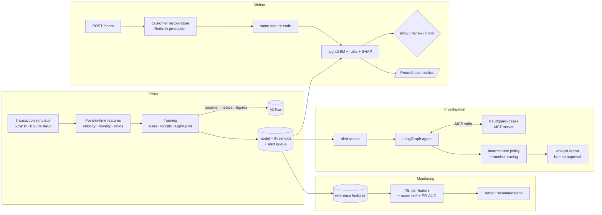
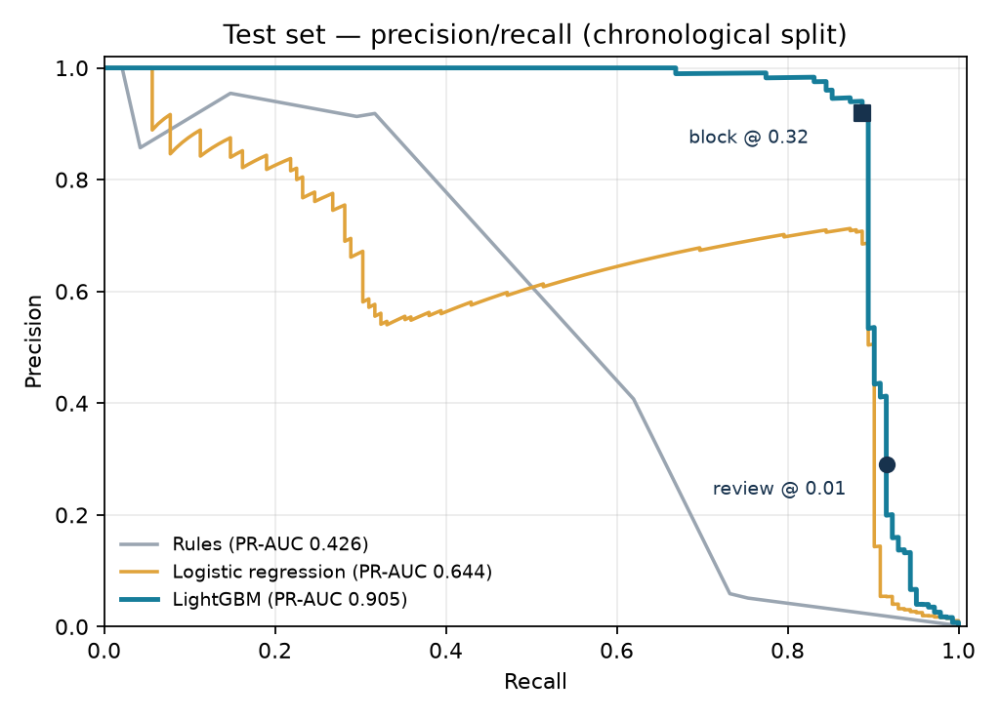
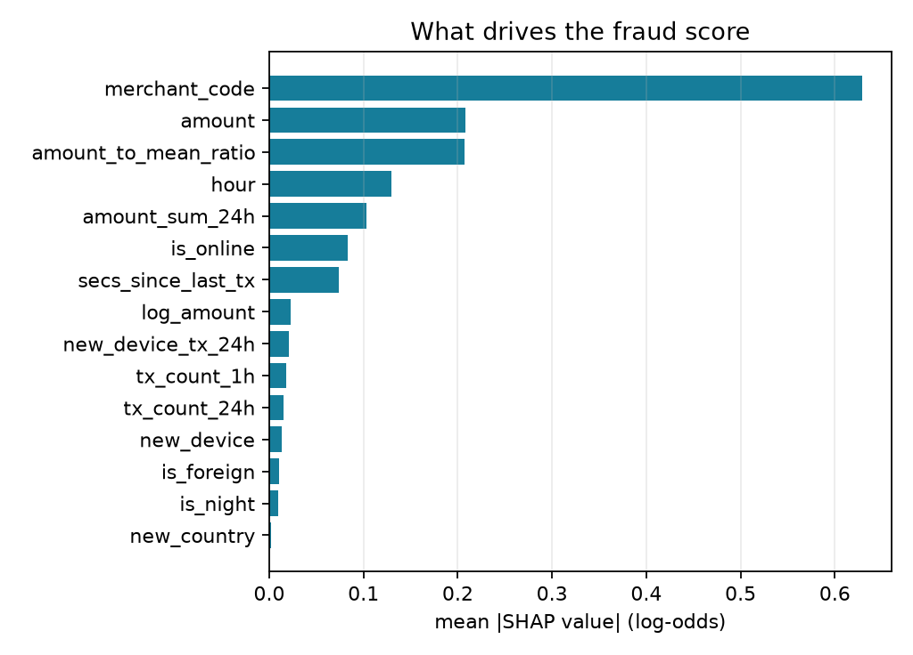
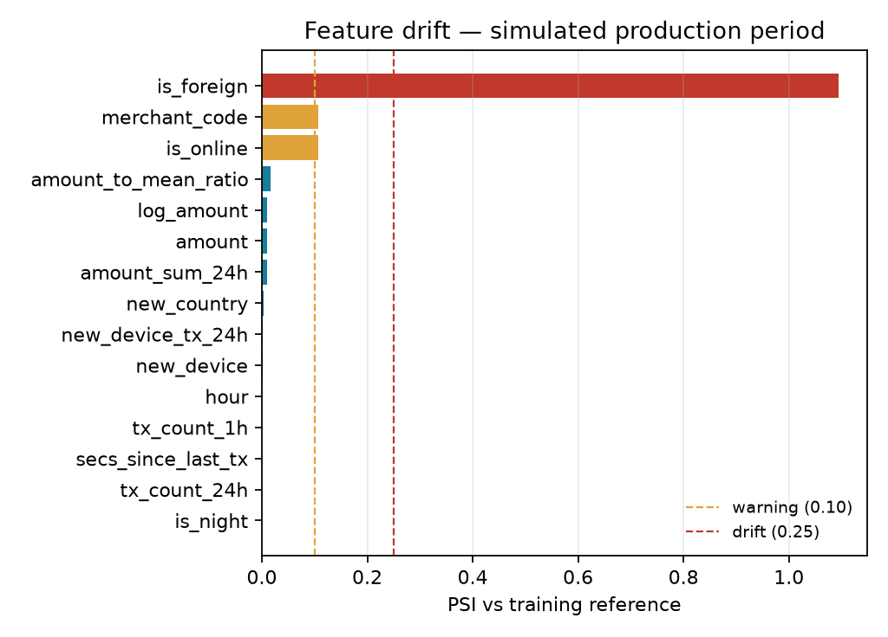
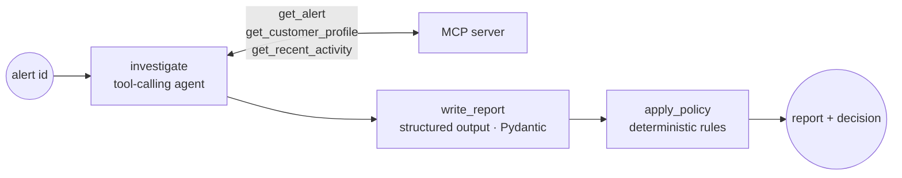

# FraudGuard — card-fraud detection, from features to an LLM investigation agent

End-to-end fraud detection platform: **point-in-time features → LightGBM scoring → real-time FastAPI
service with explanations → drift monitoring → an LLM agent (LangGraph + MCP) that investigates alerts
and writes the analyst report**, with deterministic guardrails on top of the LLM.

It is a public, synthetic-data reconstruction of the architecture I built as a freelance Data & AI
engineer for a microfinance institution (CDC ingestion, ML scoring, AI agents assisting the audit team).
No client code or data is used here: transactions come from a simulator that reproduces the hard
parts of the real problem (0.25 % fraud rate, per-customer behaviour, legitimate behaviour that looks
risky, fraud that looks normal).

| | |
|---|---|
| **ML** | LightGBM vs logistic regression vs expert rules, chronological split, PR-AUC, business thresholds, SHAP |
| **Serving** | FastAPI, Pydantic contracts, Prometheus metrics, Docker, same feature code online and offline |
| **MLOps** | MLflow tracking, PSI drift monitoring with a retraining trigger, CI (ruff + pytest + Docker smoke test) |
| **GenAI** | LangGraph agent, MCP tool server, structured output, policy guardrails, evaluation against ground truth |

---

## Architecture



## Results

All numbers below are produced by `make all` and are reproducible (fixed seeds).
Chronological split: train on days 30–90, choose thresholds on days 90–105, report on days 105–120
(71k transactions, 142 frauds). The first 30 days only serve as customer history.

| Model | PR-AUC (test) |
|---|---|
| Expert rules (weighted) | 0.426 |
| Logistic regression | 0.644 |
| **LightGBM** | **0.905** (ROC-AUC 0.994) |

Thresholds are set on the validation period from business constraints, then measured on test:

| Operating point | Rule | Precision | Recall | Fraud € caught | Alerts / 10k tx |
|---|---|---|---|---|---|
| `block` | precision ≥ 90 % on validation | 0.92 | 0.89 | 90 % | 19 |
| `review` | precision ≥ 30 % (analyst capacity) | 0.29 | 0.92 | 92 % | 63 |

<p align="center">
  
  
</p>

**Recall by fraud scenario** (at the `review` threshold): account takeover 100 %, card testing 100 %,
**stealth fraud 20 %**. Stealth fraud uses the customer's own device, in their home country, for
plausible amounts: the features barely see it. This blind spot is documented on purpose; it is also
where the LLM agent fails (see below).

## Real-time scoring API

```bash
make serve   # http://127.0.0.1:8000/docs
# three 2 EUR streaming payments from an unknown device in Nigeria at 3 a.m., then:
curl -s localhost:8000/score -H 'Content-Type: application/json' -d '{
  "tx_id": "LIVE-0004", "customer_id": "C00042", "timestamp": "2026-04-30T03:13:00",
  "amount": 899, "merchant_category": "electronics", "country": "NG", "device_id": "evil-77"}'
```

```json
{
  "tx_id": "LIVE-0004",
  "fraud_score": 0.99258,
  "decision": "block",
  "rule_hits": ["NEW_DEVICE_FOREIGN", "HIGH_AMOUNT_VS_HISTORY", "RISKY_MERCHANT_NEW_DEVICE", "NIGHT_HIGH_AMOUNT"],
  "top_reasons": [
    {"feature": "new_device_tx_24h", "value": 1.0, "contribution": 7.213},
    {"feature": "merchant_code", "value": 8.0, "contribution": 2.144},
    {"feature": "is_online", "value": 1.0, "contribution": 1.921}
  ],
  "model_version": "20261121-191000",
  "latency_ms": 42.08
}
```

* Latency (in-process, laptop CPU): **p50 28 ms, p95 32 ms** when idle, p50 42 ms under load; dominated by pandas feature computation.
* `/metrics` exposes Prometheus counters per decision and a latency histogram
  (`docker compose up` starts the API and a Prometheus instance scraping it).
* Every response carries the rules fired and the top SHAP contributions, so an analyst knows *why*.

## Drift monitoring

`make drift` scores a simulated production period where customers shop online and travel more,
and a **new fraud pattern** (gift-card mules from known devices) appears.

<p align="center"></p>

| Signal | Value | |
|---|---|---|
| `is_foreign` PSI | 1.09 | drift (> 0.25) |
| `is_online`, `merchant_code` PSI | 0.11 | warning |
| Score distribution PSI | 0.24 | warning |
| Alert rate | 0.61 % → 1.69 % | analysts' queue ×2.8 |
| PR-AUC once labels arrive | 0.905 → **0.721** | the new pattern is missed |
| Decision | `retrain_recommended: true` | |

Input drift is the early warning, because fraud labels (chargebacks) arrive weeks later.

## Alert-investigation agent (LangGraph + MCP)



* **MCP server** (`fraudguard.agent.mcp_server`) exposes the case data as tools. Any MCP client
  (this agent, Claude Desktop, an IDE) can use it. **Ground-truth labels are removed** before
  anything reaches the agent.
* **Structured output**: verdict, confidence, evidence list and recommended action are validated
  by a Pydantic schema.
* **The LLM recommends; deterministic policy decides**:
  * an LLM cannot clear an alert whose model score is above the block threshold;
  * low confidence or an inconsistent action → escalation to a human;
  * the agent never blocks a card by itself: blocking always requires human approval;
  * **number tracing**: every figure quoted as evidence must appear in a tool output.
    This guardrail was added after evaluation showed the LLM writing "€77.57 is 3.9× the
    customer's max of €27.97" (it is 2.8×). Derived or invented numbers are now flagged.

Example report (real output, `gpt-oss-120b` on Groq):

> **Alert T0531065 — model score 0.998** · Verdict `likely_fraud` (high) · Action `block_card_and_contact_customer` · Human approval: yes
>
> The transaction exhibits classic card-testing characteristics: foreign country, first-time device use,
> night-time micro-payment burst, high velocity, and rapid escalation to higher-value purchases.
>
> - Rule hits include CARD_TESTING_BURST and NEW_DEVICE_FOREIGN.
> - Recent activity reveals six micro-payments (< €5) within a 15-minute window on device dev_f2a4e07ca2, all in Nigeria, followed by larger purchases (gift cards, electronics).
> - Customer C01649's home country is FR, median transaction amount €28.73.
>
> _Tools called: get_alert, get_customer_profile, get_recent_activity_

### Agent evaluation against ground truth

`make evaluate-agent` runs the agent on a deliberately hard sample (every fraud hidden in the
ambiguous `review` band, legitimate `review` alerts, and `block` alerts) and compares verdicts with the labels.

| Metric (15 alerts, 7 frauds) | Value |
|---|---|
| Decided without a human | 13 / 15 |
| Accuracy when deciding | 0.85 |
| Legitimate alerts correctly closed | 7 / 8 |
| Frauds wrongly cleared | **2 (both "stealth")** |

Reading: the agent removes most of the false-positive workload, but it inherits the model's blind
spot: when the evidence shows a known device, the home country and a plausible amount, it concludes
"legitimate", and so would most analysts. Its value is triage and report-writing, **not**
a replacement for the analyst's final decision. Next step: add network-level evidence
(merchant fraud rates, shared devices across customers) to the MCP tools.

## Engineering decisions worth discussing

* **Point-in-time features.** Every behavioural feature uses only earlier transactions
  (`closed="left"` rolling windows, expanding means that exclude the current row). A test removes the
  future and checks that past features do not change.
* **No train/serve skew.** The API computes features by calling the *same function* on the
  customer's history plus the new transaction; a test checks online == offline features.
* **Chronological split + PR-AUC.** A random split leaks future fraud patterns, and ROC-AUC flatters
  models at 0.25 % prevalence (0.994 here, while PR-AUC is 0.905).
* **Thresholds from business constraints**, chosen on validation and reported on test, not tuned on test.
* **Label leakage found and fixed.** The first simulator version named fraudster devices `FRAUD-xxxx`:
  the agent (and any model using the id) could read the answer. Device ids are now opaque hashes,
  and a test enforces it.
* **LLM guardrails are code, not prompts.** Policy rules and number tracing are deterministic and unit-tested.

## Run it

**Without training:** the trained model, its thresholds, the reference sample for drift and the alert queue
are versioned in [`models/pretrained/`](models/pretrained/) (1.9 MB, SHA-256 in `SHA256SUMS`). The code uses
it automatically when no local `artifacts/` exists:

```bash
make install && make data      # data simulation is deterministic (~1 min), no training
make serve                     # scoring API with the shipped model
make agent                     # investigation agent on the shipped alert queue (GROQ_API_KEY)
```

**Full pipeline:**

```bash
python -m venv .venv && source .venv/bin/activate
make install            # all dependencies (requirements.txt)
make all                # simulate data → train (MLflow) → drift report → tests
make serve              # scoring API
cp .env.example .env    # add GROQ_API_KEY for the agent
make agent              # investigate the 3 highest-risk alerts
make evaluate-agent     # agent vs ground truth
make mlflow-ui          # browse runs
docker compose up --build   # API + Prometheus
```

Tests: `make test` runs **22 offline tests** (data, leakage, online/offline parity, training, drift,
API contract, policy guardrails, MCP server over stdio) in about 40 s; `make test-llm` adds an
end-to-end agent run with a real LLM (any Groq chat model: `FRAUDGUARD_LLM=openai/gpt-oss-20b make test-llm`).

## Project layout

```
src/fraudguard/
├── data/simulate.py        # synthetic transactions, 4 fraud scenarios, drift knobs
├── features.py             # point-in-time features (shared offline / online)
├── rules.py                # expert rules baseline
├── model.py                # LightGBM wrapper: predict, decide, SHAP explanations
├── train.py                # baselines, LightGBM, thresholds, MLflow, figures
├── api/main.py             # FastAPI scoring service + Prometheus
├── monitoring/drift.py     # PSI, score drift, retraining trigger
└── agent/
    ├── case_store.py       # read-only case data (labels removed)
    ├── mcp_server.py       # MCP tools
    ├── graph.py            # LangGraph: investigate → report → policy
    └── run.py              # CLI + evaluation against ground truth
tests/                      # 22 offline tests + 1 LLM test
```

## Limitations and next steps

* Synthetic data: the merchant category dominates the SHAP ranking because the simulator's fraud
  scenarios target risky merchants. Real data would be noisier.
* Streaming ingestion (SQL Server CDC → Debezium → Kafka) and a Redis feature store are part of the
  production design but are replaced here by files and an in-memory store.
* Scoring latency is pandas-bound; incremental feature updates would bring it under 5 ms.
* The agent evaluation uses 15 alerts (Groq free tier: 8k tokens/minute). The harness supports larger runs.
* The Docker image is built and smoke-tested in CI. It has not been tested on the author's machine,
  where Docker is not available.
