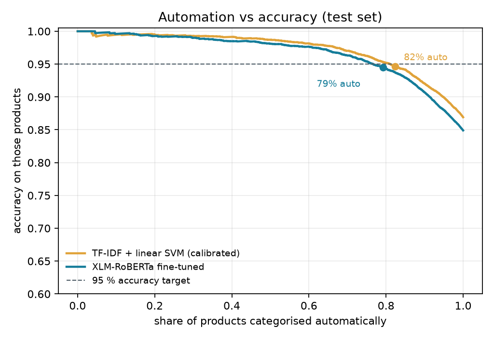
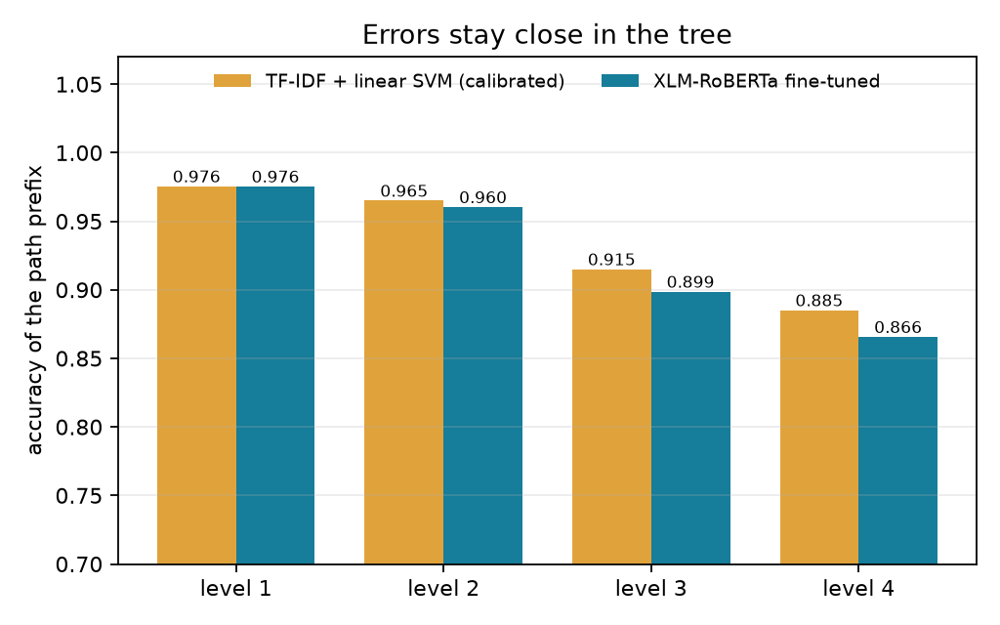
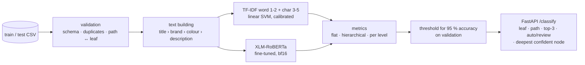

# Hierarchical product categorisation — from notebook to service

Assign each e-commerce product (title, description, brand, colour; mostly French, some German and English)
to one of **100 leaf categories** of a **184-node taxonomy** (depth 3 to 8), and decide when the prediction
is safe enough to publish without a human.

This started as a technical-assignment notebook (kept in [`project.ipynb`](project.ipynb)). It is now a
package with data validation, two models, hierarchical metrics, confidence-based routing, an API and tests.

## Results (official test set, 7,631 products)

| Model | Accuracy | F1-macro | Hierarchical F1 | Auto-categorised at 95 % target | Accuracy on those |
|---|---|---|---|---|---|
| Notebook baseline: MiniLM + CNN | 0.842 | 0.808 | – | – | – |
| **TF-IDF (word + char n-grams) + linear SVM** | **0.869** | **0.839** | **0.932** | **82 %** | 94.6 % |
| XLM-RoBERTa fine-tuned, 3 epochs (v1) | 0.807 | 0.724 | 0.898 | 69 % | 93.8 % |
| XLM-RoBERTa fine-tuned, 6 epochs, lr 5e-5 (v2) | 0.849 | 0.806 | 0.921 | 79 % | 94.5 % |

<p align="center">
  
  
</p>

* **The cheap model wins.** Fine-tuning XLM-RoBERTa on a laptop GPU (6 epochs, 50 min) reaches 0.849
  accuracy, still behind TF-IDF + linear SVM (0.869, trained in 6 min on CPU). Product titles are short and
  full of brands, model numbers and units, where character n-grams are hard to beat. The API serves
  whichever model has the best **validation** macro-F1 (TF-IDF here), never chosen on test.
  Next step: a probability-averaging ensemble of the two.
* **Errors stay close in the tree.** Leaf accuracy is 0.87, but the first two levels of the path are right
  97.6 % and 96.5 % of the time. The hierarchical F1 (ancestor overlap) gives partial credit to "LED TV"
  instead of "OLED TV" and none to "garden hose", which is closer to the business cost than flat accuracy.
* **Routing instead of a single accuracy number.** The threshold is calibrated on validation so that
  auto-published products reach 95 % accuracy (94.6 % on test). The rest goes to a human,
  who still receives the **deepest confident category**: when the model hesitates between two sibling
  leaves, it can usually still assert their parent.
* **Leakage checked.** 131 test products (1.7 %) share an exact title with a training product. Scores
  without them are identical (0.8693 vs 0.8691), so the test set is not inflated.

## Why this method, and what it cannot do

One classifier over the 100 leaves, with the tree used afterwards (hierarchical metric, deepest confident
ancestor), rather than a cascade of classifiers down the tree: in a cascade, an error near the root cannot be
recovered and deep nodes have few examples to learn from. TF-IDF with a linear SVM was kept over the transformer
because it won on validation, at a fraction of the cost.

It stops working when:

* **the taxonomy changes**: a new leaf needs labelled products and retraining; nothing transfers to an unseen
  category.
* **the text says little** (a reference number and a brand, or a product described mostly by its image): character
  n-grams have nothing to grip.
* **the catalogue drifts** (new brands, new languages): the routing threshold was calibrated on validation and must be
  re-checked on freshly labelled products before trusting the 95 % again.

## How it works



## API

```bash
make serve
curl -s localhost:8000/classify -H 'Content-Type: application/json' -d '{
  "title": "Caso WineComfort 38 Cave à vin design 38 bouteilles deux zones", "brand": "Caso"}'
```

The response holds the predicted leaf, its full path, the top 3, `decision: auto|review` and
`deepest_confident_category`. `/classify/batch` accepts up to 256 products.

## Engineering notes

* **GPU memory bug found by timing.** In the first transformer run, epoch 2 took 33 min against 15 min for
  epoch 1: the best-epoch weights were copied *on the GPU* (+1.1 GB on an 8 GB card), forcing spill-over.
  They are now copied to CPU.
* **Memory-aware model choice.** The first TF-IDF version (lbfgs logistic regression on 500k features ×
  100 classes) kept several GB of optimiser state and was OOM-killed on a 7 GB WSL machine. A calibrated
  linear SVM on 250k float32 features is more accurate and peaks at about 1.5 GB.
* **Validation before training.** Schema, duplicated ids, empty titles and `category_path` consistent
  with `category_id` are checked; training fails loudly otherwise.
* **Tests** (8, synthetic catalogue, no private data): text cleaning, validation, leakage report,
  taxonomy roll-up, hierarchical metrics (a test caught a division by zero for disjoint paths),
  threshold selection, model fit, API contract.

## Use the trained model without training

`make download-weights` fetches the TF-IDF model (248 MB) and its calibrated threshold, and verifies them
against `weights.sha256`. The repository on the Hub is **private**: the TF-IDF vocabulary contains words
from the private training data, so access is granted on request rather than published.

## Run it

The dataset belongs to the assignment provider and is **not** in the repository. Place
`trainset.csv` / `testset.csv` in `data/`, then:

```bash
make install
make train-tfidf      # ~6 min on CPU
make train-xlmr       # GPU recommended
make report           # figures + reports/metrics.json
make serve
make test
```
