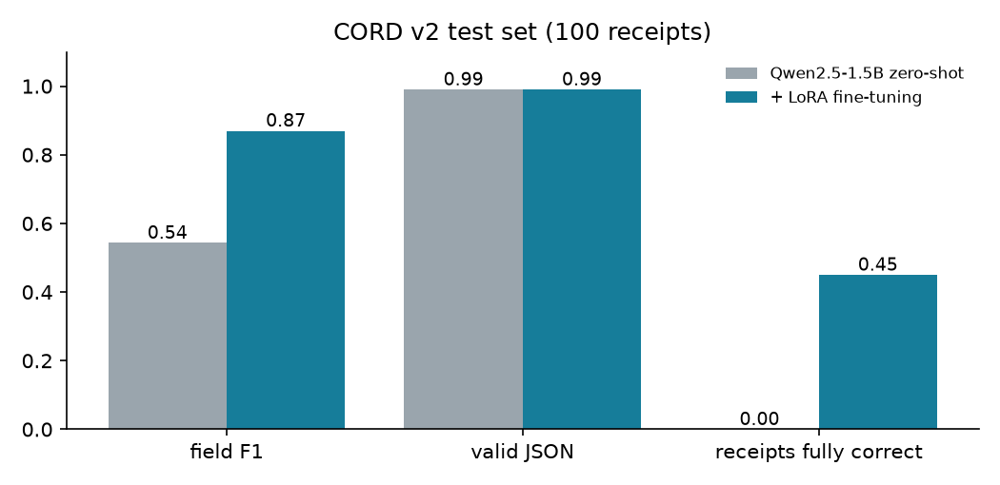
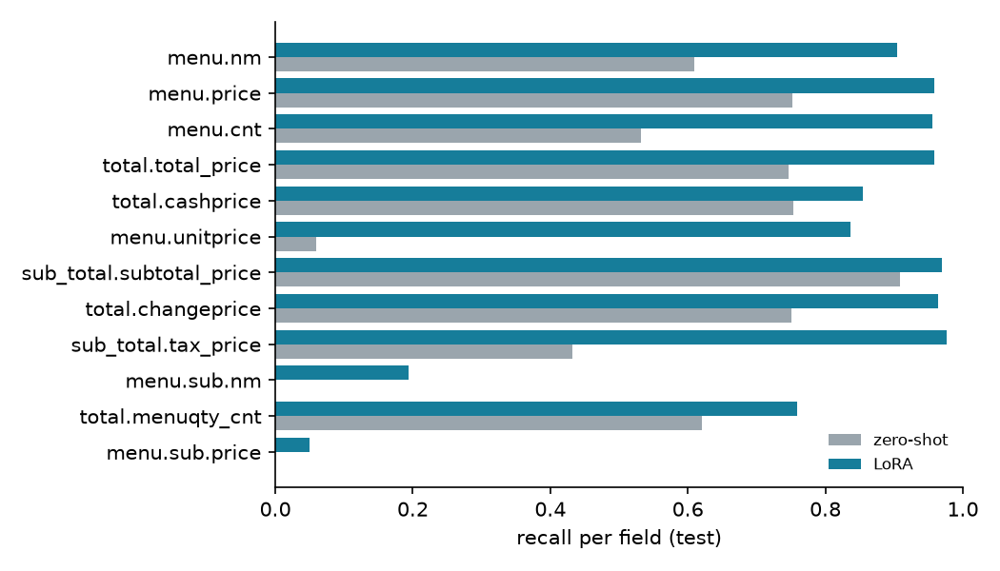

# Fine-tuning an LLM with LoRA for document data extraction

Fine-tune **Qwen2.5-1.5B-Instruct** with **LoRA (PEFT)** to turn receipt text into structured JSON
(items with name, quantity and price; subtotal, tax, service; total, cash, change, card…), on the public
**CORD v2** benchmark (Park et al., 2019, CC-BY-4.0): 800 training, 100 validation and 100 test receipts.
The same prompt, which describes the target schema, is given to the base model and to the fine-tuned one.



| Test set (100 receipts) | Qwen2.5-1.5B-Instruct, zero-shot | + LoRA fine-tuning |
|---|---|---|
| **Field F1** | 0.543 | **0.870** |
| Receipts with every field right | 0 % | **45 %** |
| Valid JSON | 99 % | 99 % |
| Generation time per receipt (RTX 5060 laptop, batch 16) | 1.97 s | **0.45 s** |

LoRA trains **18.5 M parameters, 1.2 % of the model**, in about 22 minutes on a laptop GPU (8 GB).
The fine-tuned model is also faster: it writes compact JSON with only the fields present on the receipt,
where the base model pretty-prints every key of the schema with null values.



## What was done

**Task and data** (`data.py`). CORD v2 comes with images and word-level annotations. Only the annotation
column is downloaded (1.5 MB instead of 2.3 GB): each receipt's text is rebuilt from the annotated words
(grouped by row, rows top to bottom, words left to right), and the target is the official CORD parse.
The field labels are never part of the input.

**Fine-tuning** (`train.py`). LoRA rank 16 (alpha 32, dropout 0.05) on every attention and MLP projection,
bf16, gradient checkpointing, AdamW at 2e-4 with cosine decay, effective batch 16. The loss is computed on
the answer tokens only: the system prompt and the receipt are masked, so the model learns to answer, not
to reproduce its input. After each epoch the model generates on the validation receipts and the epoch with
the best field F1 is kept.

**Evaluation** (`metrics.py`, `evaluate.py`). Each JSON is flattened into (field path, value) pairs and
compared with the reference (micro-averaged F1, as for Donut on CORD); values must match exactly, so
"75,000" and "75.000" differ. Also reported: the share of valid JSON outputs and of receipts with every
field right. The test set is used once per model, after every choice was made on validation.

**Serving** (`api.py`). FastAPI service, `POST /extract {"text": ...}`. The LoRA weights are merged into
the base model at start-up, so inference costs the same as the base model; generation runs in a worker
thread (`asyncio.to_thread`) behind a lock, so the event loop stays responsive while the single GPU
serves one request at a time.

## Honest reading

- **Not comparable with Donut's published CORD F1 (84.1).** Donut reads the image; here the model reads
  text rebuilt from the annotated words, which is easier (no OCR errors) on that side, while the rows are
  rebuilt from box positions, so tilted receipts can mix lines.
- **Where errors remain**: sub-items (options listed under a dish: recall 0.19 for their names) and rare
  fields (item codes, discounts); frequent fields (names, quantities, prices, totals, tax) are above 0.9.
- **Test set use**: the selected model (epoch 3, best validation F1 of 0.856) is scored once on test.
  A first run crashed on the GPU during epoch 2 (a WSL driver error); its epoch-1 checkpoint was scored on
  test at that point (F1 0.833, `reports/eval_lora_e1_test.json`). That score did not influence any choice.
- **Why fine-tuning rather than a larger model or more prompting**: a 1.5B model running on a laptop GPU
  goes from unusable (no receipt fully right) to production-shaped output, with a smaller, faster answer.
  On a real project the next step would be to compare with a larger model prompted with a few examples,
  on cost and latency as well as accuracy.

## Why this method, and what it cannot do

LoRA on a small model: full fine-tuning of 1.5 B parameters, with its optimiser state, does not fit an 8 GB GPU,
while LoRA trains 1.2 % of the weights and is merged into the base model for serving, so inference costs nothing
extra. A text model rather than an image model (Donut-style), because the task studied here is structuring the
content, not reading it.

It stops working when:

* **the input is real OCR output**: the text here is rebuilt from annotated words, so OCR errors were never seen in
  training.
* **the schema changes**: the behaviour learned is tied to the training schema; new fields need new examples and a
  new adapter.
* **an exact value matters more than the structure**: a number can be copied wrongly and nothing checks it; totals
  should be cross-checked (sum of items, tax) before use.

## Run it

```bash
pip install -r requirements.txt
make data        # CORD v2 annotations (~1.5 MB)
make baseline    # zero-shot Qwen2.5-1.5B-Instruct on the test split
make train       # LoRA, epoch chosen on validation -> artifacts/lora (~10 min / epoch on an 8 GB GPU)
make evaluate    # fine-tuned model on the test split -> reports/
make figures
make serve       # POST /extract {"text": "..."}
make test        # 6 CPU tests: text rebuilding, JSON parsing, metric, loss masking, API contract
```

## Layout

```
llm-finetuning/
├── src/receiptllm/
│   ├── data.py       CORD download (annotations only), text rebuilding, prompt
│   ├── metrics.py    field F1, valid JSON, document accuracy
│   ├── model.py      loading (with optional LoRA merge), batched generation
│   ├── train.py      LoRA fine-tuning with answer-only loss and validation selection
│   ├── evaluate.py   scoring on a split
│   └── api.py        extraction service (FastAPI)
├── scripts/          figures
├── reports/          scores, training history, figures
└── tests/
```
