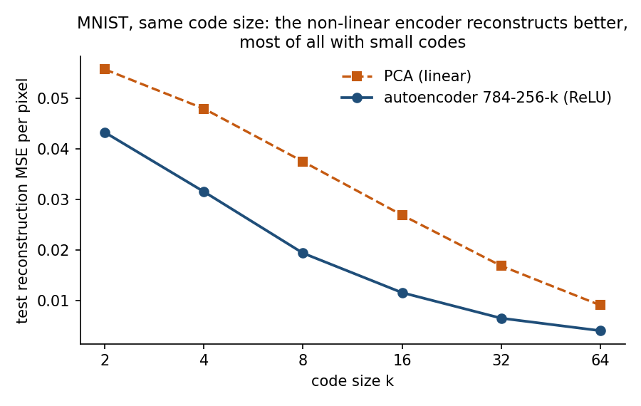
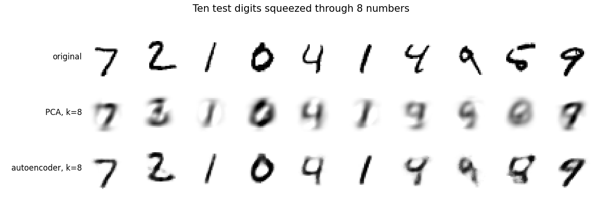

# Autoencoder

> A network trained to output its own input through a narrow middle layer. To succeed, it must squeeze each image into
> a few numbers, the *code*, and learn to rebuild the image from them: learned, non-linear compression.

## The experiment first

[PCA](pca.md) answers the same question with a linear map: what is the best way to describe 784 pixels with *k*
numbers? Both methods were given the same budget and scored with the same metric, the mean squared error per pixel on
the 10 000 MNIST test images:

| code size *k* | 2 | 4 | 8 | 16 | 32 | 64 |
|---|---|---|---|---|---|---|
| PCA | 0.0557 | 0.0479 | 0.0374 | 0.0269 | 0.0168 | 0.0090 |
| autoencoder | **0.0432** | **0.0315** | **0.0193** | **0.0115** | **0.0065** | **0.0040** |

<p align="center"></p>

The autoencoder needs about half as many numbers for the same quality: its 16-number code beats PCA's 32-number code.
The pictures show where the difference lies.

<p align="center"></p>

With 8 numbers, PCA returns blurred mixtures (a sum of 8 fixed images can only do so much: its 2 already reads as a
3), while the autoencoder keeps sharp strokes and only stumbles on the unusual 5, rebuilt halfway to an 8.

## What makes it non-linear

From [`src/mlscratch/deep_learning/autoencoder.py`](../src/mlscratch/deep_learning/autoencoder.py): two small
multilayer perceptrons, mirror images of each other.

```python
self.encoder = nn.Sequential(
    nn.Flatten(),
    nn.Linear(28 * 28, hidden),
    nn.ReLU(),
    nn.Linear(hidden, latent_dim),
)
self.decoder = nn.Sequential(
    nn.Linear(latent_dim, hidden),
    nn.ReLU(),
    nn.Linear(hidden, 28 * 28),
    nn.Sigmoid(),  # pixels are in [0, 1]
)
```

Remove the two `ReLU`s and the network becomes a product of linear maps: the best it can then learn is the PCA
subspace, so the table above would show two equal rows. The hidden layer of 256 units with a ReLU is what lets the
code bend around the shape of the data. The final `Sigmoid` keeps outputs in the pixel range.

Training minimises

```math
\mathcal{L} = \frac{1}{n \cdot 784} \sum_{i=1}^{n} \big\lVert x_i - g_\phi(f_\theta(x_i)) \big\rVert^2
```

with $f_\theta$ the encoder and $g_\phi$ the decoder, trained together by Adam for 10 epochs.

## A few practical choices

- **The whole dataset lives on the GPU.** 60 000 images take 188 MB as `float32`, so `load_mnist` moves them once and
  batches are taken by indexing a random permutation: no `DataLoader` and no worker processes for a dataset this
  small.
- **The metric is the one PCA minimises**, reported on the test set; the training loss alone would hide overfitting.
- **`encode` and `decode` are separate methods**, so the code can be used on its own (as features, or to compare
  digits).

## Where it is used, and its limits

Autoencoders are used for compression, denoising (train on noisy inputs, reconstruct clean ones), anomaly detection
(a high reconstruction error flags an input unlike the training data) and as pre-trained encoders.

As a general method, though:

- **The code space has holes.** Nothing organises it; decoding a random point, or the midpoint of two codes, usually
  gives noise. It compresses, it does not generate: that is what the [VAE](vae.md) adds.
- **Mean squared error favours blur** when the network is unsure between two shapes; perceptual or adversarial losses
  give sharper images.
- **A low reconstruction error is not a useful representation.** The code is shaped by what is easy to rebuild, not by
  what matters downstream (labels, semantics).
- **It overfits like any network** if the code is wide and the data small; the bottleneck is the regulariser.

## Tests

[`tests/test_deep_learning.py`](../tests/test_deep_learning.py) checks the shapes and that the model can overfit a tiny
batch, the standard check that gradients reach every layer. [`tests/test_deep_extras.py`](../tests/test_deep_extras.py)
checks that `reconstruction_mse` is exactly the per-pixel MSE, whatever the batch size.

<sub>Figures and numbers: `PYTHONPATH=src python scripts/make_dl_figures.py autoencoder`, about 3 minutes on a laptop
GPU ([`figures/autoencoder/measurements.json`](../figures/autoencoder/measurements.json)).</sub>
