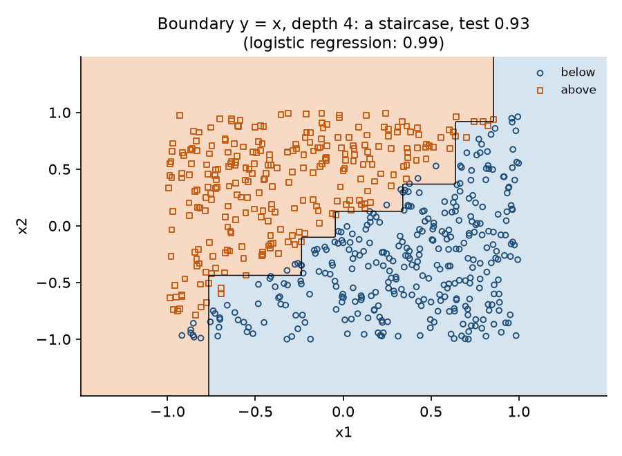

# Decision tree (CART)

> Splits the data with a sequence of yes/no questions on one feature at a time: readable rules, no scaling needed,
> and the building block of random forests and gradient boosting.

> [!NOTE]
> **In one paragraph.** CART grows a binary tree greedily: at each node it tries every feature and every threshold,
> keeps the split that most reduces the impurity of the labels (Gini or entropy), and recurses until a stopping rule
> (depth, node size, purity). A leaf predicts its majority class. Deep trees fit anything, including noise, so depth
> and leaf size are the real hyperparameters. It assumes the classes can be separated by axis-aligned cuts.

## The maths, as implemented

```math
G(S) = 1 - \sum_c p_c^2, \qquad
H(S) = -\sum_c p_c \log_2 p_c, \qquad
\Delta = I(S) - \frac{|S_L|}{|S|}\, I(S_L) - \frac{|S_R|}{|S|}\, I(S_R)
```

$p_c$ is the share of class $c$ in node $S$, $I$ is $G$ or $H$, and $S_L$, $S_R$ are the two children. The split with
the largest $\Delta$ wins; thresholds are midpoints between consecutive distinct values. A feature's importance is
the sum of $|S| \cdot \Delta$ over the nodes where it is used, normalised to 1.

## Reading the code

From [`src/mlscratch/classical/decision_tree.py`](../src/mlscratch/classical/decision_tree.py).

**Sort once, score every threshold from cumulative counts.** For a feature, the samples are sorted, and the class
counts left of every possible cut come from one cumulative sum. A node costs $O(d \cdot n \log n)$ instead of
$O(d \cdot n^2)$ for re-counting each candidate.

```python
order = np.argsort(X[:, j], kind="stable")
xs = X[order, j]
left = np.cumsum(onehot[order], axis=0)[:-1]  # class counts left of each cut, (n-1, C)
right = left[-1] + onehot[order][-1] - left
```

**Only legal cuts compete.** A cut must fall between two distinct values and leave at least `min_samples_leaf`
points on each side.

```python
valid = xs[1:] > xs[:-1]  # cut only between distinct values
n_left = np.arange(1, n)
valid &= (n_left >= m) & (n - n_left >= m)
```

**The threshold is the midpoint**, so a new value between the two training values is not arbitrarily assigned.

```python
best_gain, best_feat, best_thr = float(gain[i]), j, float((xs[i] + xs[i + 1]) / 2)
```

Every node also stores its class frequencies, so `predict_proba` returns them, and `feature_importances_` sums the
impurity decreases.

## It works

<p align="center"></p>

Iris petal features, depth 3: three rectangles, test accuracy 0.91.

## Where the method breaks

> [!WARNING]
> **Depth.** A deep enough tree memorises the training set, noise included.

<p align="center"></p>

Noisy moons: test accuracy peaks at 0.91 at depth 2, then falls to 0.81 at depth 20 while train accuracy reaches 1.00.

> [!WARNING]
> **Diagonal boundaries.** Each split is perpendicular to one axis, so a diagonal becomes a staircase.

<p align="center"></p>

Boundary $x_2 = x_1$: test accuracy 0.88 at depth 2, 0.93 at depth 4, 0.94 at depth 8; logistic regression gets 0.99
with two weights.

## Limits of the method

- **High variance.** Small changes in the data can change the top split and the whole tree; ensembles average this out.
- **Greedy.** Each split is the best one locally; the tree as a whole is not optimal.
- **Axis-aligned.** Oblique or curved boundaries need many splits, as measured above.
- **No extrapolation.** Outside the training range, a leaf returns the same answer forever.

## At scale

Production libraries bin features into histograms (LightGBM, scikit-learn's `HistGradientBoosting`), prune with
cost-complexity, handle missing values in the split search, and rarely use a single tree: random forests average many
decorrelated trees and gradient boosting adds small ones sequentially.

## How we know it is right

From [`tests/test_against_sklearn.py`](../tests/test_against_sklearn.py), on breast cancer:

```python
ours = accuracy_score(y_te, DecisionTree(max_depth=5).fit(X_tr, y_tr).predict(X_te))
ref = accuracy_score(y_te, DecisionTreeClassifier(max_depth=5, random_state=0).fit(X_tr, y_tr).predict(X_te))
assert ours >= ref - 0.05
```

[`tests/test_extras.py`](../tests/test_extras.py): `min_samples_leaf` is respected in every leaf, probabilities sum to 1,
importances sum to 1, and predictions agree with scikit-learn on at least 97 % of Iris at depth 3.

> [!TIP]
> **In an interview.** *Why does a single tree overfit?* Unlimited depth fits noise: train 1.00, test 0.81 here.
> *Gini or entropy?* Usually similar trees; Gini avoids a logarithm. *Why do forests and boosting work better?* They
> reduce the variance of single trees by averaging or by adding many small corrections.

<sub>Figures and numbers: `PYTHONPATH=src python scripts/make_figures.py` (values in
[`figures/decision_tree/measurements.json`](../figures/decision_tree/measurements.json)).</sub>
