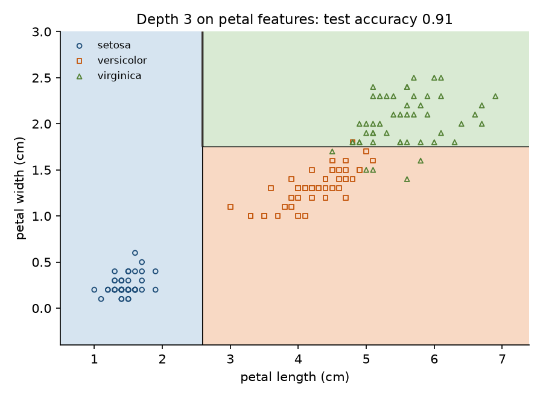
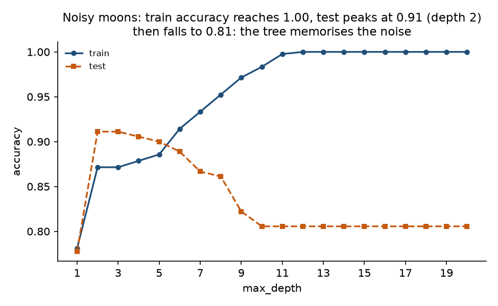

# Decision tree (CART)

> Splits the data with a sequence of yes/no questions on one feature at a time: readable rules, no scaling needed,
> and the building block of random forests and gradient boosting.

> [!NOTE]
> CART grows a binary tree greedily. At each node it tries every feature and every threshold, keeps the split that
> most reduces the impurity of the labels, and recurses until a stopping rule (depth, node size, purity). A leaf
> predicts its majority class and returns its class frequencies as probabilities.

## Growing the tree

```math
G(S) = 1 - \sum_c p_c^2, \qquad
H(S) = -\sum_c p_c \log_2 p_c, \qquad
\Delta = I(S) - \frac{|S_L|}{|S|}\, I(S_L) - \frac{|S_R|}{|S|}\, I(S_R)
```

$p_c$ is the share of class $c$ in node $S$, $I$ is the Gini impurity $G$ or the entropy $H$ (`criterion`), and $S_L$,
$S_R$ are the two children. The split with the largest $\Delta$ wins. A feature's importance is the sum of
$|S| \cdot \Delta$ over the nodes where it is used, normalised to 1.

## A fast split search

From [`src/mlscratch/classical/decision_tree.py`](../src/mlscratch/classical/decision_tree.py). The naive search
re-counts the classes on both sides of every candidate threshold, $O(n^2)$ per feature. Here each feature is sorted
once, and the class counts left of every cut come from a single cumulative sum: $O(n \log n)$.

```python
order = np.argsort(X[:, j], kind="stable")
xs = X[order, j]
left = np.cumsum(onehot[order], axis=0)[:-1]  # class counts left of each cut, (n-1, C)
right = left[-1] + onehot[order][-1] - left
```

Only legal cuts compete: between two distinct values, and leaving at least `min_samples_leaf` points on each side.

```python
valid = xs[1:] > xs[:-1]  # cut only between distinct values
n_left = np.arange(1, n)
valid &= (n_left >= m) & (n - n_left >= m)
```

The chosen threshold is the midpoint between the two values, as in scikit-learn, so an unseen value in the gap is not
assigned arbitrarily:

```python
best_gain, best_feat, best_thr = float(gain[i]), j, float((xs[i] + xs[i + 1]) / 2)
```

<p align="center"></p>

On Iris petal features, a depth-3 tree draws three rectangles; test accuracy 0.91.

## Choosing the depth

<p align="center"></p>

Depth is the main hyperparameter. On noisy moons, test accuracy is best at depth 2 (0.91); deeper trees keep
improving on the training set, up to 1.00, while test accuracy settles at 0.81. Depth, `min_samples_leaf` and
`min_samples_split` are the levers; cross-validation picks them.

## Limits, and what libraries add

Single trees have high variance: a small change in the data can change the top split and everything below it. Splits
are greedy and axis-aligned, so oblique boundaries need many of them, and a leaf returns the same answer far outside
the training range. That is why trees are mostly used in ensembles: random forests average many decorrelated trees,
gradient boosting adds small ones sequentially. Production implementations also bin features into histograms for
speed, prune by cost-complexity, and route missing values during the split search.

## Tests

From [`tests/test_against_sklearn.py`](../tests/test_against_sklearn.py), on breast cancer:

```python
ours = accuracy_score(y_te, DecisionTree(max_depth=5).fit(X_tr, y_tr).predict(X_te))
ref = accuracy_score(y_te, DecisionTreeClassifier(max_depth=5, random_state=0).fit(X_tr, y_tr).predict(X_te))
assert ours >= ref - 0.05
```

[`tests/test_extras.py`](../tests/test_extras.py): every leaf respects `min_samples_leaf`, probabilities and importances
sum to 1, and predictions agree with scikit-learn on at least 97 % of Iris at depth 3.

<sub>Figures and numbers: `PYTHONPATH=src python scripts/make_figures.py`
([`figures/decision_tree/measurements.json`](../figures/decision_tree/measurements.json)).</sub>
