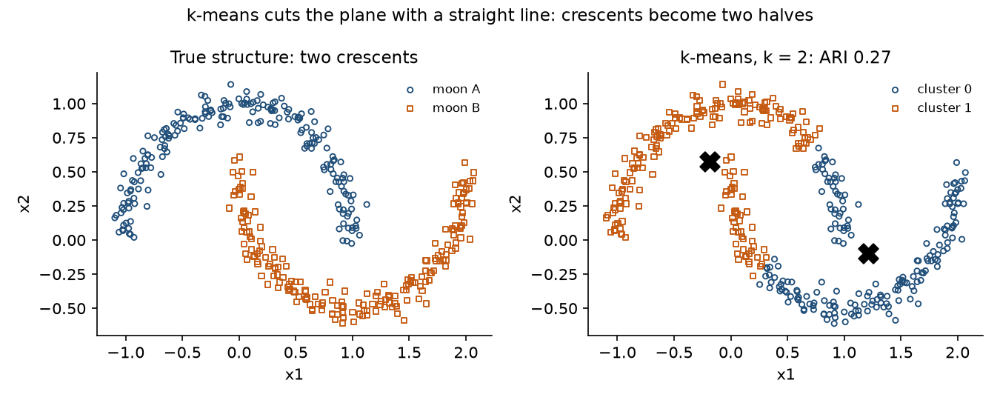
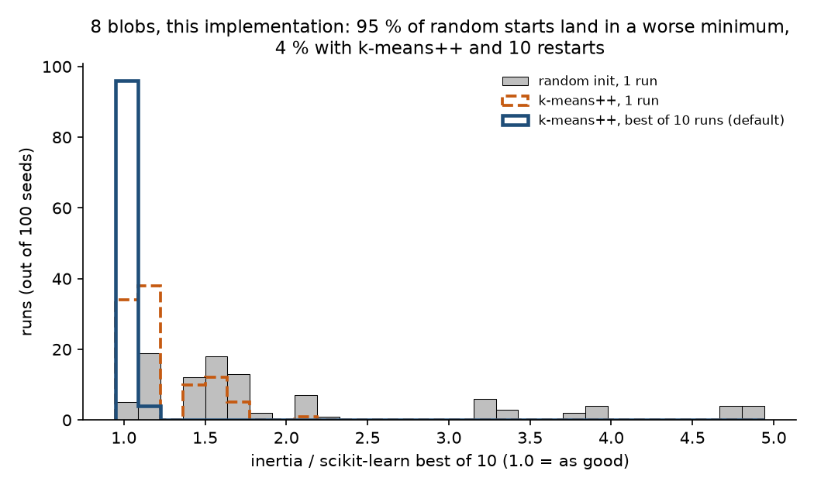

# k-means

> Splits the data into *k* groups by repeatedly assigning each point to its nearest centre and moving each centre to
> the mean of its points: the first thing to try for compact clusters of similar size.

> [!NOTE]
> **In one paragraph.** k-means (Lloyd's algorithm) alternates two steps until the centres stop moving: assign every
> point to its closest centroid, then move every centroid to the mean of its points. Neither step can increase the
> total squared distance to the centroids, so the loop settles, but on a local optimum that depends on where it
> started. Hence k-means++ initialisation and several restarts. It assumes round clusters of similar size, separable
> by distance, with *k* known in advance.

## The maths, as implemented

With points $x_i \in \mathbb{R}^d$, centroids $c_1, \dots, c_k$ and labels $a_i$:

```math
J = \sum_{i=1}^{n} \lVert x_i - c_{a_i} \rVert^2, \qquad
a_i \leftarrow \arg\min_j \lVert x_i - c_j \rVert^2, \qquad
c_j \leftarrow \frac{1}{n_j} \sum_{i \,:\, a_i = j} x_i
```

where $n_j$ is the number of points assigned to cluster $j$.
The assignment minimises $J$ for fixed centroids, the update minimises it for fixed labels. The loop stops when the
centroids move by less than `tol` times the mean feature variance, and the best of `n_init` runs (lowest $J$) is
kept.

## Reading the code

From [`src/mlscratch/classical/kmeans.py`](../src/mlscratch/classical/kmeans.py).

**k-means++ initialisation.** The first centroid is a random point; each next one is drawn with probability
proportional to its squared distance to the nearest centroid already chosen, so the starts are spread out.

```python
centroids = [X[rng.integers(len(X))]]
for _ in range(1, self.k):
    d2 = squared_distances(X, np.array(centroids)).min(axis=1)
    centroids.append(X[rng.choice(len(X), p=d2 / d2.sum())])
```

**Distances without a three-dimensional array.** Expanding the square gives every point–centroid distance with two
matrix products: memory $O(nk)$ instead of $O(nkd)$.

```python
d2 = (X**2).sum(axis=1)[:, None] - 2 * X @ C.T + (C**2).sum(axis=1)[None, :]
return np.maximum(d2, 0.0)  # round-off can make a distance slightly negative
```

**Empty clusters are re-seeded**, at the point worst served by its current centroid, so *k* clusters always come back.

```python
else:  # empty cluster: move it to the point worst served by its current centroid
    far = d2[np.arange(len(X)), labels].argmax()
    new_c[j], labels[far] = X[far], j
```

**A scale-free stopping rule and restarts.** The tolerance is multiplied by the mean feature variance, so it means the
same thing in metres or millimetres. The run with the lowest inertia is kept, and a warning is raised if it did not
converge.

## It works

<p align="center"></p>

Three round, equal-size Gaussian blobs: adjusted Rand index (ARI; 1 = perfect agreement, 0 = chance) of 0.95. The
errors sit between blobs.

## Where the method breaks

> [!WARNING]
> **Non-convex clusters.** With *k* = 2, the boundary between two centroids is a straight line.

<p align="center"></p>

Two crescents are each cut in half: ARI 0.27. No initialisation fixes this; the model itself is wrong for the data.

> [!WARNING]
> **Local optima.** The result depends on the starting centroids.

<p align="center"></p>

Eight blobs, 100 seeds, this implementation. With one random start, 95 % of runs end more than 1 % above scikit-learn's
best of ten (median 1.63 times worse); scikit-learn with the same random start does the same (94 %). k-means++ alone
brings it to 66 % (median 1.14); k-means++ with ten restarts, the default here, to 4 % (median 1.00).

## Limits of the method

- **Round, similar clusters.** Elongated, nested or very unequal clusters break the Euclidean assumption; Gaussian
  mixtures model shape and size, DBSCAN or spectral clustering follow density and connectivity.
- **k must be chosen.** Inertia always falls as *k* grows; picking *k* needs a criterion (silhouette, elbow, a
  business constraint).
- **Scale and outliers.** Euclidean distance lets the largest-scale feature dominate, and a mean is pulled by extreme
  points (k-medoids uses actual points instead).
- **Every point is assigned.** There is no notion of noise or of "belongs to no cluster".

## At scale

Production libraries add greedy k-means++, which draws several candidates per step and keeps the best one (scikit-learn
does; its single k-means++ run lands in a worse minimum 35 % of the time on the same data, against 66 % here), Elkan's
algorithm, which skips distance computations with the triangle inequality, and mini-batch k-means for large *n*.

## How we know it is right

From [`tests/test_against_sklearn.py`](../tests/test_against_sklearn.py), on four well-separated blobs:

```python
assert adjusted_rand_score(y, ours.predict(X)) > 0.95
inertia = ((X - ours.centroids[ours.predict(X)]) ** 2).sum()
assert inertia <= ref.inertia_ * 1.05
```

[`tests/test_extras.py`](../tests/test_extras.py) adds the hard case: on the eight-blob data, the default (k-means++,
ten restarts) must be within 1 % of scikit-learn's inertia, and k-means++ must beat random starts on median over 20
seeds.

> [!TIP]
> **In an interview.** *Does k-means always find the best clustering?* No: Lloyd's loop stops at a local optimum
> (95 % of single random starts here), which is why k-means++ and restarts exist. *When should you not use it?* For
> non-convex shapes (two moons: ARI 0.27), unknown *k*, or data with noise points.

<sub>Figures and numbers: `PYTHONPATH=src python scripts/make_figures.py` (values in
[`figures/kmeans/measurements.json`](../figures/kmeans/measurements.json)).</sub>
