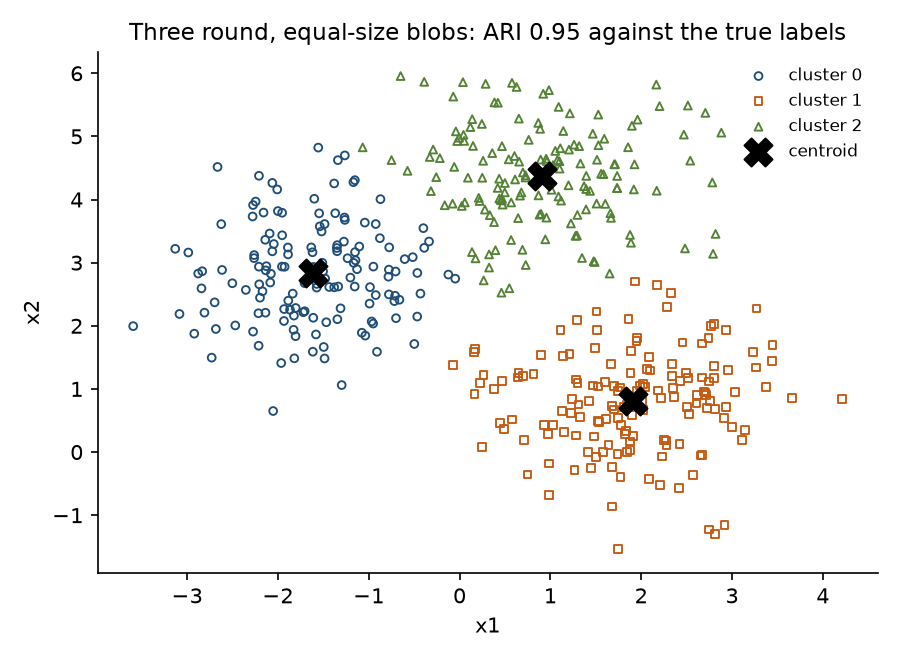

# k-means

> Splits the data into *k* groups by repeatedly assigning each point to its nearest centre and moving each centre to
> the mean of its points: the first thing to try for compact clusters of similar size.

> [!NOTE]
> Lloyd's algorithm alternates two steps until the centres stop moving: assign every point to its closest centroid,
> then move every centroid to the mean of its points. Neither step can increase the total squared distance, so the
> loop settles, but on a local optimum that depends on where it started. This implementation therefore starts with
> k-means++ and keeps the best of ten runs.

## Lloyd's loop

With points $x_i \in \mathbb{R}^d$, centroids $c_1, \dots, c_k$ and labels $a_i$:

```math
J = \sum_{i=1}^{n} \lVert x_i - c_{a_i} \rVert^2, \qquad
a_i \leftarrow \arg\min_j \lVert x_i - c_j \rVert^2, \qquad
c_j \leftarrow \frac{1}{n_j} \sum_{i \,:\, a_i = j} x_i
```

where $n_j$ is the number of points assigned to cluster $j$. The assignment minimises $J$ for fixed centroids, the
update minimises it for fixed labels.

## Inside the implementation

From [`src/mlscratch/classical/kmeans.py`](../src/mlscratch/classical/kmeans.py).

**k-means++ initialisation.** The first centroid is a random point; each next one is drawn with probability
proportional to its squared distance to the nearest centroid already chosen, so the starts are spread out.

```python
centroids = [X[rng.integers(len(X))]]
for _ in range(1, self.k):
    d2 = squared_distances(X, np.array(centroids)).min(axis=1)
    centroids.append(X[rng.choice(len(X), p=d2 / d2.sum())])
```

**Distances without a three-dimensional array.** Expanding the square gives every point–centroid distance with two
matrix products, in $O(nk)$ memory instead of $O(nkd)$.

```python
d2 = (X**2).sum(axis=1)[:, None] - 2 * X @ C.T + (C**2).sum(axis=1)[None, :]
return np.maximum(d2, 0.0)  # round-off can make a distance slightly negative
```

**Empty clusters are re-seeded** at the point worst served by its current centroid, so *k* clusters always come back.

```python
else:  # empty cluster: move it to the point worst served by its current centroid
    far = d2[np.arange(len(X)), labels].argmax()
    new_c[j], labels[far] = X[far], j
```

The tolerance is multiplied by the mean feature variance, so it means the same thing in metres or millimetres;
`inertia_`, `labels_` and `n_iter_` are exposed, and a warning is raised if the best run did not converge.

## Why k-means++ and restarts

<p align="center"></p>

Eight blobs, 100 seeds, this implementation in three settings, against scikit-learn's best of ten runs. With one
random start, 95 % of runs end more than 1 % worse (median 1.63 times the reference), exactly like scikit-learn with
the same setting (94 %). k-means++ alone brings it to 66 %; k-means++ with ten restarts, the default here, to 4 %, with
a median equal to the reference.

## On three blobs

<p align="center"></p>

Adjusted Rand index (1 = perfect agreement, 0 = chance) of 0.95 against the true labels; the errors sit between blobs.

## Beyond this implementation

The method assumes round clusters of similar size and a known *k*. Elongated or nested shapes call for Gaussian
mixtures, DBSCAN or spectral clustering; *k* needs a criterion such as the silhouette; every point is forced into a
cluster, with no notion of noise. On the engineering side, scikit-learn uses a greedy k-means++ that draws several
candidates per step (a single run of it lands in a worse minimum 35 % of the time on the data above, against 66 % here),
Elkan's algorithm to skip distance computations, and mini-batch k-means for large data.

## Tests

From [`tests/test_against_sklearn.py`](../tests/test_against_sklearn.py), on four well-separated blobs:

```python
assert adjusted_rand_score(y, ours.predict(X)) > 0.95
inertia = ((X - ours.centroids[ours.predict(X)]) ** 2).sum()
assert inertia <= ref.inertia_ * 1.05
```

[`tests/test_extras.py`](../tests/test_extras.py) adds the harder eight-blob case: the default must be within 1 % of
scikit-learn's inertia, and k-means++ must beat random starts on median over 20 seeds.

<sub>Figures and numbers: `PYTHONPATH=src python scripts/make_figures.py`
([`figures/kmeans/measurements.json`](../figures/kmeans/measurements.json)).</sub>
