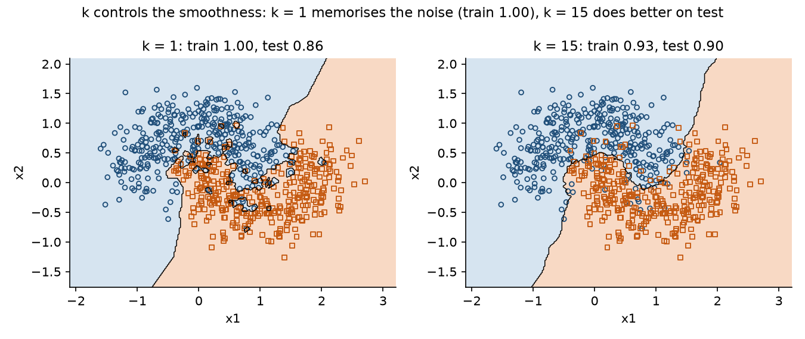
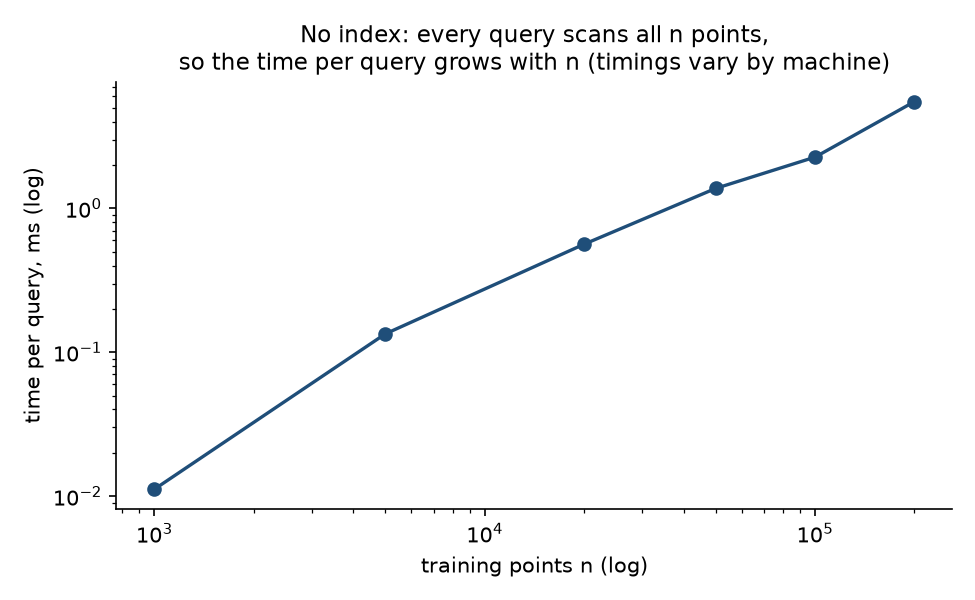
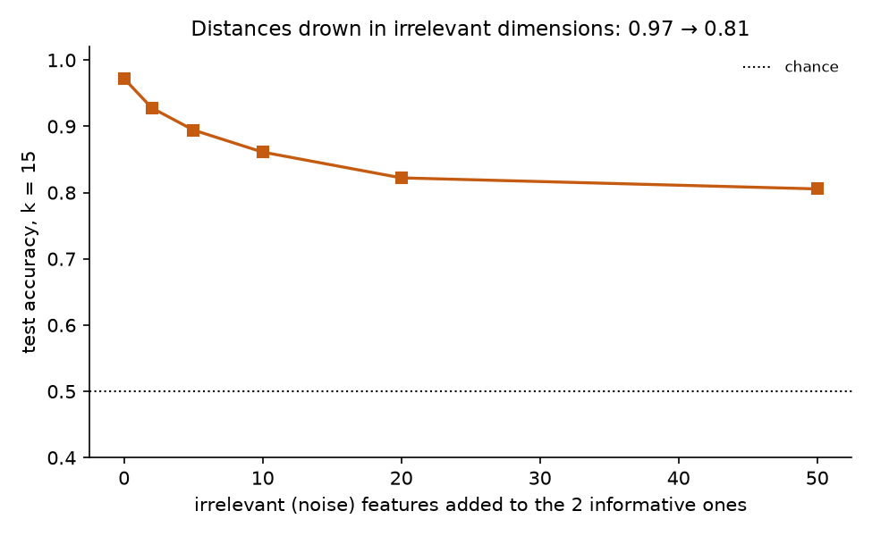

# k-nearest neighbours

> Classifies a point by the majority label of its *k* closest training points: no training at all, a flexible
> boundary, and a strong baseline on small, low-dimensional data.

> [!NOTE]
> **In one paragraph.** k-NN stores the training set. To predict, it computes the distance from the query to every
> stored point, keeps the *k* closest and takes a vote, optionally weighted by the inverse distance. *k* sets the
> trade-off: small *k* follows the noise, large *k* smooths the boundary. It assumes that close points share their
> label, which requires features on comparable scales and few irrelevant dimensions.

## The maths, as implemented

```math
\lVert q - x_i \rVert^2 = \lVert q \rVert^2 - 2\, q^\top x_i + \lVert x_i \rVert^2, \qquad
\hat y(q) = \arg\max_c \sum_{i \in N_k(q)} w_i \, \mathbb{1}[y_i = c], \qquad
w_i = 1 \ \text{or} \ \frac{1}{\lVert q - x_i \rVert}
```

$N_k(q)$ is the set of the *k* training points closest to $q$. Ties between classes go to the smallest label, as in
scikit-learn.

## Reading the code

From [`src/mlscratch/classical/knn.py`](../src/mlscratch/classical/knn.py).

**Distances by matrix product.** Expanding the square avoids a (queries × points × features) array; queries are
processed in batches of `batch_size`, so memory stays bounded.

```python
d2 = (A**2).sum(axis=1)[:, None] - 2 * A @ B.T + (B**2).sum(axis=1)[None, :]
return np.maximum(d2, 0.0)
```

**The k nearest without a full sort.** `argpartition` finds the *k* smallest distances in linear time per row;
their order does not matter for a vote.

```python
nn = np.argpartition(d2, self.k - 1, axis=1)[:, : self.k]  # k smallest, unordered: O(n) per row
```

**A vectorised, optionally weighted vote.** `np.add.at` accumulates the weights of each neighbour into its class;
with `weights="distance"`, an exact match wins outright.

```python
votes = np.zeros((len(Q), len(self.classes_)))
np.add.at(votes, (np.arange(len(Q))[:, None], labels), w)
return votes.argmax(axis=1)  # argmax returns the first maximum: smallest label wins ties
```

## It works

<p align="center"></p>

Noisy moons, 1 000 points. With $k = 1$ the boundary wraps every point (train 1.00, test 0.86); with $k = 15$ it
smooths out and generalises better (train 0.93, test 0.90).

## Where the method breaks

> [!WARNING]
> **Prediction cost.** Without an index, every query scans the whole training set.

<p align="center"></p>

Brute-force search grows with the number of stored points: on the author's laptop, from about a hundredth of a
millisecond per query at 1 000 points to about 5 ms at 200 000 (10 features). Exact timings vary by machine.

> [!WARNING]
> **Irrelevant dimensions.** Noise features enter every distance with the same weight as the useful ones.

<p align="center"></p>

Two informative features plus pure noise, all standardised: test accuracy falls from 0.97 to 0.86 with 10 noise
features and 0.81 with 50.

## Limits of the method

- **Scale-dependent.** Distances need standardised features; one large-scale feature decides the neighbours.
- **Curse of dimensionality.** In many dimensions all points look equally far apart; select or reduce features first.
- **Memory and latency.** The model is the whole training set, and prediction cost grows with it.
- **Imbalanced data.** A frequent class wins votes by its numbers alone; distance weights or resampling help.

## At scale

Libraries index the points: KD-trees and ball trees for low dimensions, approximate nearest-neighbour indexes (HNSW,
inverted files with quantisation, as in FAISS) for high dimensions, trading a little accuracy for large speed-ups.

## How we know it is right

From [`tests/test_against_sklearn.py`](../tests/test_against_sklearn.py), on Iris:

```python
ours = KNearestNeighbors(k=5).fit(X_tr, y_tr).predict(X_te)
ref = KNeighborsClassifier(n_neighbors=5, algorithm="brute").fit(X_tr, y_tr).predict(X_te)
assert (ours == ref).mean() >= 0.97  # only distance ties may break differently
```

[`tests/test_extras.py`](../tests/test_extras.py): distance-weighted votes with tiny batches agree with scikit-learn's
on at least 98 % of points.

> [!TIP]
> **In an interview.** *What does k control?* Bias and variance: $k = 1$ scores 1.00 on train and 0.86 on test here.
> *Why standardise?* Distances mix units. *Why is k-NN slow in production?* $O(n \cdot d)$ per query without an index;
> use a tree or an approximate index.

<sub>Figures and numbers: `PYTHONPATH=src python scripts/make_figures.py` (values in
[`figures/knn/measurements.json`](../figures/knn/measurements.json)).</sub>
