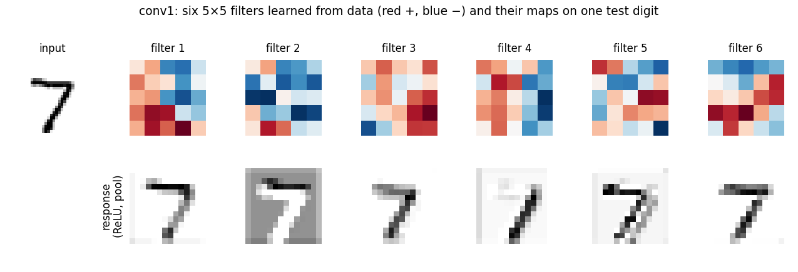
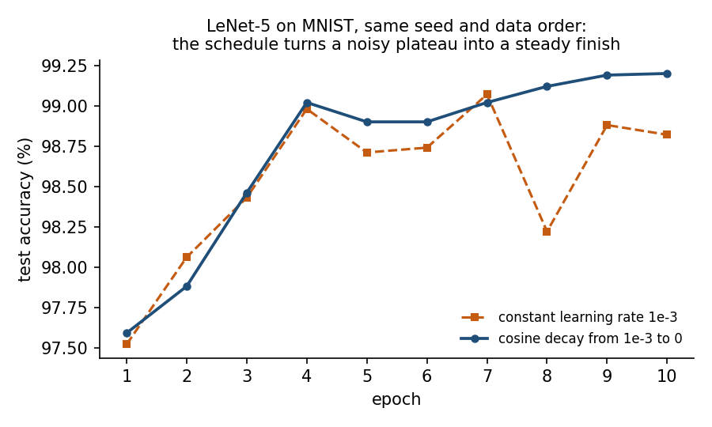
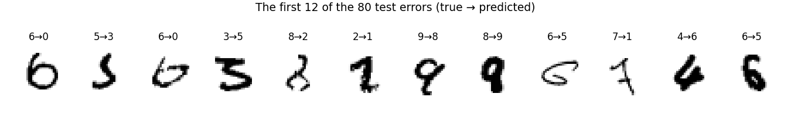

# LeNet-5

> The convolutional network LeCun and colleagues used to read handwritten digits in the 1990s: two layers of small
> learned filters, each followed by pooling, then three fully connected layers. With 62 000 parameters it reaches
> 99.2 % on MNIST.

## One image through the network

The fastest way to understand a CNN is to follow the shape of the tensor. For one MNIST digit:

| layer | operation | output shape | parameters |
|---|---|---|---|
| input | grey-level image | 1 × 28 × 28 | |
| `conv1` | 6 filters 5 × 5, padding 2 | 6 × 28 × 28 | 156 |
| pool | ReLU, then max over 2 × 2 | 6 × 14 × 14 | |
| `conv2` | 16 filters 5 × 5 × 6, no padding | 16 × 10 × 10 | 2 416 |
| pool | ReLU, then max over 2 × 2 | 16 × 5 × 5 | |
| `fc1` | flatten 400 → 120 | 120 | 48 120 |
| `fc2` | 120 → 84 | 84 | 10 164 |
| `fc3` | 84 → 10 class scores | 10 | 850 |

Three ideas are visible in this table. **Local connections**: each output of `conv1` looks at a 5 × 5 patch, not at
the whole image. **Weight sharing**: the same 25 weights slide over every position, so `conv1` has 156 parameters
where a dense layer from 784 to 4 704 units would need 3.7 million. **Pooling**: halving the resolution makes the
features tolerant to small shifts and lets the next layer see a larger part of the digit.

From [`src/mlscratch/deep_learning/lenet.py`](../src/mlscratch/deep_learning/lenet.py), the convolutional part, kept
apart from the classifier so its outputs can be inspected:

```python
def features(self, x: torch.Tensor) -> tuple[torch.Tensor, torch.Tensor]:
    """Activation maps after each convolution block: (B, 6, 14, 14) and (B, 16, 5, 5)."""
    a1 = F.max_pool2d(F.relu(self.conv1(x)), 2)
    a2 = F.max_pool2d(F.relu(self.conv2(a1)), 2)
    return a1, a2
```

Two departures from 1998 make it a *modernised* LeNet: ReLU instead of scaled tanh, and max pooling instead of
trainable average pooling. The connection table of the original `conv2` (each map read only some of the six inputs)
is replaced by full connections.

## What the first layer learned

<p align="center"></p>

Nobody designed these filters. Training turned random weights into edge and stroke detectors: some respond to the
horizontal bar of the 7, others to its diagonal, one to the background around the strokes. `conv2` combines these maps
into detectors of larger parts.

## Training it well

The model is trained with Adam for 10 epochs. Two details matter more than their size suggests:

```python
def normalize(x: torch.Tensor) -> torch.Tensor:
    """Centre and scale pixels with the training-set statistics: inputs around 0 make the first layer easier to fit."""
    return (x - MNIST_MEAN) / MNIST_STD
```

```python
sched = torch.optim.lr_scheduler.CosineAnnealingLR(opt, T_max=epochs) if cosine else None
```

The learning-rate schedule decides how the run *ends*. Same seed, same data order, only the schedule differs:

<p align="center"></p>

With a constant rate, the last epochs jump between 98.2 % and 99.1 % and the run ends at 98.8 %, wherever the last
step happened to land. With the cosine decay, the steps shrink to zero and the run ends at **99.20 %**, 80 errors out
of 10 000.

## The errors that remain

<p align="center"></p>

Most are digits a person would hesitate over too: a 6 closed into a 0, a 9 whose loop touches its tail. Beyond about
99.5 %, the gains come from data augmentation, ensembles and larger networks, not from the architecture.

## The limits of the design

- **Fully connected head, fixed input size.** The flatten step assumes exactly 16 × 5 × 5 features; another image size
  needs a different `fc1`. Global average pooling, as in [ResNet](resnet.md), removes this constraint.
- **Shallow.** Two convolutional layers are enough for centred digits on a clean background, not for natural images;
  stacking many more requires batch normalisation and skip connections.
- **Shift tolerance, not invariance.** Pooling absorbs shifts of a pixel or two; rotations and scale changes must be
  learned from data or augmentation.

## Tests

[`tests/test_deep_learning.py`](../tests/test_deep_learning.py) checks the output shape and that LeNet fits 32 random
labelled images, a test that fails if gradients do not reach the convolutions.
[`tests/test_deep_extras.py`](../tests/test_deep_extras.py) checks the feature-map shapes of the table above.

<sub>Figures and numbers: `PYTHONPATH=src python scripts/make_dl_figures.py lenet`, about a minute on a laptop GPU
([`figures/lenet/measurements.json`](../figures/lenet/measurements.json)).</sub>
