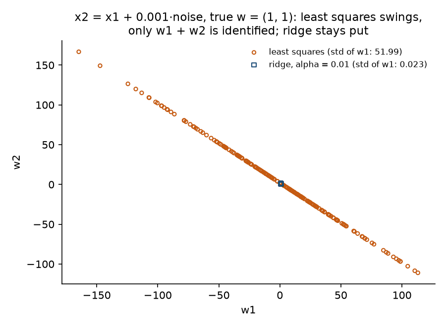

# Linear regression

> Fits the straight line, or hyperplane, that minimises the squared error: the baseline for any numeric prediction,
> and the model whose coefficients can be read directly.

> [!NOTE]
> The model predicts $\hat y = Xw + b$ and chooses $w$ and $b$ to minimise the mean squared error. The solution is
> exact (least squares) or reached step by step (gradient descent); both are implemented and agree. An optional ridge
> penalty keeps the coefficients stable when features are correlated.

## The objective

```math
J(w, b) = \frac{1}{2n} \lVert Xw + b - y \rVert^2 + \frac{\alpha}{2} \lVert w \rVert^2
```

Gradient descent and the exact solver minimise the same $J$:

```math
w \leftarrow w - \eta \left( \frac{X^\top (Xw + b - y)}{n} + \alpha w \right)
\qquad\text{or}\qquad
(X_c^\top X_c + n\alpha I)\, w = X_c^\top y_c
```

$\eta$ is the learning rate `lr`, $X_c$ and $y_c$ are the centred data, and the intercept is recovered as
$b = \bar y - \bar x^\top w$, so it is never penalised. scikit-learn's `Ridge(alpha=a)` penalises the summed error;
it matches `alpha = a / n` here.

## Two ways to the same coefficients

From [`src/mlscratch/classical/linear_regression.py`](../src/mlscratch/classical/linear_regression.py).

**Gradient descent**, with a guard: a non-finite loss stops the run with a clear message instead of returning `NaN`.

```python
self.w -= self.lr * ((X.T @ err) / n + self.alpha * self.w)
self.b -= self.lr * np.mean(err)
```

```python
if not np.isfinite(loss):
    raise FloatingPointError("gradient descent diverged: lower lr or standardise the features")
```

**The exact solution never inverts $X^\top X$.** Plain least squares calls `lstsq` on the centred data and copes
with an exactly duplicated feature; ridge solves a well-conditioned linear system.

```python
if self.alpha > 0:
    A = Xc.T @ Xc + len(X) * self.alpha * np.eye(X.shape[1])
    self.w = np.linalg.solve(A, Xc.T @ yc)
else:
    self.w = np.linalg.lstsq(Xc, yc, rcond=None)[0]
self.b = float(y_mean - x_mean @ self.w)
```

<p align="center"></p>

On $y = 3x + 2$ plus noise, both routes recover $w = 2.98$ and $b = 2.00$; gradient descent reaches the exact training
error in about a hundred steps.

## Why the ridge option

When two features carry the same information, least squares can only identify their combination. With
$x_2 = x_1 + 0.001 \cdot$ noise and true $w = (1, 1)$, refitted on 200 noise draws:

<p align="center"></p>

| | std of $w_1$ over 200 fits | mean of $w_1 + w_2$ |
|---|---|---|
| least squares | 52 | 2.00 |
| ridge, $\alpha = 0.01$ | 0.023 | 1.99 |

The predictions are good either way; the penalty is what makes the individual coefficients interpretable.

## Limits of the method

Linear in the features, so curvature and interactions must be engineered (polynomials, splines, products). The squared
loss lets one outlier pull the whole fit; Huber or quantile losses are more robust. Confidence intervals on $w$ assume
independent errors of constant variance. Gradient descent needs standardised features, since the largest feature
scale sets the largest stable step. Libraries add the regularisation strength chosen by cross-validation, lasso and
elastic net, and sparse or stochastic solvers for very large data.

## Tests

From [`tests/test_against_sklearn.py`](../tests/test_against_sklearn.py):

```python
np.testing.assert_allclose(ours.w, ref.coef_, rtol=1e-6)
assert ours.b == pytest.approx(ref.intercept_, abs=1e-6)
```

[`tests/test_extras.py`](../tests/test_extras.py): ridge equals scikit-learn's `Ridge` to $10^{-8}$, gradient descent
reaches the ridge solution, a duplicated column is handled, and divergence raises an error.

<sub>Figures and numbers: `PYTHONPATH=src python scripts/make_figures.py`
([`figures/linear_regression/measurements.json`](../figures/linear_regression/measurements.json)).</sub>
