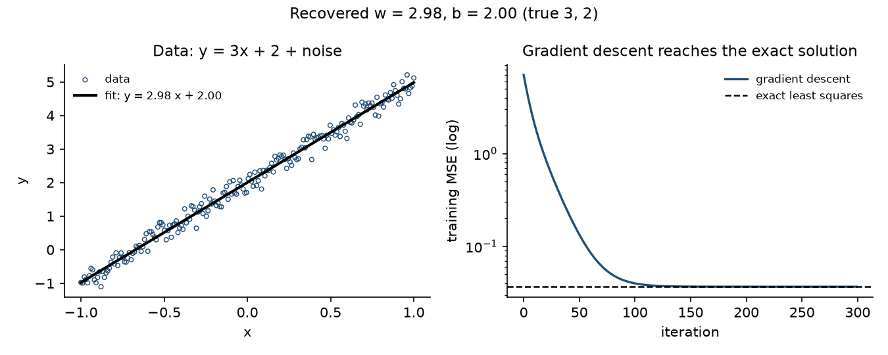
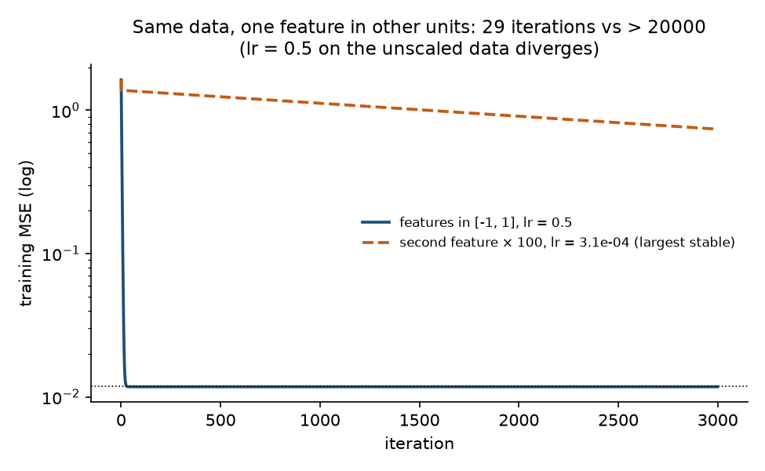

# Linear regression

> Fits the straight line (or hyperplane) that minimises the squared error: the baseline for any numeric prediction,
> and the model whose coefficients can be read directly.

> [!NOTE]
> **In one paragraph.** Linear regression predicts $\hat y = Xw + b$ and chooses $w, b$ to minimise the mean squared
> error. The solution is exact (least squares) or reached step by step (gradient descent); both are implemented and
> agree. A ridge penalty $\alpha \lVert w \rVert^2$ keeps the coefficients stable when features are correlated. It
> assumes the target is a linear function of the features plus noise.

## The maths, as implemented

```math
J(w, b) = \frac{1}{2n} \lVert Xw + b - y \rVert^2 + \frac{\alpha}{2} \lVert w \rVert^2, \qquad
w \leftarrow w - \eta \left( \frac{X^\top (Xw + b - y)}{n} + \alpha w \right), \qquad
(X_c^\top X_c + n\alpha I)\, w = X_c^\top y_c
```

$\eta$ is the learning rate `lr`, $X_c$ and $y_c$ are the centred data. The intercept $b$ is never penalised: it is
recovered as $\bar y - \bar x^\top w$. scikit-learn's `Ridge(alpha=a)` penalises the summed error, so it matches
`alpha = a / n` here (tested).

## Reading the code

From [`src/mlscratch/classical/linear_regression.py`](../src/mlscratch/classical/linear_regression.py).

**Gradient descent, with a guard.** The update is the gradient of $J$; a non-finite loss stops the run with a clear
message instead of returning `NaN` coefficients.

```python
self.w -= self.lr * ((X.T @ err) / n + self.alpha * self.w)
self.b -= self.lr * np.mean(err)
```

```python
if not np.isfinite(loss):
    raise FloatingPointError("gradient descent diverged: lower lr or standardise the features")
```

**The exact solution never inverts $X^\top X$.** Plain least squares calls `lstsq` on the centred data, which works
even when a feature is an exact copy of another (tested); ridge solves a well-conditioned linear system.

```python
if self.alpha > 0:
    A = Xc.T @ Xc + len(X) * self.alpha * np.eye(X.shape[1])
    self.w = np.linalg.solve(A, Xc.T @ yc)
else:
    self.w = np.linalg.lstsq(Xc, yc, rcond=None)[0]
self.b = float(y_mean - x_mean @ self.w)
```

## It works

<p align="center"></p>

On $y = 3x + 2$ plus noise, both solvers recover $w = 2.98$, $b = 2.00$; gradient descent reaches the exact
training error in about a hundred steps.

## Where the method breaks

> [!WARNING]
> **Correlated features.** When two features carry the same information, only their combination is identified.

<p align="center"></p>

$x_2 = x_1 + 0.001 \cdot$ noise, true $w = (1, 1)$, refitted on 200 noise draws. Least squares swings wildly
(standard deviation of $w_1$: 52) while $w_1 + w_2$ stays at 2.0; ridge with $\alpha = 0.01$ keeps $w_1$ within 0.023.
The predictions are fine in both cases; the **coefficients** cannot be interpreted without the penalty.

> [!WARNING]
> **Unscaled features and gradient descent.** The largest stable step is set by the largest feature scale.

<p align="center"></p>

Same data, one feature multiplied by 100. With features in $[-1, 1]$, `lr = 0.5` converges in 29 iterations. Unscaled,
`lr = 0.5` diverges, and the largest stable step ($3.1 \times 10^{-4}$) has not converged after 20 000 iterations.

## Limits of the method

- **Linear in the features.** Curvature or interactions must be added as features (polynomials, splines, products).
- **Squared loss.** One large outlier can pull the whole fit; Huber or quantile losses are more robust.
- **Coefficients are fragile under collinearity**, as measured above; ridge, lasso or removing redundant features help.
- **Inference needs assumptions.** Confidence intervals on $w$ assume independent errors of constant variance.

## At scale

Production code adds regularisation chosen by cross-validation (`RidgeCV`, lasso and elastic net), sparse iterative
solvers for millions of features, and stochastic or mini-batch gradients when the data does not fit in memory.

## How we know it is right

From [`tests/test_against_sklearn.py`](../tests/test_against_sklearn.py): coefficients identical to scikit-learn's, and
gradient descent converging to the exact solution.

```python
np.testing.assert_allclose(ours.w, ref.coef_, rtol=1e-6)
assert ours.b == pytest.approx(ref.intercept_, abs=1e-6)
```

[`tests/test_extras.py`](../tests/test_extras.py): ridge equals `sklearn.linear_model.Ridge` to $10^{-8}$, gradient
descent reaches the ridge solution, an exactly duplicated column is handled, and divergence raises an error.

> [!TIP]
> **In an interview.** *Why not invert $X^\top X$?* It squares the condition number and is singular for collinear
> features; use a least-squares solver or ridge. *Why can't you read coefficients here?* Collinearity: only
> $w_1 + w_2$ is identified (std of $w_1$: 52 without ridge). *Why standardise before gradient descent?* The step size
> is limited by the largest scale (29 iterations vs more than 20 000).

<sub>Figures and numbers: `PYTHONPATH=src python scripts/make_figures.py` (values in
[`figures/linear_regression/measurements.json`](../figures/linear_regression/measurements.json)).</sub>
