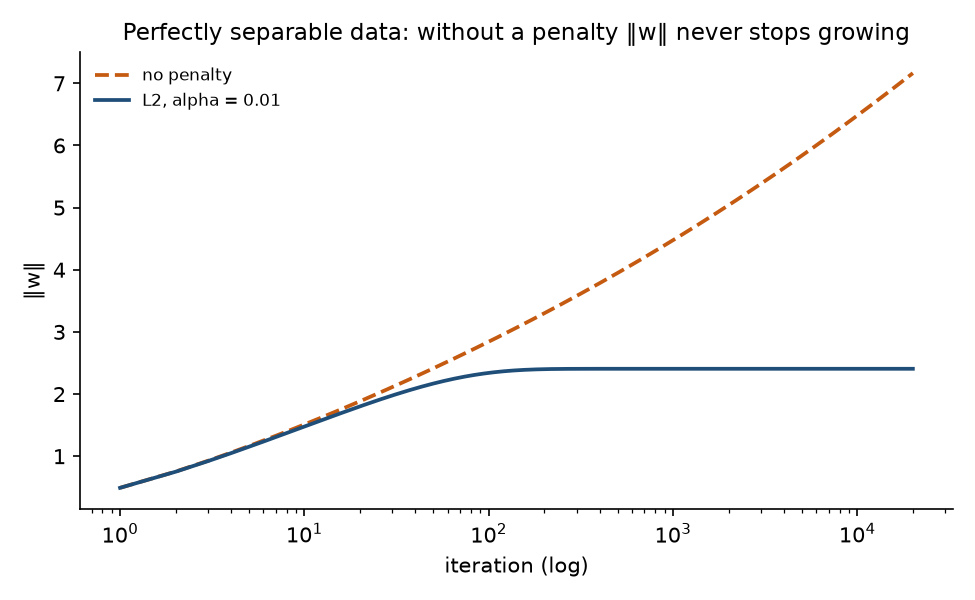
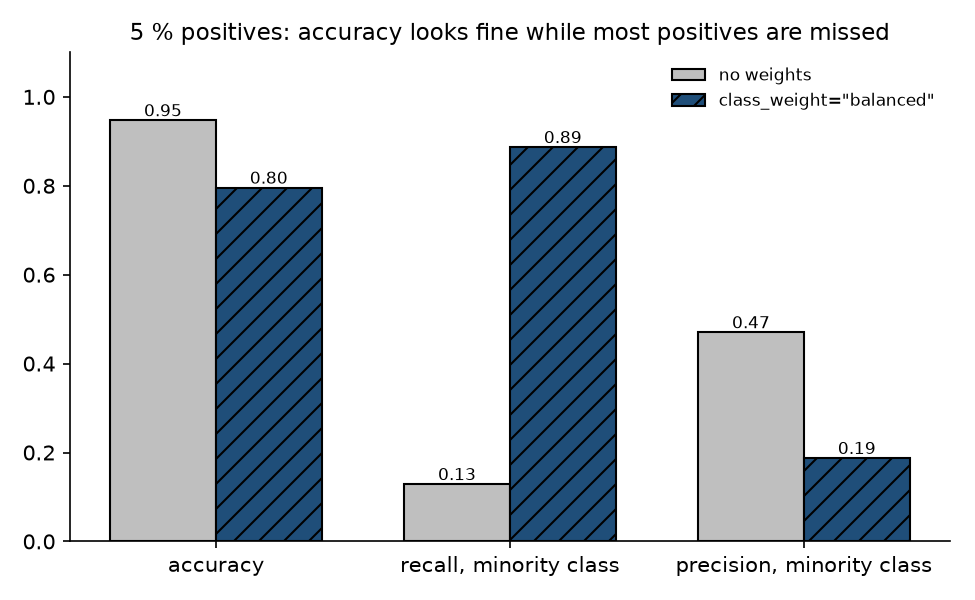

# Logistic regression

> Turns a linear score into a probability with the sigmoid: the standard baseline for binary classification, with
> coefficients that read as changes in log-odds.

> [!NOTE]
> **In one paragraph.** Logistic regression models $P(y = 1 \mid x) = \sigma(x^\top w + b)$ and fits $w, b$ by
> minimising the cross-entropy, here by gradient descent. The decision boundary is the hyperplane where the
> probability is 0.5. An L2 penalty keeps the weights finite on separable data, and class weights stop a rare class
> from being ignored. It assumes the log-odds are linear in the features. This implementation is binary.

## The maths, as implemented

```math
p_i = \sigma(x_i^\top w + b), \qquad
J = -\frac{1}{n} \sum_{i} s_i \big[ y_i \log p_i + (1 - y_i) \log (1 - p_i) \big] + \frac{\alpha}{2} \lVert w \rVert^2, \qquad
\nabla_w J = \frac{1}{n} X^\top \big( s \odot (p - y) \big) + \alpha w
```

$\sigma(z) = 1/(1 + e^{-z})$; $s_i$ is the weight of sample $i$, 1 by default and $n / (2 n_{y_i})$ with
`class_weight="balanced"`. The gradient has the same form as in linear regression, with $p$ in place of $\hat y$.

## Reading the code

From [`src/mlscratch/classical/logistic_regression.py`](../src/mlscratch/classical/logistic_regression.py).

**Balanced class weights.** Each class contributes the same total weight to the loss, however rare it is.

```python
counts = np.bincount(y.astype(int), minlength=2)
sw = (n / (2 * counts))[y.astype(int)]
```

**One gradient step.** `err` is the derivative of the weighted cross-entropy with respect to the logit.

```python
p = sigmoid(X @ self.w + self.b)
err = sw * (p - y)  # gradient of the weighted cross-entropy with respect to the logit
self.w -= self.lr * ((X.T @ err) / n + self.alpha * self.w)
```

**A numerically safe sigmoid and an explicit threshold.** Logits are clipped to $[-50, 50]$ before `exp`, and
`predict` takes the threshold as an argument, so precision can be traded for recall without retraining.

```python
def predict(self, X: np.ndarray, threshold: float = 0.5) -> np.ndarray:
    return (self.predict_proba(X) >= threshold).astype(int)
```

## It works

<p align="center"></p>

Two overlapping Gaussian classes: a straight boundary, test accuracy 0.97.

## Where the method breaks

> [!WARNING]
> **Perfectly separable data.** The loss keeps falling as the weights grow, so there is no finite optimum.

<p align="center"></p>

Without a penalty, $\lVert w \rVert$ is 4.48 after 1 000 steps, 6.48 after 10 000 and 7.16 after 20 000, and still rising:
the probabilities drift to 0 and 1. With $\alpha = 0.01$ it settles at 2.41.

> [!WARNING]
> **Class imbalance.** Accuracy rewards ignoring the rare class.

<p align="center"></p>

With 5 % positives, the plain model reaches 0.95 accuracy but finds only 13 % of the positives. Balanced weights find
89 % of them, at the cost of precision (0.47 → 0.19) and accuracy (0.80): a trade-off to set from the business cost.

## Limits of the method

- **Linear boundary.** Curved classes need engineered features, kernels or another model.
- **Probabilities are only as good as the linear assumption**; check calibration before using them as risks.
- **Correlated features** make individual coefficients unstable, as for linear regression.
- **Binary here.** Multi-class needs a softmax over classes or one model per class.

## At scale

Libraries replace plain gradient descent with second-order or quasi-Newton solvers (L-BFGS, Newton's method), which
converge in far fewer steps, and with stochastic solvers for very large or sparse data.

## How we know it is right

From [`tests/test_against_sklearn.py`](../tests/test_against_sklearn.py), on breast cancer:

```python
ours = accuracy_score(y_te, LogisticRegression(lr=0.1, n_iters=3000).fit(X_tr, y_tr).predict(X_te))
ref = accuracy_score(y_te, SkLogit(max_iter=5000).fit(X_tr, y_tr).predict(X_te))
assert ours >= ref - 0.02
```

[`tests/test_extras.py`](../tests/test_extras.py): balanced weights raise the minority recall on 95/5 data, and the L2
penalty shrinks the weights on separable data.

> [!TIP]
> **In an interview.** *Why not use accuracy on imbalanced data?* 0.95 accuracy here, with 13 % of positives found.
> *What happens on separable data?* No finite maximum-likelihood solution: weights grow forever, so regularise.
> *How do you trade precision for recall?* Move the threshold or weight the classes; both are exposed here.

<sub>Figures and numbers: `PYTHONPATH=src python scripts/make_figures.py` (values in
[`figures/logistic_regression/measurements.json`](../figures/logistic_regression/measurements.json)).</sub>
