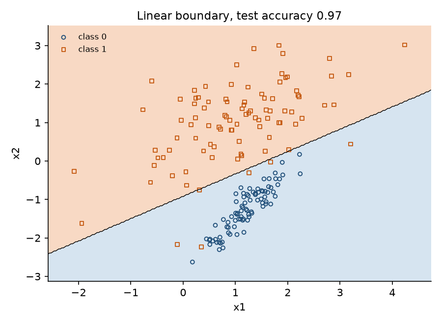

# Logistic regression

> Turns a linear score into a probability with the sigmoid: the standard baseline for binary classification, with
> coefficients that read as changes in log-odds.

<p align="center"></p>

Two overlapping Gaussian classes, a straight boundary where the predicted probability is 0.5, and a test accuracy of
0.97. Everything below explains how that line is found.

## Model and loss

```math
p_i = \sigma(x_i^\top w + b), \qquad
J = -\frac{1}{n} \sum_{i} s_i \big[ y_i \log p_i + (1 - y_i) \log (1 - p_i) \big] + \frac{\alpha}{2} \lVert w \rVert^2
```

$\sigma(z) = 1/(1 + e^{-z})$, and $s_i$ is the weight of sample $i$: 1 by default, $n / (2 n_{y_i})$ with
`class_weight="balanced"`. The gradient has the same shape as for linear regression, with $p$ in place of $\hat y$:

```math
\nabla_w J = \frac{1}{n} X^\top \big( s \odot (p - y) \big) + \alpha w
```

The L2 term ($\alpha > 0$) also keeps the weights finite when the classes are perfectly separable, where the
unpenalised loss has no minimum.

## The code

From [`src/mlscratch/classical/logistic_regression.py`](../src/mlscratch/classical/logistic_regression.py). One gradient
step, where `err` is the derivative of the weighted cross-entropy with respect to the logit:

```python
p = sigmoid(X @ self.w + self.b)
err = sw * (p - y)  # gradient of the weighted cross-entropy with respect to the logit
self.w -= self.lr * ((X.T @ err) / n + self.alpha * self.w)
```

The sigmoid clips logits to $[-50, 50]$ before `exp`, and `predict` takes the decision threshold as an argument, so
precision can be traded for recall without retraining:

```python
def predict(self, X: np.ndarray, threshold: float = 0.5) -> np.ndarray:
    return (self.predict_proba(X) >= threshold).astype(int)
```

## Class weights, measured

With balanced weights, each class contributes the same total weight to the loss, however rare it is:

```python
counts = np.bincount(y.astype(int), minlength=2)
sw = (n / (2 * counts))[y.astype(int)]
```

<p align="center"></p>

On data with 5 % positives, the unweighted model scores 0.95 accuracy but finds 13 % of the positives. Balanced
weights find 89 % of them, at the cost of precision (0.47 → 0.19) and accuracy (0.80). Which side to favour is a
business decision; both are one argument away.

## Limits of the method

| Limit | What to do |
|---|---|
| The boundary is linear | engineered features, kernels, or a non-linear model |
| Probabilities assume linear log-odds | check calibration before reading them as risks |
| Correlated features destabilise coefficients | regularise, or remove redundant features |
| Binary here | softmax over classes, or one model per class |

At scale, libraries replace plain gradient descent with quasi-Newton or Newton solvers (L-BFGS, IRLS), and with
stochastic solvers for very large or sparse data.

## Tests

From [`tests/test_against_sklearn.py`](../tests/test_against_sklearn.py), on breast cancer:

```python
ours = accuracy_score(y_te, LogisticRegression(lr=0.1, n_iters=3000).fit(X_tr, y_tr).predict(X_te))
ref = accuracy_score(y_te, SkLogit(max_iter=5000).fit(X_tr, y_tr).predict(X_te))
assert ours >= ref - 0.02
```

[`tests/test_extras.py`](../tests/test_extras.py): balanced weights raise the minority recall, and the L2 penalty
shrinks the weights on separable data.

<sub>Figures and numbers: `PYTHONPATH=src python scripts/make_figures.py`
([`figures/logistic_regression/measurements.json`](../figures/logistic_regression/measurements.json)).</sub>
