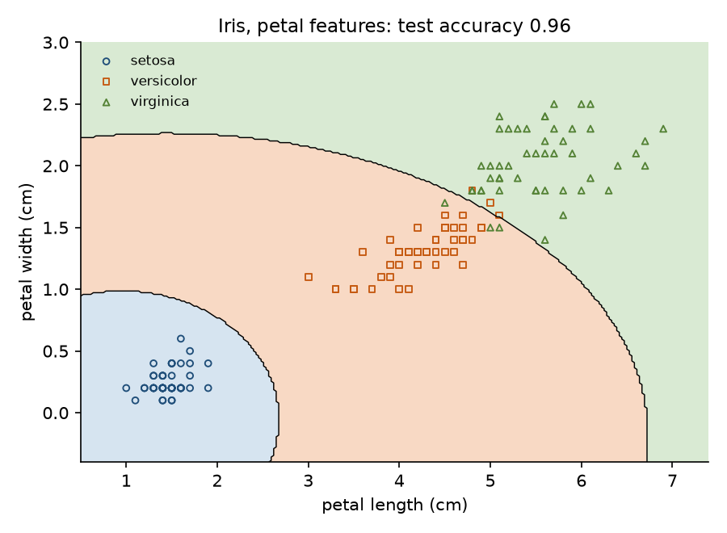

# Gaussian naive Bayes

> Classifies with Bayes' rule, assuming each feature is Gaussian within a class and independent of the others: fast,
> needs little data, and a sensible first model when features carry separate evidence.

For each class, the model learns a prior (its frequency) and, for every feature, a mean and a variance. A new point
gets the class with the highest posterior. The independence assumption is what makes training a single pass over the
data.

## The model

```math
\log P(c \mid x) = \log \pi_c + \sum_{j=1}^{d} \log \mathcal{N}\big(x_j ; \mu_{cj}, \sigma^2_{cj}\big) + \text{const}
```

$\pi_c$ is the class frequency, $\mu_{cj}$ and $\sigma^2_{cj}$ the mean and variance of feature $j$ within class $c$.
Working with log-densities turns a product of many small numbers, which would underflow, into a sum.

## Implementation notes

From [`src/mlscratch/classical/naive_bayes.py`](../src/mlscratch/classical/naive_bayes.py).

- **Parameters are (classes × features) arrays**, and every variance gets a small floor relative to the largest
  feature variance, as in scikit-learn, so a feature that is constant within a class cannot produce a zero variance.

  ```python
  eps = self.var_smoothing * X.var(axis=0).max()
  self.mean_ = np.array([X[y == c].mean(axis=0) for c in self.classes_])  # (C, d)
  self.var_ = np.array([X[y == c].var(axis=0) for c in self.classes_]) + eps  # (C, d)
  ```

- **All points and all classes in one expression**, by broadcasting over (points × classes × features), instead of a
  Python loop per point and per class.

  ```python
  ll = -0.5 * (np.log(2 * np.pi * self.var_)[None] + (X[:, None, :] - self.mean_[None]) ** 2 / self.var_[None])
  return self.log_prior_[None] + ll.sum(axis=2)
  ```

- **Probabilities with the log-sum-exp trick**: subtracting each row's maximum before `exp` keeps the numbers finite
  even when log-likelihoods are in the thousands.

  ```python
  jll -= jll.max(axis=1, keepdims=True)  # log-sum-exp trick: exp never overflows
  ```

<p align="center"></p>

On Iris petal length and width, each class has its own variances, so the boundaries are curves; test accuracy 0.96.

## When to use it, and when not

**Reach for it** when data is scarce, features are many, training must be instant, or a fast baseline is needed; its
ranking of classes is often good even when its assumptions are not.

**Look elsewhere** when features are strongly correlated (the same evidence is counted several times, so the
probabilities become overconfident), when a class is made of several clusters (one Gaussian per feature cannot
describe it), or when calibrated probabilities matter. For text and counts, the multinomial and Bernoulli variants
replace the Gaussian; calibration (Platt scaling, isotonic regression) fixes the probabilities when they are needed.

## Tests

From [`tests/test_against_sklearn.py`](../tests/test_against_sklearn.py), on Iris:

```python
ours = GaussianNaiveBayes().fit(X_tr, y_tr).predict(X_te)
ref = GaussianNB().fit(X_tr, y_tr).predict(X_te)
assert (ours == ref).mean() >= 0.97
```

[`tests/test_extras.py`](../tests/test_extras.py) goes further: the predicted **probabilities** equal scikit-learn's to
$10^{-8}$.

<sub>Figure and numbers: `PYTHONPATH=src python scripts/make_figures.py`
([`figures/naive_bayes/measurements.json`](../figures/naive_bayes/measurements.json)).</sub>
