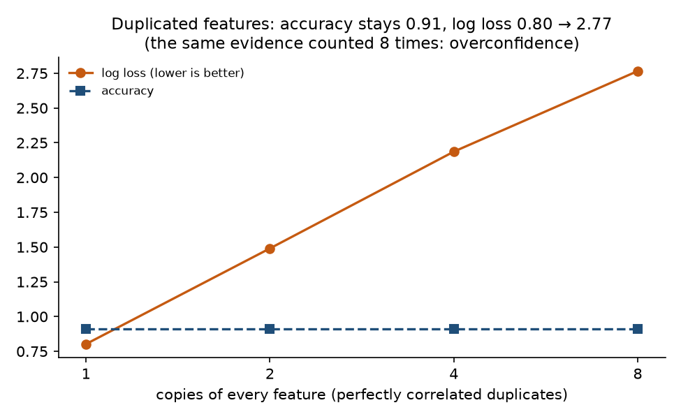
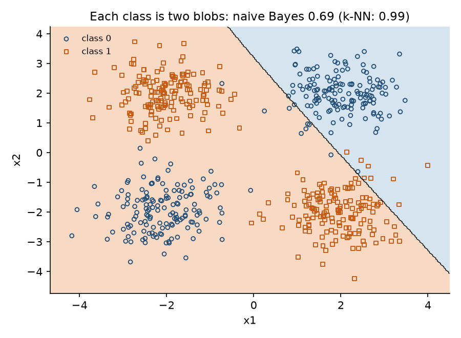

# Gaussian naive Bayes

> Classifies with Bayes' rule, assuming each feature is Gaussian within a class and independent of the others: fast,
> needs little data, and a sensible first model when features carry independent evidence.

> [!NOTE]
> **In one paragraph.** For each class, the model estimates a prior (its frequency) and, for every feature, a mean and a
> variance. A new point gets the class with the highest posterior, computed as a sum of log-densities. The
> "naive" independence assumption is what makes it fast and data-efficient, and also what makes its probabilities
> overconfident when features are correlated. It assumes each class is one Gaussian blob per feature.

## The maths, as implemented

```math
\log P(c \mid x) = \log \pi_c + \sum_{j=1}^{d} \log \mathcal{N}\big(x_j ; \mu_{cj}, \sigma^2_{cj}\big) + \text{const}, \qquad
\sigma^2_{cj} \leftarrow \sigma^2_{cj} + \epsilon \max_j \operatorname{Var}(x_j)
```

$\pi_c$ is the class frequency, $\mu_{cj}$ and $\sigma^2_{cj}$ the mean and variance of feature $j$ in class $c$, and
$\epsilon$ is `var_smoothing` ($10^{-9}$), relative to the largest feature variance, as in scikit-learn.

## Reading the code

From [`src/mlscratch/classical/naive_bayes.py`](../src/mlscratch/classical/naive_bayes.py).

**All parameters as arrays.** Means and variances are stored as (classes × features) matrices; the smoothing keeps a
feature that is constant within a class from producing a zero variance.

```python
eps = self.var_smoothing * X.var(axis=0).max()
self.mean_ = np.array([X[y == c].mean(axis=0) for c in self.classes_])  # (C, d)
self.var_ = np.array([X[y == c].var(axis=0) for c in self.classes_]) + eps  # (C, d)
```

**Every class at once.** Broadcasting over (points × classes × features) gives all joint log-likelihoods in one
expression, instead of a Python loop per point and per class.

```python
ll = -0.5 * (np.log(2 * np.pi * self.var_)[None] + (X[:, None, :] - self.mean_[None]) ** 2 / self.var_[None])
return self.log_prior_[None] + ll.sum(axis=2)
```

**Probabilities without overflow.** Subtracting the row maximum before `exp` (the log-sum-exp trick) keeps the
numbers finite even when log-likelihoods are in the thousands.

```python
jll -= jll.max(axis=1, keepdims=True)  # log-sum-exp trick: exp never overflows
```

## It works

<p align="center"></p>

Iris petal length and width: the class boundaries are curves (quadratic, because each class has its own variances),
test accuracy 0.96.

## Where the method breaks

> [!WARNING]
> **Correlated features.** The same evidence, counted several times, inflates the confidence.

<p align="center"></p>

Breast cancer with every feature duplicated 1, 2, 4 and 8 times: accuracy stays at 0.91, but the log loss rises from
0.80 to 2.77, and 99.4 % of predictions end above 0.999 probability. The ranking survives; the probabilities do not.

> [!WARNING]
> **A class that is not one blob.** One Gaussian per feature cannot describe a class made of two clusters.

<p align="center"></p>

Each class is two diagonal blobs (an XOR pattern): naive Bayes reaches 0.69, k-NN 0.99 on the same split.

## Limits of the method

- **Independence.** Correlated features are double-counted; probabilities become extreme even when the ranking is right.
- **One Gaussian per class and feature.** Multimodal or skewed features need transforms or another model.
- **Poorly calibrated.** Use it for ranking and classification; calibrate before reading probabilities as risks.
- **Strengths that remain.** Trains in one pass, needs little data, handles many features cheaply.

## At scale

For text and counts, multinomial and Bernoulli variants replace the Gaussian; production code adds incremental
updates (`partial_fit`) for streams, and probability calibration (Platt scaling, isotonic regression).

## How we know it is right

From [`tests/test_against_sklearn.py`](../tests/test_against_sklearn.py), on Iris:

```python
ours = GaussianNaiveBayes().fit(X_tr, y_tr).predict(X_te)
ref = GaussianNB().fit(X_tr, y_tr).predict(X_te)
assert (ours == ref).mean() >= 0.97
```

[`tests/test_extras.py`](../tests/test_extras.py): predicted probabilities equal scikit-learn's `GaussianNB` to
$10^{-8}$ on Iris.

> [!TIP]
> **In an interview.** *Why "naive"?* Features are assumed independent given the class. *When does it hurt?* With
> correlated features: here accuracy holds (0.91) but log loss goes from 0.80 to 2.77. *Why logs?* A product of many
> small densities underflows; sums of logs do not.

<sub>Figures and numbers: `PYTHONPATH=src python scripts/make_figures.py` (values in
[`figures/naive_bayes/measurements.json`](../figures/naive_bayes/measurements.json)).</sub>
