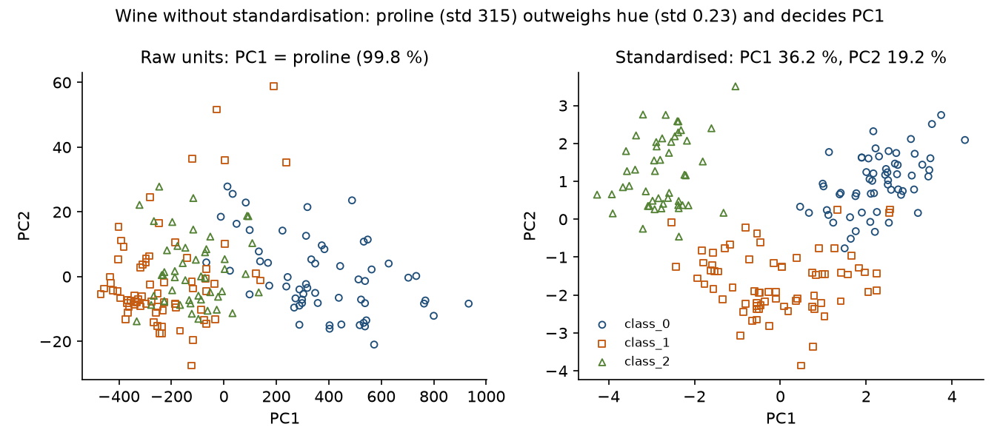
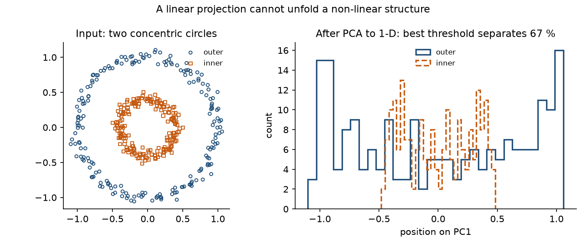

# Principal Component Analysis

> Finds the orthogonal directions along which the data varies most and projects onto the first few: the tool for
> compressing correlated features, or for looking at high-dimensional data in two dimensions.

> [!NOTE]
> **In one paragraph.** PCA centres the data, computes its covariance and keeps the eigenvectors with the largest
> eigenvalues. Each eigenvector is a direction (a *component*); its eigenvalue is the variance of the data along it.
> Projecting onto the first *k* components keeps more variance than any other *k*-dimensional linear view. It assumes
> that the structure worth keeping is linear and that the features are on comparable scales.

## The maths, as implemented

With $X \in \mathbb{R}^{n \times d}$, mean $\mu$ and $k$ components:

```math
C = \frac{(X-\mu)^\top (X-\mu)}{n-1} = V \Lambda V^\top, \qquad
W = [v_1, \dots, v_k], \qquad
Z = (X-\mu) W, \qquad
\text{ratio}_i = \frac{\lambda_i}{\sum_{j=1}^{d} \lambda_j}
```

The eigenvalues $\lambda$ are sorted in decreasing order, and the ratio divides by **all** $d$ of them. With
`solver="svd"` the same $V$ comes from the SVD of $X-\mu$, and $\lambda_i = s_i^2/(n-1)$.

## Reading the code

From [`src/mlscratch/classical/pca.py`](../src/mlscratch/classical/pca.py).

**Covariance, then a symmetric eigensolver.** `eigh` exploits the symmetry of $C$: real eigenvalues, orthonormal
eigenvectors. It returns them in ascending order, hence the reversal.

```python
cov = (Xc.T @ Xc) / (n - 1)
eigvals, eigvecs = np.linalg.eigh(cov)  # symmetric matrix: real eigenvalues, orthonormal eigenvectors
order = np.argsort(eigvals)[::-1]  # eigh returns ascending order
```

**Or an SVD of the centred data**, which never forms $X^\top X$ and so avoids squaring its condition number.
Both solvers give the same components (tested to $10^{-8}$).

```python
_, s, vt = np.linalg.svd(Xc, full_matrices=False)  # never forms X^T X
eigvals, eigvecs = s**2 / (n - 1), vt.T
```

**A deterministic sign.** If $v$ is an eigenvector, so is $-v$. Without a rule, the axes of a plot can flip between
runs. The convention makes the largest loading of each component positive; a test checks that permuting the rows
leaves the components unchanged.

```python
signs = np.sign(eigvecs[np.argmax(np.abs(eigvecs), axis=0), np.arange(eigvecs.shape[1])])
eigvecs = eigvecs * np.where(signs == 0, 1.0, signs)
```

**Whitening and reconstruction.** `whiten=True` rescales every projected coordinate to unit variance;
`inverse_transform` maps back to the original space, exactly when all components are kept.

## It works

<p align="center"></p>

Iris, four features in the same unit (cm): PC1 carries 92.5 % of the variance, PC2 5.3 %, and setosa separates on PC1
alone.

## Where the method breaks

> [!WARNING]
> **Unscaled features.** PCA maximises variance, and variance depends on units.

<p align="center"></p>

Wine, 13 features in raw units. Proline has a standard deviation of 315, hue of 0.23. PC1 explains 99.8 % of the
variance and is proline alone (loading 0.9998). After standardisation, PC1 and PC2 carry 36.2 % and 19.2 % and the
three classes appear.

> [!WARNING]
> **Non-linear structure.** A projection is a linear map; it cannot unfold a curve.

<p align="center"></p>

Two concentric circles: the cloud is nearly isotropic, so PC1 explains 50.4 %, no more than any direction, and the
best threshold on PC1 separates 67 % of points (50 % is chance).

## Limits of the method

- **Linear only.** Curved manifolds, rings and spirals need kernel PCA, Isomap, UMAP or an autoencoder.
- **Variance is not relevance.** The direction that varies most is not necessarily the one that separates the classes;
  PCA never looks at labels (LDA does).
- **Sensitive to outliers.** A few extreme points can tilt a component, because squared deviations dominate.
- **Components are mixtures.** Each one combines every original feature, which makes them hard to explain to a
  business user; sparse PCA trades some variance for readable loadings.

## At scale

For millions of rows or thousands of features, production libraries use randomised or truncated SVD (only the top
*k* components are computed) and incremental PCA for data that does not fit in memory.

## How we know it is right

From [`tests/test_against_sklearn.py`](../tests/test_against_sklearn.py): explained variance identical to
scikit-learn's, and each component pointing in the same direction, sign aside.

```python
np.testing.assert_allclose(ours.explained_variance_ratio_, ref.explained_variance_ratio_, rtol=1e-6)
for ours_c, ref_c in zip(ours.components_.T, ref.components_, strict=True):
    assert abs(abs(ours_c @ ref_c) - 1) < 1e-6  # same direction, sign is arbitrary
```

[`tests/test_extras.py`](../tests/test_extras.py) pins the rest: both solvers agree, the sign survives a row
permutation, `inverse_transform` reconstructs Iris to $10^{-10}$, whitened coordinates have unit variance, and
`NaN` or too many components raise an error.

> [!TIP]
> **In an interview.** *Why standardise first?* Because PCA ranks directions by variance, and variance is in the units
> of each feature (Wine: one feature, 99.8 %). *Why can the sign of a component change?* Because $v$ and $-v$ are both
> eigenvectors; fix a convention. *Eigendecomposition or SVD?* SVD of the centred data, which avoids forming $X^\top X$.

<sub>Figures and numbers: `PYTHONPATH=src python scripts/make_figures.py` (values in
[`figures/pca/measurements.json`](../figures/pca/measurements.json)).</sub>
