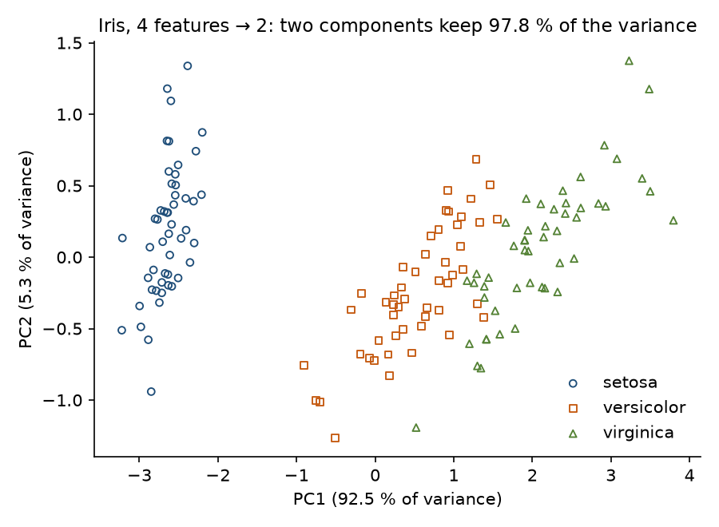

# Principal Component Analysis

> Finds the orthogonal directions along which the data varies most and projects onto the first few: the tool for
> compressing correlated features, or for looking at high-dimensional data in two dimensions.

PCA centres the data, computes its covariance and keeps the eigenvectors with the largest eigenvalues. Each
eigenvector is a direction, a *component*; its eigenvalue is the variance of the data along that direction. Projecting
onto the first *k* components keeps more variance than any other *k*-dimensional linear view.

## From covariance to components

With $X \in \mathbb{R}^{n \times d}$, mean $\mu$ and $k$ components:

```math
C = \frac{(X-\mu)^\top (X-\mu)}{n-1} = V \Lambda V^\top, \qquad
W = [v_1, \dots, v_k], \qquad
Z = (X-\mu) W, \qquad
\text{ratio}_i = \frac{\lambda_i}{\sum_{j=1}^{d} \lambda_j}
```

The eigenvalues $\lambda$ are sorted in decreasing order, and the explained-variance ratio divides by **all** $d$ of
them, so it stays correct when only a few components are kept.

## Two solvers, one answer

[`src/mlscratch/classical/pca.py`](../src/mlscratch/classical/pca.py) offers both classic routes. They return the same
components (tested to $10^{-8}$).

| `solver` | Computes | Why choose it |
|---|---|---|
| `"eigh"` (default) | the eigenvectors of the $d \times d$ covariance | short, and close to the textbook |
| `"svd"` | the right singular vectors of $X - \mu$ | never forms $X^\top X$, so the condition number is not squared |

```python
cov = (Xc.T @ Xc) / (n - 1)
eigvals, eigvecs = np.linalg.eigh(cov)  # symmetric matrix: real eigenvalues, orthonormal eigenvectors
order = np.argsort(eigvals)[::-1]  # eigh returns ascending order
```

```python
_, s, vt = np.linalg.svd(Xc, full_matrices=False)  # never forms X^T X
eigvals, eigvecs = s**2 / (n - 1), vt.T
```

`eigh` rather than `eig`: the covariance is symmetric, and `eigh` uses that to guarantee real eigenvalues and
orthonormal eigenvectors. It returns them in ascending order, hence the reversal.

## Making the output stable

If $v$ is an eigenvector, $-v$ is one too, and nothing in the maths chooses between them: without a rule, the axes of a
plot can flip from one run to the next. The code makes the largest loading of every component positive; a test checks
that shuffling the rows leaves the components unchanged.

```python
signs = np.sign(eigvecs[np.argmax(np.abs(eigvecs), axis=0), np.arange(eigvecs.shape[1])])
eigvecs = eigvecs * np.where(signs == 0, 1.0, signs)
```

Two options complete the class: `whiten=True` rescales each projected coordinate to unit variance, and
`inverse_transform` maps a projection back to the original space, exactly when all components are kept. Inputs are
validated: `NaN`, too few rows or too many components raise an error.

## On Iris

<p align="center"></p>

Four features in the same unit (cm) reduced to two: PC1 carries 92.5 % of the variance, PC2 5.3 %, and setosa
separates on PC1 alone.

## What PCA cannot see

- **Non-linear structure.** Rings, spirals and curved manifolds need kernel PCA, Isomap, UMAP or an autoencoder.
- **Units.** Variance depends on the scale of each feature; standardise unless all features share a unit, as on Iris.
- **Labels.** The direction that varies most is not necessarily the one that separates classes; LDA uses the labels.
- **Outliers.** Squared deviations let a few extreme points tilt a component.
- **Readability.** Each component mixes every feature; sparse PCA trades some variance for readable loadings.

For millions of rows or thousands of features, libraries compute only the top *k* components with randomised or
truncated SVD, and use incremental PCA when the data does not fit in memory.

## Checked against scikit-learn

From [`tests/test_against_sklearn.py`](../tests/test_against_sklearn.py):

```python
np.testing.assert_allclose(ours.explained_variance_ratio_, ref.explained_variance_ratio_, rtol=1e-6)
for ours_c, ref_c in zip(ours.components_.T, ref.components_, strict=True):
    assert abs(abs(ours_c @ ref_c) - 1) < 1e-6  # same direction, sign is arbitrary
```

[`tests/test_extras.py`](../tests/test_extras.py) covers the rest: both solvers agree, the sign survives a row
permutation, `inverse_transform` reconstructs Iris to $10^{-10}$, and whitened coordinates have unit variance.

<sub>Figure and numbers: `PYTHONPATH=src python scripts/make_figures.py`
([`figures/pca/measurements.json`](../figures/pca/measurements.json)).</sub>
