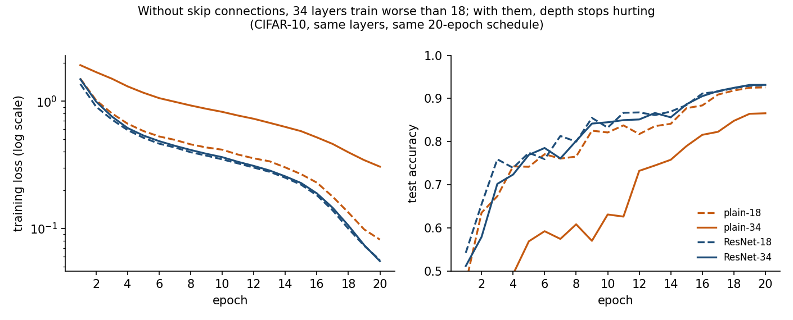
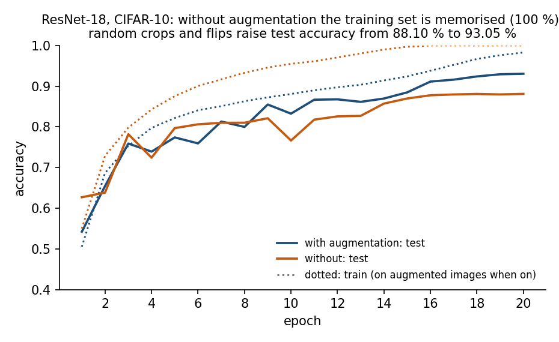

# ResNet-18 (CIFAR variant)

> A deep convolutional network made of blocks that each learn a *correction* to their input, added back through a
> skip connection. That one addition is what lets networks grow from about 20 layers to more than 100.

## The puzzle the skip connection solves

In 2015, He and colleagues observed something odd: a deeper plain network (a stack of convolutions) trained *worse*
than a shallower one: higher error on the training set itself, so not overfitting. A deeper network could in
principle copy the shallow one and set its extra layers to the identity; gradient descent just does not find that
solution.

The experiment is reproduced here on CIFAR-10. The same code builds both families: `residual=False` removes the
skip connections and nothing else.

<p align="center"></p>

| after 20 epochs | plain-18 | plain-34 | ResNet-18 | ResNet-34 |
|---|---|---|---|---|
| training loss | 0.082 | **0.306** | 0.056 | 0.055 |
| test accuracy | 92.56 % | **86.56 %** | 93.05 % | 93.15 % |

Going from 18 to 34 layers, the plain network loses 6 points of test accuracy and trains slower from the first epoch; with skip
connections, the deeper network is at least as good. The plain networks here have batch normalisation, as in the
paper, so this is not the vanishing-gradient problem of the 1990s: it is an optimisation difficulty.

## The block

From [`src/mlscratch/deep_learning/resnet.py`](../src/mlscratch/deep_learning/resnet.py):

```python
def forward(self, x: torch.Tensor) -> torch.Tensor:
    out = F.relu(self.bn1(self.conv1(x)))
    out = self.bn2(self.conv2(out))
    if self.residual:
        out = out + self.shortcut(x)
    return F.relu(out)
```

The two convolutions compute $F(x)$ and the block outputs $\text{ReLU}(F(x) + x)$. If the best thing a block can do
is nothing, it only has to push $F$ towards zero, which is easy. And in the backward pass the addition gives the
gradient a direct path, $\partial(F(x) + x)/\partial x = \partial F/\partial x + I$, through every block.

When a block halves the resolution and doubles the channels, $x$ and $F(x)$ no longer have the same shape, so the
shortcut becomes a 1 × 1 convolution with stride 2. Those projections are the only parameters the plain network
lacks (11.17 M against 11.00 M).

**The CIFAR variant.** ImageNet ResNets start with a 7 × 7 convolution of stride 2 and a max pooling, which would
shrink a 32 × 32 image to 8 × 8 before the first block. Here the stem is a single 3 × 3 convolution of stride 1, so the
four stages work at 32, 16, 8 and 4 pixels; global average pooling then feeds the classifier.

## The training recipe

The architecture is half of the result. The other half is the recipe, now part of `train_resnet`:

| ingredient | in the code | why |
|---|---|---|
| random crop + horizontal flip | `augment()`, on the GPU, per image | the network sees a new version of each image at every epoch |
| SGD, momentum 0.9, Nesterov, weight decay 5e-4 | `torch.optim.SGD` | the standard for ResNets on CIFAR |
| one-cycle schedule | `OneCycleLR`, 15 % warm-up | a large rate early, then a cosine decay to almost zero |
| mixed precision, channels-last | `torch.autocast`, `GradScaler` | faster on GPUs with tensor cores (speed-up not measured here) |

The augmentation crops every image of the batch at its own random offset with one indexing operation, instead of a
Python loop:

```python
rows = (torch.arange(H, device=x.device)[None] + dy[:, None])[:, :, None]  # (B, H, 1)
cols = (torch.arange(W, device=x.device)[None] + dx[:, None])[:, None, :]  # (B, 1, W)
out = xp[torch.arange(B, device=x.device)[:, None, None], :, rows, cols]  # (B, H, W, C)
```

<p align="center"></p>

Without augmentation, ResNet-18 reaches 100 % on the training set at epoch 17 and has nothing left to learn from it:
88.10 % on test. With crops and flips it never quite memorises the training set (98.3 %) and reaches 93.05 %. Each run
takes about 5 minutes on a laptop GPU (RTX 5060).

## Limits

- **Still a convolutional prior.** Local filters and pooling suit images; Vision Transformers trade this prior for
  more flexibility, and overtake ResNets when pre-trained on very large datasets.
- **Depth is not free.** ResNet-34 doubles the parameters of ResNet-18 for 0.1 point here; on CIFAR-10, width and
  training length matter as much as depth.
- **Batch normalisation couples the images of a batch.** Very small batches give noisy statistics; group or layer
  normalisation replace it in detection or on small GPUs.
- **93 % is not the ceiling.** Longer schedules and stronger augmentation (cutout, mixing images) are commonly reported
  to push a ResNet-18 past 95 % on CIFAR-10 (not measured here); this page stays at 20 epochs to compare variants
  under one budget.

## Tests

[`tests/test_deep_learning.py`](../tests/test_deep_learning.py) checks the output shape.
[`tests/test_deep_extras.py`](../tests/test_deep_extras.py) checks that every augmented image is a shifted, possibly
flipped crop of its original, that about half of the images are flipped, and that `residual=False` removes exactly the
projection shortcuts.

<sub>Figures and numbers: `PYTHONPATH=src python scripts/make_dl_figures.py resnet --retrain`, about 30 minutes on a
laptop GPU; without `--retrain`, the figures are redrawn from
[`figures/resnet/runs.json`](../figures/resnet/runs.json).</sub>
