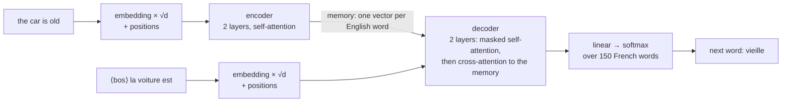
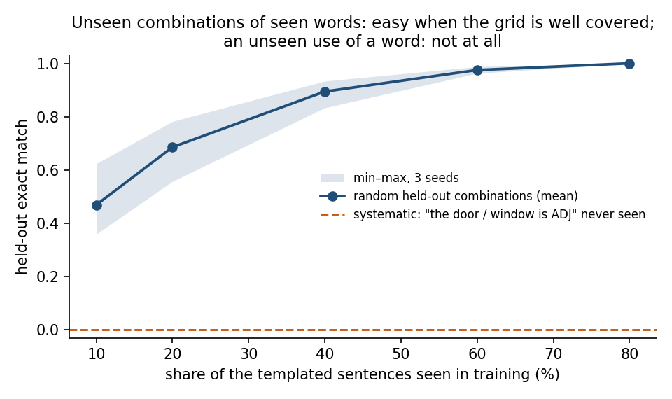
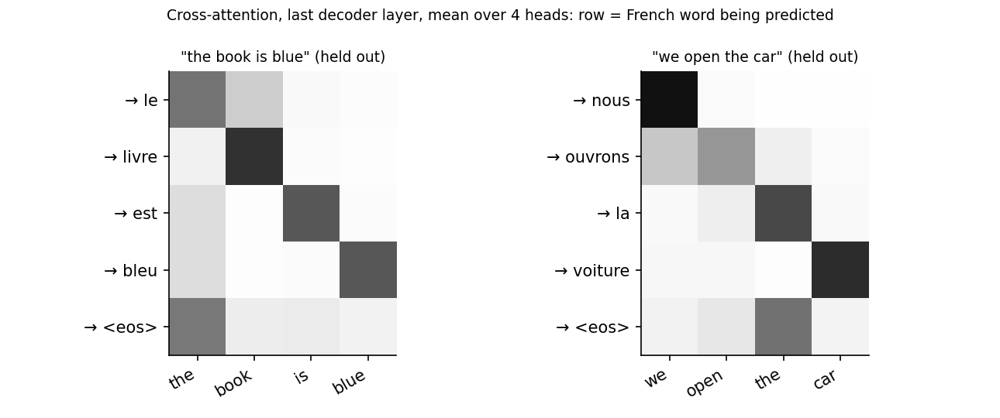

# A small English → French Transformer

> An encoder reads the English sentence; a decoder writes the French one word by word, each step looking at the
> words it has already written and, through attention, at the English words it needs. The architecture behind
> machine translation and, without the encoder, behind today's language models.

This model is deliberately small: 717 000 parameters, 267 sentence pairs, two minutes of training. That is enough to
show every moving part, and to ask the question that matters: **does it translate sentences it has never seen?**

| English (never seen in training) | model output | |
|---|---|---|
| the car is old | la voiture est vieille | ✓ adjective agrees with the feminine noun |
| the car is big | la voiture est grande | ✓ |
| we open the car | nous ouvrons la voiture | ✓ first-person plural |
| she opens the door | elle ouvre la porte | ✓ |
| he likes the garden | il aime le jardin | ✓ masculine article |
| the book is blue | le livre est bleu | ✓ |

## The data, built to be tested

[`data.py`](../src/mlscratch/nlp/en_fr_translation/data.py) holds 65 hand-written pairs ("thank you" → "merci")
and 202 templated sentences. The templates are where French is less forgiving than English:

| pattern | English varies | French must follow |
|---|---|---|
| `the NOUN is ADJ` | 10 nouns × 8 adjectives | gender of the article and agreement of the adjective: *le chat est blanc*, *la voiture est blanche* |
| `SUBJ VERB the NOUN` | 5 subjects × 3 verbs | conjugation and elision: *nous aimons*, *ils aiment*, *j'aime* (written `j aime`) |

```python
for en_n, fr_n, g in NOUNS:
    art = "le" if g == "m" else "la"
    for en_a, fr_m, fr_f in ADJECTIVES:
        pairs.append((f"the {en_n} is {en_a}", f"{art} {fr_n} est {fr_m if g == 'm' else fr_f}"))
```

`train_test_split` holds out part of the templated sentences. The hand-written pairs always train, and a held-out
sentence is moved back to training if one of its words would otherwise never be seen: the test measures whether the
model **combines known words in a new way**, not whether it guesses unknown ones. The vocabulary is built from the
training pairs only, so nothing about the test sentences leaks in.

## The architecture



From [`model.py`](../src/mlscratch/nlp/en_fr_translation/model.py), $d = 128$, 4 attention heads, feed-forward width
256. Attention itself is the scaled dot product, computed inside PyTorch's layers:

```math
\mathrm{Attention}(Q, K, V) = \mathrm{softmax}\!\left(\frac{Q K^\top}{\sqrt{d_k}} + M\right) V
```

where $M$ is a mask: 0 where attention is allowed, $-\infty$ where it is not. Attention has no notion of order, so a
sinusoidal position code is added to each embedding:

```python
pe[:, 0::2] = torch.sin(pos * div)
pe[:, 1::2] = torch.cos(pos * div)
```

### Three masks, three jobs

Sentences in a batch have different lengths and are padded to the longest. Getting the masks right is most of the
work of a seq2seq Transformer:

| mask | where | prevents |
|---|---|---|
| `src_key_padding_mask` | encoder self-attention | English words attending to padding |
| `memory_key_padding_mask` | decoder cross-attention | French words attending to English padding |
| `tgt_mask` (causal) + `tgt_key_padding_mask` | decoder self-attention | a French word seeing the words *after* it, or padding |

```python
causal = torch.triu(torch.ones(T, T, device=src.device, dtype=torch.bool), diagonal=1)
```

The causal mask is what makes training parallel: all positions of the French sentence are predicted at once, each
blind to its future, instead of one at a time.

## Training and decoding are different loops

**Training uses teacher forcing.** The decoder receives the *correct* French sentence shifted by one, and learns to
predict each next word:

```python
# teacher forcing: input = tgt[:-1], target = tgt[1:]
return src, tgt[:, :-1], tgt[:, 1:]
```

The loss ignores padding and uses **label smoothing**: the target word keeps 90 % of the probability, the rest is
spread over the vocabulary. On a corpus small enough to memorise, this stops the model from pushing its logits to
infinity:

```python
crit = nn.CrossEntropyLoss(ignore_index=pad_id, label_smoothing=label_smoothing)
```

**Inference has no correct sentence to lean on.** `generate` starts from `<bos>`, picks the most probable word,
appends it and runs the decoder again, until `<eos>`:

```python
next_id = self.proj(out[:, -1:]).argmax(-1)
ys = torch.cat([ys, next_id], dim=1)
```

This *greedy* decoding never revisits a choice: one early mistake and every following word is conditioned on it.
Real systems use beam search, which keeps the k best partial sentences.

## What it learned

### Unseen combinations

With 20 % of the templated sentences held out, the model translates **all 40** of them exactly, gender agreement
and conjugation included. Holding out more makes the task harder, because each word is seen in fewer contexts:

<p align="center"></p>

| templated sentences seen in training | 80 % | 60 % | 40 % | 20 % | 10 % |
|---|---|---|---|---|---|
| held-out exact match (mean of 3 seeds) | 1.00 | 0.98 | 0.89 | 0.69 | 0.47 |

### Where it looks

Cross-attention shows which English words the decoder reads when it writes each French word:

<p align="center"></p>

Mostly a diagonal: each French word reads its English counterpart, which the model was never told. Two cells
are more interesting. *ouvrons* reads both "we" and "open": the ending of the verb depends on the subject. And *la*
reads "the", not "car", yet the gender is right: the encoder's vector for "the" has already attended to "car", so
the information arrives through it. Attention maps show where a layer reads, not everything it knows.

### An unseen *use* of a word

The last test is harsher. "door" and "window" appear in training only at the end of a sentence ("open the door",
"close the window"), never followed by "is" and an adjective. Asked for the 16 sentences "the door is ADJ" and
"the window is ADJ", the model gets **none** right:

```text
the door is black   → la porte     (reference: la porte est noire)
the door is white   → la porte     (reference: la porte est blanche)
the door is red     → la porte     (reference: la porte est rouge)
```

Every word of the answer is in its vocabulary and it has produced *la porte* many times, but it has only ever seen
*la porte* end a sentence, so it ends it. The model learned the statistics of the training sentences, not the rule
"a noun can be followed by its description". This weakness in *systematic* generalisation is a known property of neural
sequence models; more varied data reduces it, and very large pre-training reduces it further, without removing it
entirely.

## Limits

- **A word-level vocabulary.** Any word outside the 150 French and 126 English words is `<unk>`. Real systems split
  text into subword units (byte-pair encoding), so a new word is a new combination of known pieces.
- **Greedy decoding**, no beam search and no length penalty.
- **No cache at inference.** `generate` re-runs the decoder over the whole prefix at every step; production decoders
  cache the keys and values of previous positions, so each step costs one position, not all of them.
- **Attention is quadratic in length.** Every word attends to every other: fine for ten words, the main cost for long
  documents.
- **Scale.** 267 sentences teach patterns, not French. The same code needs millions of pairs, a learning-rate warm-up
  and a larger model to translate open text.

## Tests

[`tests/test_deep_extras.py`](../tests/test_deep_extras.py):

- the template grid has 205 distinct sentences and the split never puts a sentence in both sets, nor a word in the
  test set that training has not seen;
- the systematic split holds out exactly the requested sentences;
- cross-attention rows sum to 1 and padded English positions receive **exactly zero** attention;
- the model learns four short pairs perfectly (a bug in the masks or the shift would break this).

<sub>Figures and numbers: `PYTHONPATH=src python scripts/make_dl_figures.py translation`, about 30 minutes on a laptop
GPU for 17 trainings ([`figures/transformer/measurements.json`](../figures/transformer/measurements.json)).</sub>
