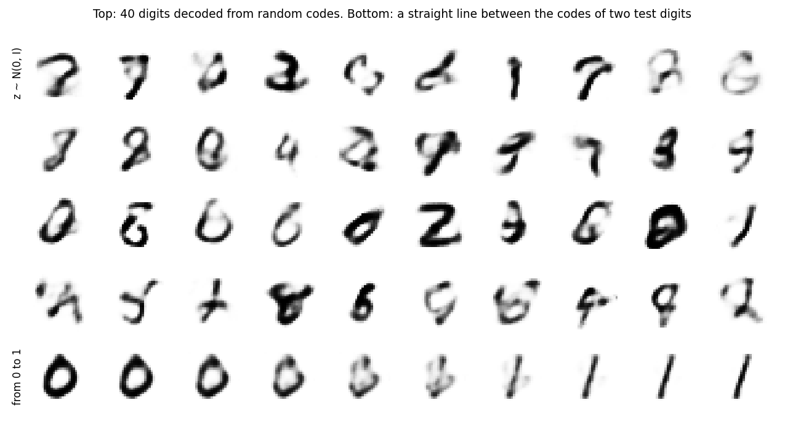
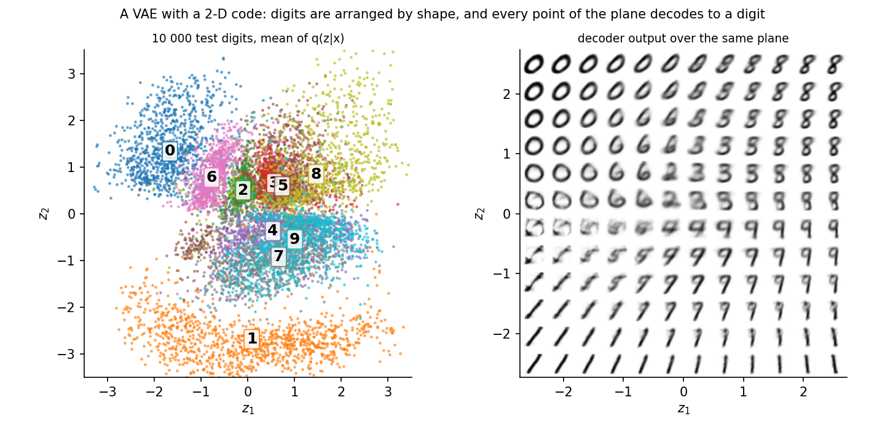
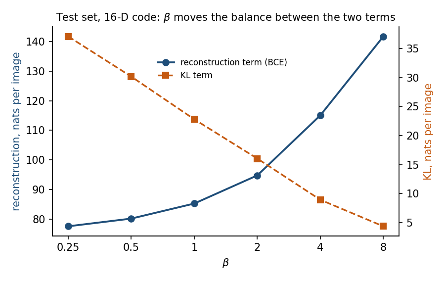

# Variational autoencoder (VAE)

> An autoencoder whose code space is forced to look like a standard Gaussian, so that any point drawn from that
> Gaussian decodes to a plausible image: an autoencoder that can generate.

<p align="center"></p>

None of the 40 digits above exists in MNIST: each comes from a random vector $z \sim \mathcal{N}(0, I)$ passed through
the decoder. A plain [autoencoder](autoencoder.md) cannot do this, because nothing tells it where in the code space
the digits are. Three changes fix that.

## Three changes to an autoencoder

From [`src/mlscratch/deep_learning/vae.py`](../src/mlscratch/deep_learning/vae.py).

**1. The encoder returns a distribution, not a point.** For each image it outputs a mean and a log-variance per code
dimension: "this digit is somewhere around $\mu$, give or take $\sigma$". Predicting $\log \sigma^2$ rather than
$\sigma$ keeps the network's output unconstrained.

```python
def encode(self, x: torch.Tensor):
    h = F.relu(self.fc1(x.view(-1, 28 * 28)))
    return self.fc_mu(h), self.fc_logvar(h)
```

**2. Training decodes a random draw from it**, which forces nearby codes to decode to similar images. Sampling is not
differentiable, so the randomness is moved into a separate variable $\varepsilon$: the *reparameterisation trick*.
Gradients then flow through $\mu$ and $\sigma$ as through any other layer.

```python
def reparameterize(self, mu: torch.Tensor, logvar: torch.Tensor) -> torch.Tensor:
    std = torch.exp(0.5 * logvar)
    eps = torch.randn_like(std)
    return mu + eps * std
```

**3. A penalty pulls every distribution towards $\mathcal{N}(0, I)$**: the Kullback–Leibler divergence, which has a
closed form for two Gaussians. Without it the encoder would shrink $\sigma$ to zero and become a plain autoencoder
again.

```python
bce = F.binary_cross_entropy(recon, x, reduction="sum")
# KL(N(mu, sigma^2) || N(0, 1)) in closed form, summed over latent dimensions
kl = -0.5 * torch.sum(1 + logvar - mu.pow(2) - logvar.exp())
```

Together, the two terms are the negative of the *evidence lower bound* (ELBO), a lower bound on the log-likelihood of
the data:

```math
\log p_\theta(x) \;\ge\; \underbrace{\mathbb{E}_{q_\phi(z \mid x)}\big[\log p_\theta(x \mid z)\big]}_{-\text{reconstruction}}
\;-\; \beta \cdot \underbrace{\mathrm{KL}\big(q_\phi(z \mid x) \,\Vert\, \mathcal{N}(0, I)\big)}_{\text{regularisation}},
\qquad \beta = 1
```

On the test set, after 20 epochs with a 16-dimensional code: reconstruction 82.3 nats per image, KL 23.4, so a bound
of 105.7 nats.

> [!NOTE]
> Pixels here are grey levels in [0, 1] scored with a binary cross-entropy, a common shortcut. Published MNIST
> likelihoods use binarised pixels, so these numbers are not comparable with papers.

## Seeing the code space

With a 2-dimensional code, the whole space can be drawn. Left: where the encoder places the test digits. Right: what the
decoder produces at each point of the same plane.

<p align="center"></p>

There are no holes: every point decodes to something digit-like, and moving across the plane morphs one digit into the
next (0 into 6, 7 into 9, 1 at the bottom). The KL term is what packs the codes around the origin; the labels were
never used.

## The β knob

The [code](../src/mlscratch/deep_learning/vae.py) exposes `beta`, the weight of the KL term. $\beta = 1$ is the true
ELBO; other values trade reconstruction against regularity (the "β-VAE" variant).

```python
def vae_loss(recon, x, mu, logvar, beta: float = 1.0):
    """Negative ELBO for beta = 1; beta > 1 weighs the prior more (smoother latent space, blurrier digits)."""
    bce, kl = vae_terms(recon, x, mu, logvar)
    return bce + beta * kl
```

<p align="center"></p>

| β | 0.25 | 0.5 | 1 | 2 | 4 | 8 |
|---|---|---|---|---|---|---|
| reconstruction (nats) | 77.5 | 80.1 | 85.2 | 94.7 | 115.1 | 141.8 |
| KL (nats) | 37.1 | 30.2 | 22.8 | 16.0 | 8.9 | 4.3 |

Small β gives sharper reconstructions and a code that carries more information about each image; large β gives a code
closer to the prior, often more disentangled, at the cost of blur. When the KL term collapses to near zero (very large
β, or a very powerful decoder), the code is ignored: *posterior collapse*. KL annealing (start at β = 0 and increase)
is the usual remedy.

## What VAEs are good at, and not

They give a smooth, continuous code, fast sampling in one decoder pass, an encoder for free, and a likelihood bound to
compare models. Their samples are blurrier than those of GANs or diffusion models, because the Gaussian decoder
averages over uncertainty and the bound is not tight. Today VAEs are often the *compressor* inside larger generators:
latent diffusion models run their diffusion in a VAE's code space.

## Tests

[`tests/test_deep_learning.py`](../tests/test_deep_learning.py): the KL term is exactly zero when $q = \mathcal{N}(0, I)$,
and the VAE can overfit a tiny batch. [`tests/test_deep_extras.py`](../tests/test_deep_extras.py): `beta` scales only
the KL term, KL is non-negative, and samples are images in [0, 1].

<sub>Figures and numbers: `PYTHONPATH=src python scripts/make_dl_figures.py vae`, about 9 minutes on a laptop GPU
([`figures/vae/measurements.json`](../figures/vae/measurements.json)). The β sweep trains each model for 10 epochs,
the 16-dimensional model above for 20.</sub>
