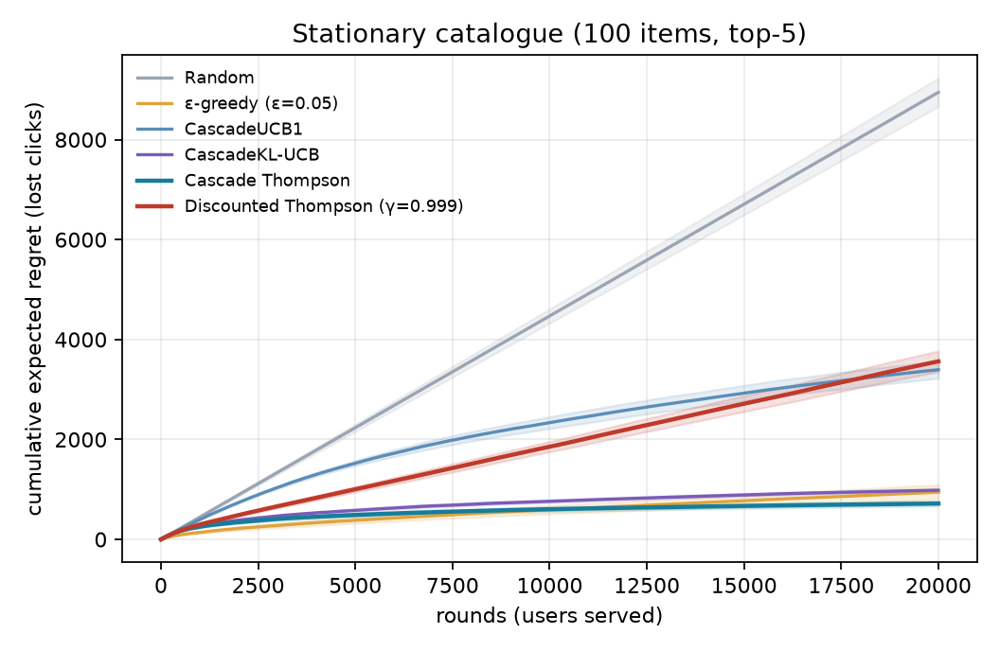
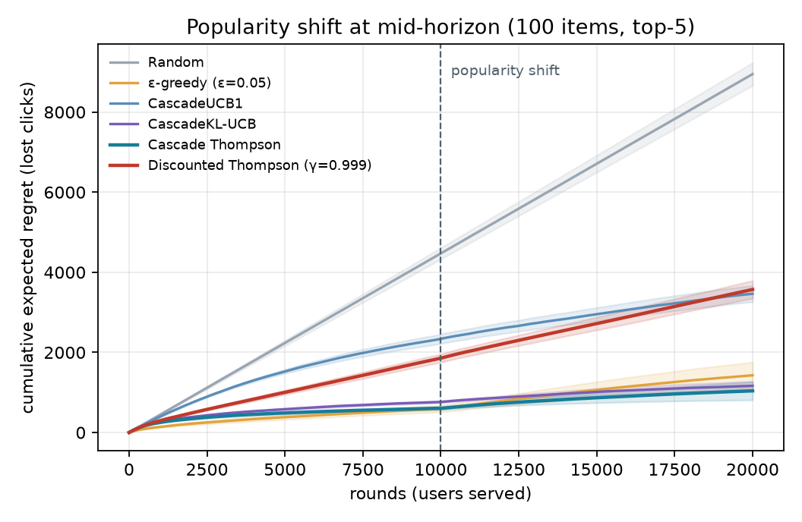

# Online learning to rank with cascading bandits

Which 5 products (or articles, or ads) should a page show, when click-through rates are unknown and the
catalogue changes? A ranking policy learns them **online**, from clicks, while serving real users. Every
user shown a weak list is a lost click.

The project simulates realistic traffic, compares six policies on the same users, and serves the best one
behind an API that learns from each click.

## The cascade model

Users scan the list top-down and click the **first** attractive item, then leave. That gives partial
feedback: items above the click were seen and rejected, the clicked item was attractive, items below were
**never seen**. Treating "not clicked" as "not attractive" for unseen positions would bias every estimate.
The update rule handles it, and a test pins it down.

Catalogue: 100 items with realistic click rates (most at 1–5 %, a few at 10–25 %), top-5 list.
Optimal click-through rate ≈ 0.66.

## Results (20,000 users, 10 seeds, 95 % confidence bands)

| Policy | Lost clicks (regret) | CTR after learning | % of optimal | After a popularity shift: lost clicks |
|---|---|---|---|---|
| Random ranking | 8,948 | 0.216 | 33 % | 8,949 |
| ε-greedy (ε = 0.05) | 945 | 0.628 | 95 % | 1,429 |
| CascadeUCB1 | 3,396 | 0.578 | 88 % | 3,464 |
| CascadeKL-UCB | 984 | 0.648 | 98 % | 1,165 |
| **Cascade Thompson sampling** | **718** | **0.656** | **99 %** | **1,039** |
| Discounted Thompson (γ = 0.999) | 3,563 | 0.496 | 75 % | 3,570 |

<p align="center">
  
  
</p>

What the numbers say:

* **Thompson sampling wins** and reaches 99 % of the optimal click rate: against random ranking,
  that is 3× more clicks. It is also the simplest policy to run (one Beta posterior per item).
* **UCB1 over-explores.** Its confidence bonus is calibrated for worst cases; KL-UCB's tighter index, built
  for click (Bernoulli) rewards, cuts regret by 3.5×.
* **ε-greedy looks good on a stable catalogue but suffers most from the shift** (+50 % regret): its
  exploration is blind, so it is slow to notice that the best items changed.
* **Negative result: "forgetting" did not help.** Discounting old evidence is the textbook answer to
  non-stationarity. With 100 items and only 1–5 observed per user, every γ tried (0.999, 0.9999, 0.99995)
  forgot faster than it learned. Plain Thompson sampling re-adapted on its own: its regret after the shift
  was 460 against 577–613 for the discounted variants (5 seeds). Kept in the benchmark on purpose.

## Why this method, and what it cannot do

Bandits rather than a model trained offline on click logs: logs only show items that were displayed, so an
offline model learns nothing about the others. A bandit chooses what to show *and* learns from it, paying a measured
price for exploration (the regret above). The cascade model learns one estimate per item instead of one per list
(100 items, but over 9 billion ordered top-5 lists), and reads each click as evidence about the items above it.

It stops working when:

* **users do not scan top-down** (grids, carousels, several clicks per visit): the update would read unseen items as
  rejected.
* **click rates depend on the user or the context**: these policies learn one ranking for everyone; personalisation
  needs contextual bandits.
* **the catalogue changes faster than evidence accumulates** (see Limitations).

## Serving API

```bash
make serve
curl -s localhost:8000/ranking
# {"ranking_id": "3f2c…", "items": [42, 7, 13, 88, 5]}
curl -s -X POST localhost:8000/feedback -H 'Content-Type: application/json' \
     -d '{"ranking_id": "3f2c…", "clicked_position": 1}'     # or null when nothing was clicked
curl -s localhost:8000/stats                                  # CTR, current best items with their evidence
```

* Feedback must reference a ranking that was actually served. Unknown, expired or replayed ids are
  rejected (404), and out-of-range positions return 422. A replayed callback cannot double-count a click.
* The posterior is checkpointed to JSON, so a restart keeps what was learned.
* Thread-safe updates (one lock around rank / update).

## Limitations

* **Simulated users only.** Click rates are drawn from a chosen distribution and users follow the cascade model
  exactly, so the benchmark cannot show what a violation of the model would cost. A replay evaluation on real logs
  would be the next check.
* **Non-stationarity is not solved.** Discounted Thompson sampling, the textbook answer, lost to plain Thompson
  sampling for every discount factor tried (the negative result above): with 1 to 5 observations per user and 100
  items, forgetting discards evidence faster than it arrives. Change detection or a sliding window over a smaller
  candidate set are untested alternatives.
* **One ranking for everyone.** No user or item features, no position effects beyond the cascade.
* **One process.** The posterior lives in memory behind a lock, with a JSON checkpoint; several replicas would need a
  shared store and a merge rule for concurrent updates.

## Run it

```bash
pip install -r requirements.txt && export PYTHONPATH=src        # into the shared environment
make benchmark                 # ~3.5 min on CPU: both scenarios, figures, reports/benchmark.json
make test                      # 8 tests: click model, cascade update, exploration order, learning, API
make serve
```

## Layout

```
src/rankbandit/
├── environment.py   cascade click model, realistic catalogue, popularity shift
├── policies.py      random, ε-greedy, CascadeUCB1, CascadeKL-UCB, Thompson, discounted Thompson
├── simulate.py      benchmark over seeds, confidence bands, figures
└── api.py           FastAPI service (rank → feedback → learn), JSON checkpoint
```

<sub>Origin: rebuilt from Master's coursework on bandits (UCB, Thompson sampling on independent arms), extended
to ranking with partial feedback, benchmarked and served.</sub>
