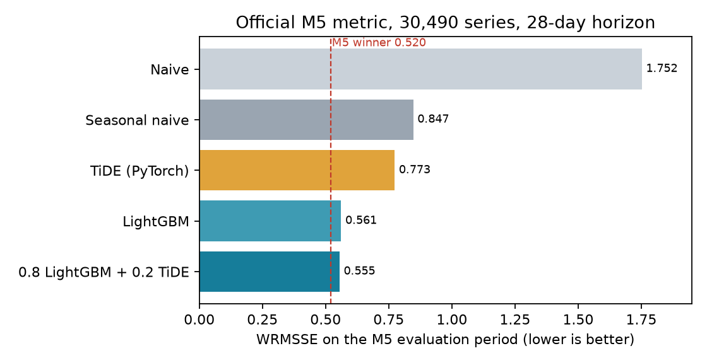
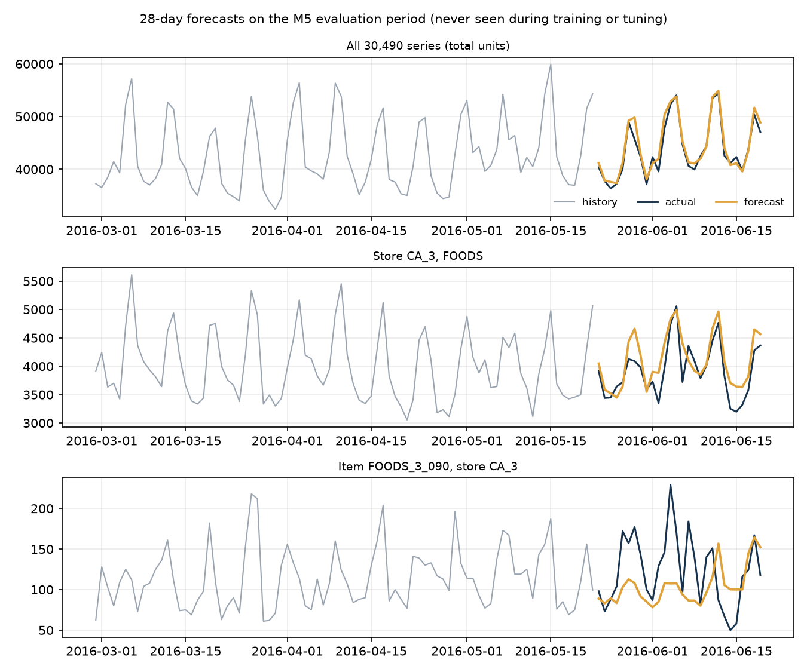
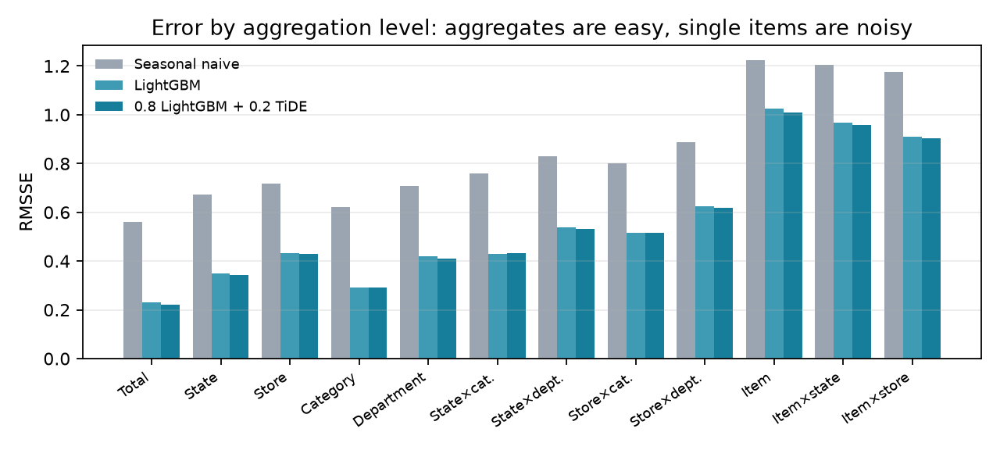

# Retail sales forecasting on M5 (Walmart): LightGBM, TiDE and their blend

Forecast the next 28 days of daily unit sales for **30,490 product × store series** (Walmart, 3 states,
10 stores, 3,049 products), from three data sources: sales history, a calendar (holidays, sport and
religious events, SNAP food-stamp days) and weekly sell prices. Scored with the **official M5 metric
(WRMSSE)** on the competition's real evaluation period, which is never used for any choice.



| Model | WRMSSE (M5 evaluation period) |
|---|---|
| Naive (last day repeated) | 1.752 |
| Seasonal naive (last week repeated) | 0.847 |
| TiDE, deep learning (PyTorch) | 0.774 |
| LightGBM, Tweedie objective | 0.561 |
| **Blend 0.8 LightGBM + 0.2 TiDE** | **0.555** |
| *M5 winner (5,558 teams), for reference* | *0.520* |

The metric code reproduces the published M5 benchmarks exactly (seasonal naive 0.847, naive 1.752), so
the numbers are comparable with the competition's.



## What was done

**Data and features** (`data.py`, `features.py`): one row per series and day; every sales feature is at
least 28 days old (lags 28–56 and 364, rolling means and standard deviation of the 28-day lag), so a single
model forecasts the whole horizon without recursion or leakage. Calendar features (weekday, month, day of
month, event name and type, SNAP day of the series' state) and price features (price, price relative to
its maximum and to its department, weekly price change). Days before a product's launch and days when it
is not on sale are dropped: they are missing data, not zero demand.

**LightGBM** (`lgbm.py`): one global model over all series, Tweedie objective (suited to intermittent
counts: most item-days sell 0 or 1 unit), 450 rounds chosen on the validation fold.

**TiDE** (`tide.py`): the MLP encoder–decoder of Das et al. (Google, TMLR 2023), implemented in PyTorch.
112 days of history scaled per series, known-in-advance covariates (calendar, SNAP, relative price) for
history and horizon, embeddings for item / department / category / store / state, Tweedie loss on the
scaled target, series sampled in proportion to their sales value (as WRMSSE weighs them).

**Blend**: 0.8 LightGBM + 0.2 TiDE, weight chosen on validation (0.623 vs 0.628 for LightGBM alone) and
confirmed on the evaluation period (0.555 vs 0.561).

## Protocol

| Fold | Forecast days | Used for |
|---|---|---|
| validation | d_1914 – d_1941 | every choice: features, rounds, epochs, blend weight |
| evaluation | d_1942 – d_1969 | final scores only (the M5 private leaderboard period) |

## Honest reading

- **Aggregates are accurate, single items are noisy.** RMSSE is about 0.2–0.4 for total, state and category
  sales but about 0.9–1.0 for individual items (see below): a single product's daily sales are dominated by
  randomness, which is why WRMSSE averages the 12 levels.
- **Deep learning did not beat gradient boosting here**, as in the competition itself, where tree models
  won. TiDE still adds value in the blend because its errors differ from LightGBM's.
- **Gap to the winner (0.555 vs 0.520)**: the winning solution trained many LightGBM models per store and
  per horizon with recursive features and careful ensembling; this project uses one model per family.



## Why this method, and what it cannot do

Global models over all series rather than one model per series (ARIMA, exponential smoothing): 30,490 local
models would each fit a short, mostly-zero history, while a global model shares what it learns across series (a
holiday effect, a price cut). Lags of at least 28 days let one model forecast the whole horizon directly, without
feeding its own errors back.

It stops working when:

* **the future has no past**: a new product has no lags, and a shock outside anything the features describe (a store
  closure, a pandemic) is invisible to both models.
* **decisions need uncertainty**: these are point forecasts, while stock decisions need quantiles of demand.
* **the horizon exceeds the shortest lag**: beyond 28 days, the lag features must be rebuilt or forecasts fed back
  recursively.

## Run it

```bash
pip install -r requirements.txt
make data          # M5 from a public mirror (~50 MB)
make validate      # choices on the validation fold
make test-fold     # scores on the evaluation period -> reports/test_results.json
make figures
make serve         # GET /forecast/FOODS_3_090/CA_3 -> 28 daily forecasts
make test          # 4 fast tests: loss, TiDE shapes, no-leak rolling features, API contract
```

Memory: feature building and training peak below 6 GB (the 12-level aggregation matrices are sparse:
the bottom level alone would be a dense 30,490 × 30,490 matrix).

## Layout

```
sales-forecasting/
├── src/salesfc/
│   ├── data.py       M5 loading, folds, price matrix
│   ├── metrics.py    WRMSSE over the 12 aggregation levels
│   ├── features.py   leakage-free features for global models
│   ├── lgbm.py       LightGBM (Tweedie)
│   ├── tide.py       TiDE in PyTorch
│   └── api.py        forecast service (FastAPI)
├── scripts/          test-period scoring, figures
├── reports/          results and figures
└── tests/
```
