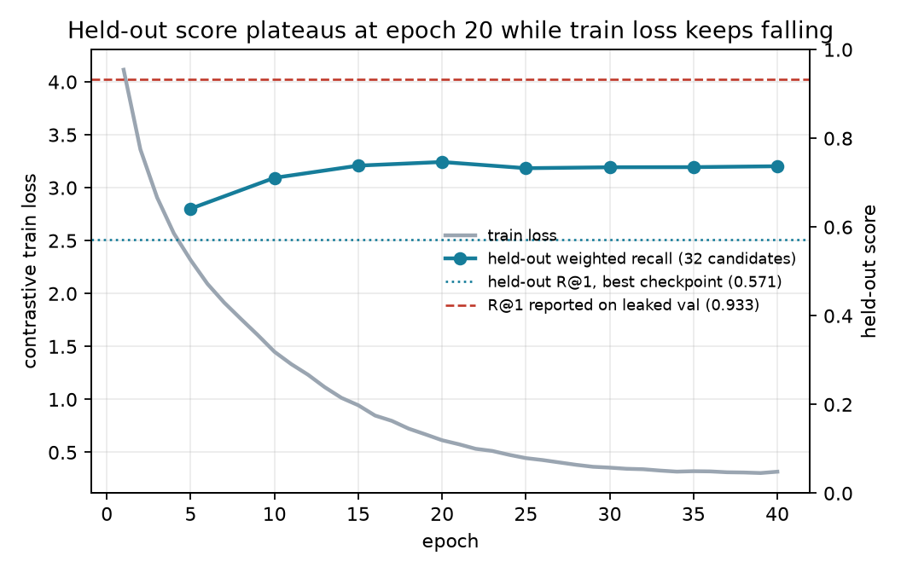
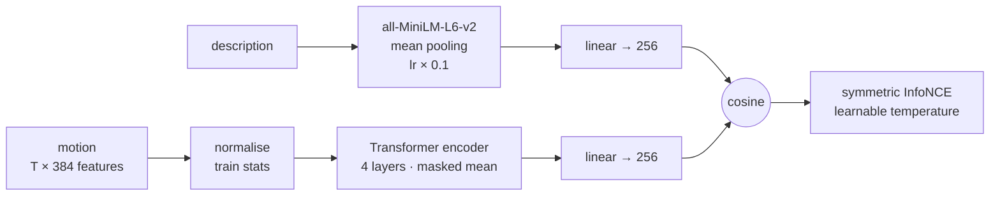

# Text-to-motion retrieval — and the validation leak behind a 0.933

Describe a two-person interaction in English ("two people shake hands and then walk away") and retrieve
the matching motion-capture sequences from a library of 6,018. CLIP-style dual encoder: a pretrained
sentence encoder for text, a Transformer over motion frames, trained with a symmetric contrastive loss.

This started as a university data challenge on Kaggle (Université de Lille, Centrale Lille, IMT Nord Europe),
which our two-person team **Recall@1** won: **1st place** on the
[final leaderboard](https://www.kaggle.com/competitions/text-to-motion-retrieval/leaderboard)
with a score of **0.898** (2nd: 0.867, 3rd: 0.847). The leaderboard score is the average of
Recall@k for k = 1…10 weighted by 1/k, so ranking the right motion first matters most. The leaderboard
scores hidden test data. The leak below concerns only the notebook's *local* validation score.
The original notebooks are kept for history (`datachallenge.ipynb`, `text-motion-expl.ipynb`).

## The finding: the original score was measured on training data

The notebook reported **Recall@1 = 0.933** on the challenge's `val/` folders. Hashing every candidate
motion showed that **640 / 640 sampled validation candidates are also training motions**, and the notebook
trained on 100 % of `train.txt`. The model was being asked to recognise sequences it had memorised.

The rebuilt pipeline holds out a seeded 10 % of motion ids (601 motions, 1,803 descriptions) **before**
training. Normalisation statistics come from training motions only. Every number below is on these unseen motions.

## Results on unseen motions

| Protocol | R@1 | R@5 | R@10 | Other |
|---|---|---|---|---|
| Challenge format: target hidden among 32 candidates | **0.571** | 0.885 | 0.952 | weighted recall 0.747 (random: R@1 0.031) |
| Full gallery: each description against all 601 held-out motions | 0.119 | 0.367 | 0.500 | median rank 10 / 601 |
| *Original notebook, leaked val* | *0.933* | | | *not comparable* |

<p align="center"></p>

The held-out score plateaus around epoch 20 while the training loss keeps falling: past that point the
model memorises. The best checkpoint is chosen on held-out data, not on the final epoch. With the leaky
protocol this plateau was invisible, because memorisation *raised* the reported score.

## Search API

```bash
make serve    # embeds the 6,018 motions once at start-up
curl -s localhost:8000/search -H 'Content-Type: application/json' \
     -d '{"text": "two people shake hands and then walk away", "k": 3}'
```

Real output (top match is a held-out motion the model never saw):

| score | split | reference description of the retrieved motion |
|---|---|---|
| 0.528 | held-out | the two individuals first greet each other with a warm handshake, then embrace and part ways back-to-back. |
| 0.525 | train | one person walks towards the other person and pushes them away with both hands when they meet. |
| 0.523 | train | two people bid farewell by waving hands, and one person hands over a forgotten item to the other. |

Query latency: about 20 ms on CPU (one text-encoder pass + one matrix product over the library).

## Model



* Random crop to 196 frames and small Gaussian noise for training; centre crop for evaluation.
* Each training step samples one of the 3 descriptions of each motion, so the 3 paraphrases act as augmentation.
* bf16 autocast on GPU: 40 epochs take about 9 minutes on a laptop RTX 5060 (10 s per epoch).

## Use the trained model without training

The weights (101 MB) are attached to the GitHub Release
[`t2m-weights-v1`](https://github.com/Layeser/ai-portfolio/releases/tag/t2m-weights-v1) of this repository, outside
the git history. `weights.sha256` pins their checksums, and the download refuses any file that does not match.

```bash
pip install -r requirements.txt && export PYTHONPATH=src
make download-weights     # -> artifacts/dual_encoder.pt, normalizer.npz, split.json, metrics.json
make serve                # search API, only needs the motion library in data/
```

## Run it

The challenge data (motions + texts) is not redistributed. Link it into `data/` (`data/motions/*.npy`,
`data/texts/*.txt`), then:

```bash
pip install -r requirements.txt
python -m t2m.train --epochs 40     # writes artifacts/ (model, normaliser, split, metrics)
python -m t2m.report                # figure
uvicorn t2m.api:app                 # search service
pytest -q                           # 7 tests on synthetic motions (split, normaliser, crop/mask, metrics, loss, training + API)
```

## Limitations and next steps

* Gallery R@1 of 0.12 shows that fine-grained retrieval among hundreds of similar interactions is still
  hard. Early stopping at epoch 20, hard-negative mining and a larger text encoder are the next experiments.
* The 384 motion features are used as provided. Without the skeleton specification, there is no 3D rendering of results.
