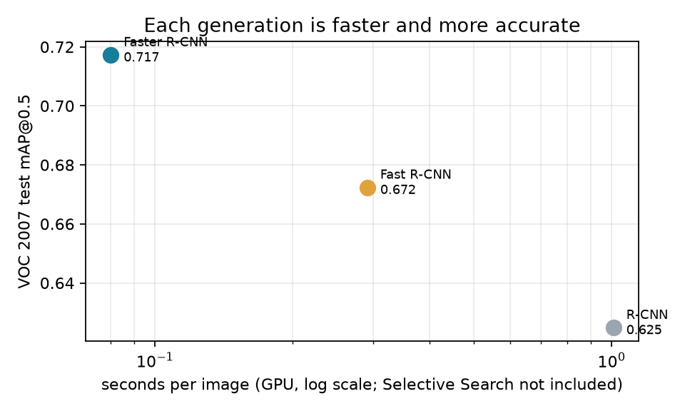
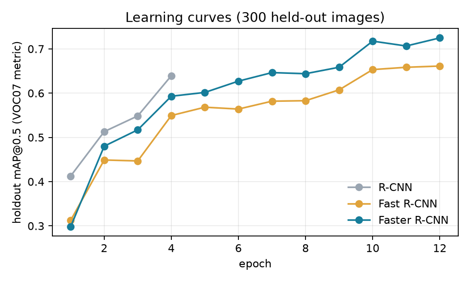
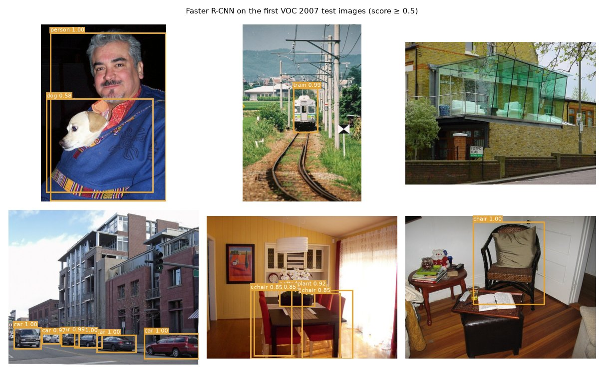

# R-CNN → Fast R-CNN → Faster R-CNN, from scratch in PyTorch

The three papers that defined two-stage object detection, re-implemented on a common base and
compared under the **papers' own protocol**: train on PASCAL VOC 2007 trainval, test on the 4,952
images of VOC 2007 test, mAP@0.5 with the VOC 2007 11-point metric.

| Model | Year | Region proposals | Features | **VOC07 test mAP** | Paper (VGG-16) | GPU time / image |
|---|---|---|---|---|---|---|
| R-CNN | 2014 | Selective Search | one CNN pass **per region** | **62.5 %** | 66.0 % (58.5 % AlexNet) | 1.01 s + Selective Search |
| Fast R-CNN | 2015 | Selective Search | one pass **per image** + RoI pooling | **67.2 %** | 66.9 % | 0.29 s + Selective Search |
| Faster R-CNN | 2015 | learned (Region Proposal Network) | one pass per image | **71.7 %** | 69.9 % | **0.08 s** |



Each generation is both **more accurate and faster**, which is the point of the story: R-CNN classifies
~500 warped crops with 500 CNN passes; Fast R-CNN shares one pass and pools region features from it;
Faster R-CNN replaces the 1.4 s/image CPU Selective Search with a learned RPN on the same features.

All three use the same ImageNet-pretrained ResNet-50 (frozen batch norm, conv1 + layer1 frozen), so the
comparison isolates the detection design. The papers used VGG-16; ResNet-50 explains part of the margin.





*Faster R-CNN on the first six VOC 2007 test images (not cherry-picked), score ≥ 0.5.*

## How each model works (and where it departs from the paper)

**R-CNN** (`models.RCNN`)
- Proposals: Selective Search "fast" mode, cached once (`scripts/selective_search.py`, ~1,400 boxes / image).
- Each proposal is enlarged so that 16 px of context surround it once warped, then warped to 224×224 —
  done on the GPU with RoIAlign on the image itself instead of cropping on the CPU.
- *Departure*: the paper trains SVMs and ridge box regressors on cached features; here the fine-tuned
  softmax head and a class-specific box regressor are trained jointly (the paper reports the softmax
  variant a few points lower). Test time uses the 500 top-ranked proposals instead of ~2,000.

**Fast R-CNN** (`models.FastRCNN`)
- conv1–layer3 on the whole image (stride 16), RoI pooling to 14×14, ResNet layer4 as the per-region head
  (the "C4" layout used for ResNet in the Faster R-CNN paper), multi-task loss (softmax + smooth L1).
- Mini-batches of 2 images × 128 RoIs, 25 % foreground (IoU ≥ 0.5), background IoU in [0.1, 0.5).
- *Departure*: RoIAlign (Mask R-CNN, 2017) instead of RoIPool; `pooler="pool"` gives the original layer.

**Faster R-CNN** (`models.FasterRCNN`)
- RPN: 9 anchors per position (3 scales × 3 ratios), 256 anchors per image (50 % positive: IoU ≥ 0.7 or best
  anchor of a ground truth; negatives IoU < 0.3), cross-boundary anchors ignored, NMS 0.7,
  2,000 proposals for training / 300 for testing.
- Approximate joint training (RPN and detection losses summed, proposals detached), as in the paper's
  released code.

Shared: per-class NMS at 0.3, VOC evaluation with "difficult" objects ignored (`evaluate.py`, checked with
an oracle — ground-truth boxes as detections give mAP 1.0).

## Protocol

- Train: VOC 2007 trainval minus 300 images (4,711); **holdout**: those 300 images, used for every choice
  (checkpoint selection, schedule); **test**: VOC 2007 test, used once per model, at the end.
- SGD, momentum 0.9, lr 0.005 for 2 images per batch, 500-iteration warm-up, ×0.1 at 75 % of training,
  bf16 autocast, horizontal flips, shorter side 600 px. 12 epochs for Fast and Faster R-CNN, 4 for R-CNN.
- Laptop GPU (RTX 5060, 8 GB): ~9 min/epoch for Fast and Faster R-CNN, ~20 min/epoch for R-CNN.

## Reproduce

```bash
pip install -r requirements.txt
ln -s /path/to/VOCdevkit data/VOCdevkit   # VOC2007 (trainval + test)
make proposals        # Selective Search for R-CNN and Fast R-CNN (~45 min on 8 CPU cores)
make train-faster     # then train-fast, train-rcnn
make evaluate         # VOC 2007 test mAP of the three best checkpoints -> reports/
make figures
make test             # 8 CPU tests on synthetic data: IoU, box coding, matching, mAP, anchors, train + inference
```

## Layout

```
two-stage-detectors/
├── src/twostage/
│   ├── voc.py        VOC parsing, splits (with the holdout), resizing, flips, cached proposals
│   ├── boxes.py      IoU, R-CNN box parameterisation, matching, sampling
│   ├── models.py     R-CNN, Fast R-CNN, RPN, Faster R-CNN on one ResNet-50 base
│   ├── train.py      shared training loop with holdout monitoring and checkpointing
│   └── evaluate.py   VOC 2007 / 2010 mAP
├── scripts/          Selective Search cache, figures
├── reports/          training histories, test results, figures
└── tests/
```
