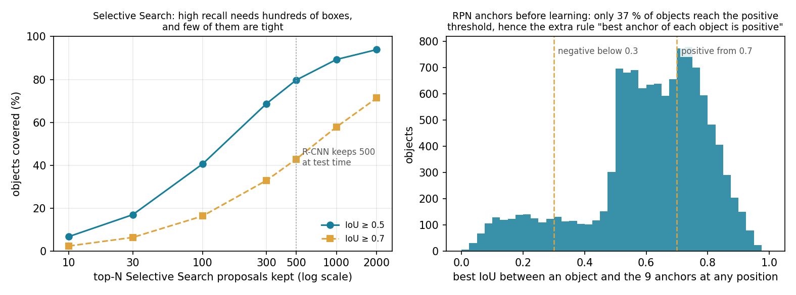

# Two-stage detection, read through this code

> Stage one proposes a few hundred boxes that might contain an object; stage two classifies each one and corrects
> its coordinates. R-CNN, Fast R-CNN and Faster R-CNN keep this split and change *how* each stage is computed.
> The [README](../README.md) compares their results; this page explains the machinery they share.

## The shared vocabulary

Everything below rests on three functions of [`src/twostage/boxes.py`](../src/twostage/boxes.py), used by all three
models.

**1. A box is corrected, not predicted.** The network never outputs coordinates directly. Given a reference box
(a proposal or an anchor) of centre $(x_r, y_r)$ and size $(w_r, h_r)$, it predicts four offsets towards the object
$(x, y, w, h)$:

```math
t_x = \frac{x - x_r}{w_r}, \qquad t_y = \frac{y - y_r}{h_r}, \qquad t_w = \log\frac{w}{w_r}, \qquad t_h = \log\frac{h}{h_r}
```

Dividing by the reference size makes the targets independent of scale (the same $t_x$ for a car near or far), and
the logarithm keeps widths positive whatever the network outputs. `decode` inverts it, and clamps $t_w, t_h$ so that
an early, wild prediction cannot overflow `exp`:

```python
dw, dh = (deltas[:, 2::4] / ww).clamp(max=BBOX_CLIP), (deltas[:, 3::4] / wh).clamp(max=BBOX_CLIP)
```

**2. Every candidate gets a label from its overlap.** `match` assigns each proposal the class of the ground truth it
overlaps most, if the IoU is high enough; ambiguous overlaps are excluded from training rather than forced into a
class.

```python
iou, idx = box_iou(proposals, gt_boxes).max(1)
labels = gt_labels[idx].clone()
labels[iou < fg_iou] = 0
labels[iou < bg_low] = -1
```

**3. Training sees a balanced sample.** An image yields thousands of candidates, almost all background. `sample` draws
a fixed number with a fixed share of positives (25 % for the detection head, 50 % for the RPN), so the loss is not
dominated by easy negatives.

## What changes from one paper to the next

| | stage one: where do boxes come from? | stage two: where do their features come from? |
|---|---|---|
| R-CNN | Selective Search, on the CPU | each box is cropped from the **image** and goes through the whole CNN |
| Fast R-CNN | Selective Search, on the CPU | one CNN pass per image; each box is cropped from the **feature map** (RoI pooling) |
| Faster R-CNN | a small network on that same feature map (the RPN) | as Fast R-CNN |

The move from R-CNN to Fast R-CNN is one line in [`models.py`](../src/twostage/models.py): the crop happens on the
stride-16 feature map instead of the image, so 500 regions cost one backbone pass instead of 500.

```python
x = roi_align(features, rois, 14, spatial_scale=1 / 16, sampling_ratio=0, aligned=True)
```

The move to Faster R-CNN replaces Selective Search by anchors: at every position of the feature map, 9 reference boxes
(3 sizes × 3 aspect ratios) that the RPN scores and corrects with the same offsets as above.

```python
for r in ratios:
    for s in scales:
        w, h = s / math.sqrt(r), s * math.sqrt(r)
        base.append([-w / 2, -h / 2, w / 2, h / 2])
```

## What the first stage hands over

Measured on the 12,032 non-difficult objects of VOC 2007 test, without any trained model:

<p align="center"></p>

**Selective Search** needs many boxes. With the 500 that R-CNN keeps at test time, 80 % of objects are covered at
IoU ≥ 0.5, but only 43 % at IoU ≥ 0.7; all ~1,400 boxes per image reach 94 % and 71 %. The second stage's box
regression is what turns these loose boxes into tight ones.

**Anchors** are fixed shapes, so their fit is cruder: only 37 % of objects have an anchor at IoU ≥ 0.7, the
threshold for a positive in the paper. Without a second rule, the other 63 % would never train the RPN. That is why
`RPN.loss` also marks the best anchor of each object as positive:

```python
gt_best = iou.max(0).values
hits = (iou == gt_best[None]) & (gt_best[None] > 0)  # each GT keeps its best anchor(s)
labels[hits.any(1)] = 1
```

The 10 % of objects whose best anchor stays below 0.3 are small: median side 55 pixels on the resized image, against
128 for the smallest anchor.

## Limits of the two-stage design

- **Speed is bounded by the second stage**: hundreds of regions per image go through `layer4`. One-stage detectors
  (SSD, RetinaNet, later YOLOs) predict classes directly on the anchors and are faster, at some cost in accuracy on
  small objects.
- **Hand-set geometry.** Anchor sizes and ratios, IoU thresholds (0.7 / 0.3, 0.5 / 0.1) and the NMS threshold are
  chosen by hand for VOC; another dataset can need other values.
- **One scale of features.** A single stride-16 map serves all object sizes; feature pyramids (FPN) give small
  objects a finer map, which is where the 55-pixel objects above are lost.
- **NMS removes duplicates after the fact** and can delete a true detection next to another one; set-based detectors
  (DETR) learn to output each object once.

## Tests

[`tests/`](../tests) checks this vocabulary on synthetic data: IoU equal to torchvision's, `encode` then `decode`
returns the original boxes, `match` and `sample` respect their thresholds and proportions, the anchors cover the
image, and each model trains and predicts with the right shapes.

<sub>Figure and numbers: `python scripts/explainer_figures.py`, about 20 s on CPU from the cached proposals
([`reports/first_stage.json`](../reports/first_stage.json)).</sub>
