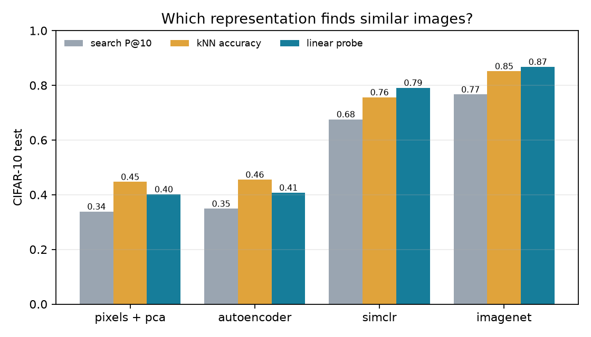
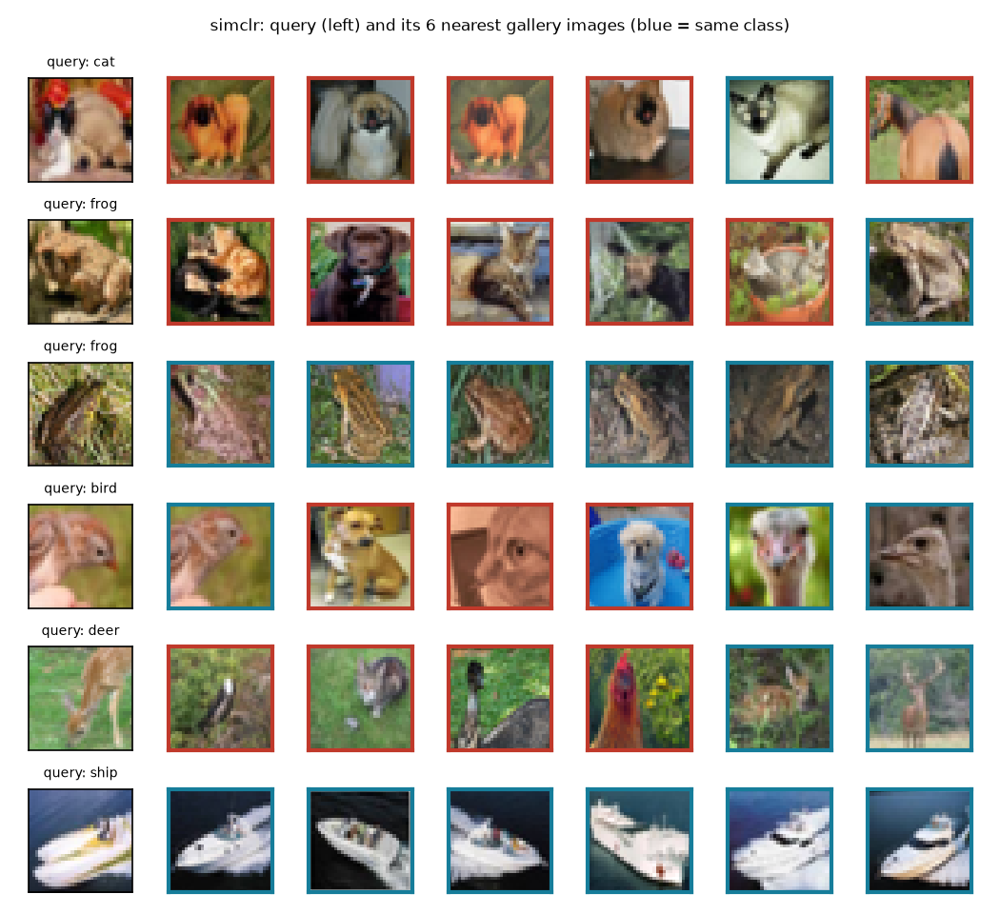

# Visual similarity search: which image representation actually works?

"Show me images like this one" is a common product feature: similar products, duplicate detection,
photo libraries. Its quality depends almost entirely on the **image representation**. This project
compares four of them on the same search engine: from raw pixels to self-supervised learning and
transfer learning. Everything is served through a FAISS index behind a FastAPI service.



## Results

Setup: the gallery is CIFAR-10 train (50,000 images) and the queries are CIFAR-10 test (10,000
images). A result counts as relevant when it shares the query's class. Labels are used **only to
score**, never to train the encoders.

| Representation | Learns from | P@10 | mAP@10 | kNN acc. | Linear probe | Training |
|---|---|---|---|---|---|---|
| Pixels + PCA (128-d) | pixel statistics | 0.338 | 0.491 | 0.447 | 0.401 | 1 min |
| Conv autoencoder (256-d) | reconstruction | 0.349 | 0.504 | 0.455 | 0.407 | 1.4 min |
| **SimCLR ResNet-18 (512-d)** | **contrastive views, no labels** | **0.676** | **0.751** | **0.756** | **0.791** | 26 min |
| ImageNet ResNet-18 (512-d) | 1.3 M labelled ImageNet images | 0.766 | 0.834 | 0.852 | 0.868 | none (transfer) |

Search latency: 0.1–0.3 ms per query for exact FAISS search over 50k vectors, and ~13 ms end to end
through the API (decode, embed, search) on CPU.

**What this shows**

* **Reconstruction is not similarity.** The autoencoder barely beats raw pixels. Reconstructing an
  image well means encoding colours and layout, not *what* is in it.
* **Self-supervision closes most of the gap.** SimCLR learns from 50k unlabelled images, in 26
  minutes on a laptop GPU, and doubles search precision (0.35 → 0.68). This is the option when
  images are unlabelled and unlike ImageNet (medical, industrial, satellite).
* **Transfer learning still wins here.** CIFAR-10 objects are ImageNet-like, so a model trained on
  1.3 M labelled photos is the strongest choice at zero training cost. This would not hold for
  domain-specific images.



*SimCLR: six random test queries and their six nearest gallery images (blue = same class). The errors
are understandable: animals on similar backgrounds, a cat confused with dogs.*

## Engineering notes

* **Per-image augmentation on the GPU.** torchvision's batch transforms draw *one* random crop or
  colour per batch. Every image would then get the same augmentation, which starves the contrastive
  task. `simclr_views` vectorises random-resized-crop (`roi_align`), flip, colour jitter and grayscale
  with independent parameters per image. A test checks this.
* **Embeddings from the backbone, not the projection head**, as recommended in the SimCLR paper.
* **Cosine search** = inner product on L2-normalised vectors (`faiss.IndexFlatIP`). Exact search is
  enough at 50k images. For millions of images, swap in an IVF/HNSW index without changing the API.

## Use it without training

```bash
pip install -r requirements.txt
make download-weights                     # SimCLR encoder + gallery embeddings, SHA-256 verified
VSEARCH_ENCODER=simclr make serve         # or imagenet (default: best P@10)
curl -F file=@my_image.png "http://127.0.0.1:8000/search?k=8"
# -> {"encoder": "simclr", "matches": [{"image_id": 1234, "label": "ship", "score": 0.91}, ...]}
# GET /images/1234.png returns the matched gallery image
```

## Reproduce

```bash
make evaluate      # trains and evaluates the 4 encoders (~30 min on an 8 GB GPU), writes figures + reports/results.json
make quick         # CPU-friendly: pixels + PCA and a 2-epoch autoencoder
make test          # 6 tests: metrics, cosine index, NT-Xent loss, per-image augmentation, encoders, API contract
```

## Layout

```
visual-search/
├── src/vsearch/
│   ├── data.py        CIFAR-10 loading
│   ├── encoders.py    pixels+PCA, autoencoder, SimCLR (+ GPU augmentation), ImageNet ResNet
│   ├── evaluate.py    training, FAISS index, P@10 / mAP@10 / kNN / linear probe, figures
│   └── api.py         FastAPI search service
├── scripts/weights.py publish / download trained weights
├── reports/           results.json and figures
└── tests/
```

## Limits and next steps

* CIFAR images are 32×32, so this shows the *method*. The same code applies to product photos by
  changing `data.py`.
* Class membership is a proxy for "similar". A real product would also measure user clicks.
* Next: longer SimCLR training (accuracy keeps rising with epochs), fine-tune the ImageNet model
  with SimCLR on the target domain, approximate index (IVF-PQ) for scale.
