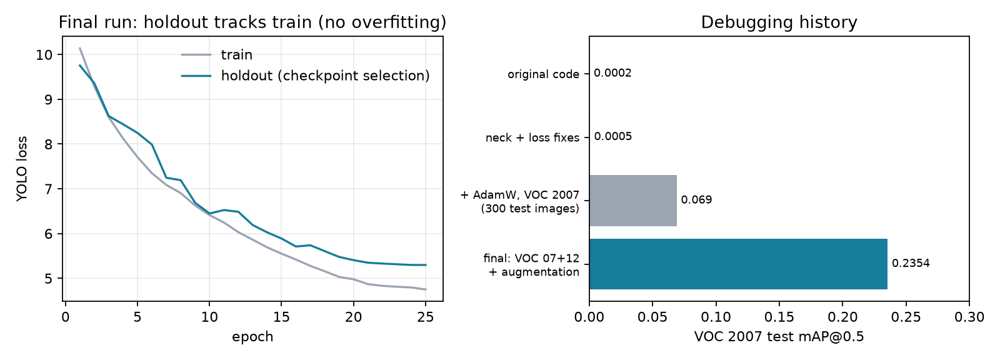
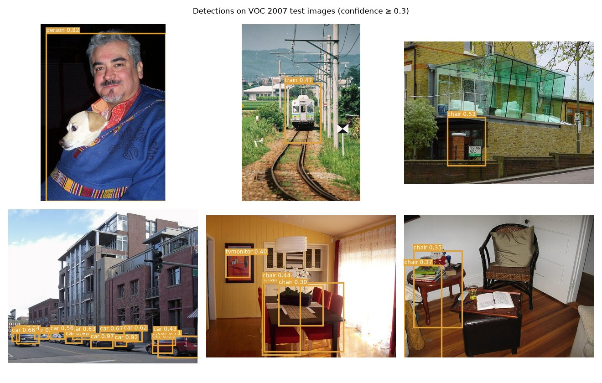
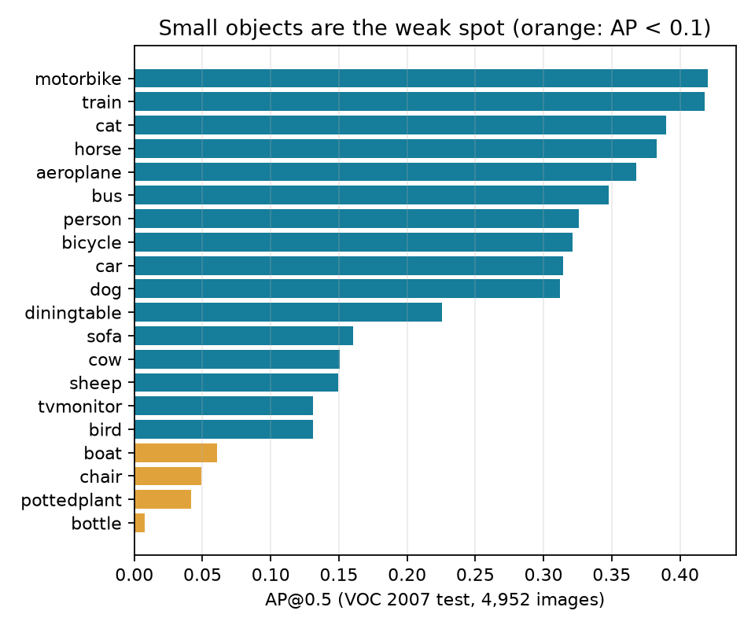

# YOLOv1 from scratch: implementation, debugging and evaluation

**YOLOv1** written in PyTorch module by module: neck, detection head, loss, target encoding, decoding,
NMS and VOC mAP. It is not an Ultralytics wrapper. The backbone is a torchvision ResNet-50 pre-trained
on ImageNet, as in the original paper.

The interesting part is the debugging. The first version trained without errors but reached a
**mAP of 0.0002**. Three silent bugs were found one at a time with targeted diagnostics. The final
model reaches **0.235 mAP@0.5 on the full VOC 2007 test set** (4,952 images).

How the model works, from the output tensor to the loss and the limits of the 7×7 grid:
[docs/yolov1.md](docs/yolov1.md).



## Results

| | |
|---|---|
| VOC 2007 test mAP@0.5 | **0.235** (4,952 images, never used for any choice) |
| Training data | VOC 2007 + 2012 trainval (15,551 images), minus 1,000 held out for checkpoint selection |
| Training | 25 epochs, ~7.5 min/epoch on an 8 GB laptop GPU |
| Released weights | fp16, 146 MB (instead of 874 MB), same mAP (0.2530 vs 0.2531 on 500 test images) |



*The first six test images, not cherry-picked. Typical errors are visible: a false "chair" on a
building and duplicated boxes in cluttered scenes.*

**Honest reading.** The paper reports 0.634 after ~135 epochs on the same data. The gap here comes
mainly from training budget: 25 epochs on a laptop GPU, with a cosine schedule. Small objects are the weak spot: bottle 0.008, potted plant 0.04, chair 0.05. This is a
known limit of YOLOv1, which predicts only 2 boxes per cell on a 7×7 grid. Large objects do much
better: motorbike 0.42, train 0.42, cat 0.39.



## Debugging story: from 0.0002 to 0.235

| Symptom / test | Root cause | Fix |
|---|---|---|
| **Oracle check**: ground-truth targets fed through decode → NMS → mAP give 0.87, not ~0 | The evaluation pipeline is sound (0.87 < 1 mainly because two objects can fall in the same grid cell, a YOLOv1 limit), so the bug is in training | – |
| Neck output inspected | ResNet's 14×14 map was pooled to 4×4 then **stretched back to 7×7**, destroying spatial information | one stride-2 conv 14×14 → 7×7 |
| Class predictions near uniform | Classes were regressed with MSE on one-hot vectors | logits + softmax cross-entropy |
| **Overfit test** on 16 images (a model that cannot memorise 16 images has a bug) | SGD at lr 1e-3 reached mAP **0.058** on the 16 training images; AdamW reached **0.962** | AdamW lr 1e-4, warmup + cosine |
| Val loss rising after epoch 14 (VOC 2007 alone, 5k images) | Overfitting | VOC 07+12 (3× data), flip + scale/translate augmentation, checkpoint chosen on a holdout |

The test set is used once, at the end. Checkpoint selection relies only on the 1,000-image holdout
(`scripts/make_holdout.py`).

## Use it without training

```bash
pip install -r requirements.txt
make download-weights   # fp16 checkpoint from the GitHub Release, SHA-256 verified
make serve              # POST /detect (image) -> boxes (x1, y1, x2, y2), labels, scores
python detect.py --weights checkpoints/yolov1/yolov1_voc2007_fp16.pt --source images/
```

## Reproduce

```bash
make prepare            # download VOC 2007 + 2012, convert, carve the holdout
make train              # 25 epochs (config/train.yaml)
make evaluate           # VOC 2007 test mAP@0.5 -> reports/eval_voc2007_test.json
make export-weights     # fp16 checkpoint + release/ + weights.sha256
python scripts/make_figures.py
python scripts/explainer_figures.py   # grid-collision figure of docs/yolov1.md (CPU, ~20 s)
make test               # 17 tests: boxes, loss stability, resume, evaluation, export, weights, API
```

## Layout

```
yolo-from-scratch/
├── src/            backbone, neck, head, loss, model
├── utils/          dataset + augmentation, VOC conversion, box ops, helpers
├── train.py        training loop (AdamW, warmup + cosine, holdout selection, resume)
├── evaluate.py     VOC mAP@0.5 (all-point interpolation), --split holdout|test
├── api.py          FastAPI detection service
├── detect.py / infer.py   command-line inference
├── scripts/        holdout split, fp16 export, weight release/download, figures
├── config/train.yaml
└── tests/
```

## Next steps

* More epochs: the holdout loss is still decreasing slowly at the end of the cosine schedule.
* Multi-scale training and a finer grid (or anchors, i.e. YOLOv2) for small objects.
