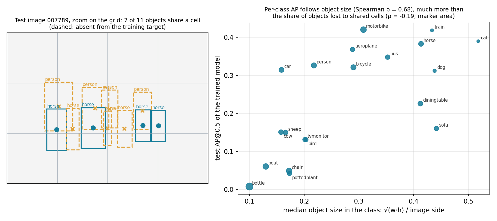

# How this YOLOv1 works

> One forward pass, one tensor out: the image is cut into a 7 × 7 grid and every cell predicts boxes and a class.
> Detection becomes a single regression problem, which is what made YOLO fast. This page reads the code of this
> repository; the [README](../README.md) tells how it was debugged.

## Reading the output tensor

For a 448 × 448 image, [`src/model.py`](../src/model.py) returns a tensor of shape (7, 7, 30) per image. Each cell
owns 30 numbers:

| slice | meaning | activation |
|---|---|---|
| `0:4`, `5:9` | two boxes: centre (x, y) relative to the cell, width and height relative to the image | sigmoid |
| `4`, `9` | each box's confidence that it contains an object | sigmoid |
| `10:30` | one score per VOC class, shared by the two boxes | raw logits |

So the model can describe at most 2 boxes and **one class** per cell. The detection head
([`src/header.py`](../src/header.py)) applies the activations:

```python
box_coords = torch.sigmoid(box_raw[..., :4])       # x, y, w, h in [0, 1]
box_conf = torch.sigmoid(box_raw[..., 4:5])         # objectness in [0, 1]
```

## From annotations to a target

[`utils/boxes.py`](../utils/boxes.py) `encode_boxes` places each ground-truth object in the cell that contains its
centre and writes the same layout as the output:

```python
grid_x = min(int(x / cell_size), grid_size - 1)
grid_y = min(int(y / cell_size), grid_size - 1)

# Normalized offsets relative to the cell
target[grid_y, grid_x, 0] = 1.0  # object present
target[grid_y, grid_x, 1] = (x / cell_size) - grid_x
```

A cell has room for one object. When two centres land in the same cell, the second write replaces the first.

## The loss, term by term

[`src/loss.py`](../src/loss.py) sums five squared-error and cross-entropy terms. In each cell that holds an object,
only one of the two boxes is *responsible* for it: the one whose current prediction overlaps the target most. Over
training, this rule lets the two boxes of a cell specialise in different shapes.

```python
best_iou, best_box_idx = ious.max(dim=-1, keepdim=True)  # (B, S, S, 1)
```

| term | applies to | weight |
|---|---|---|
| centre (x, y), squared error | responsible box | λ_coord = 5 |
| $\sqrt{w}, \sqrt{h}$, squared error | responsible box | λ_coord = 5 |
| confidence → 1 | responsible box | 1 |
| confidence → 0 | every other box | λ_noobj = 0.5 |
| class, cross-entropy | cells with an object | 1 |

Two weights correct imbalances. Most of the 98 boxes are empty, so the "no object" term is halved; otherwise it would
drown the few positive cells. Localisation is weighted up by 5. The square roots make an error of 10 pixels cost more
on a small box than on a large one.

> [!NOTE]
> **Where this code departs from the 2016 paper, and why.** The confidence target is 1, not the current IoU, which
> stayed near zero early in training while the no-object term pushed every confidence down. Classes use softmax
> cross-entropy on logits instead of squared error on probabilities, which learned too slowly (the model predicted
> "person" everywhere after 9 epochs). The two fully connected layers of the paper's head are replaced by
> convolutions, and the backbone is an ImageNet-pretrained ResNet-50 instead of the paper's own network. The first
> two came out of the debugging story of the README.

## From tensor to detections

`decode_predictions` turns every box into a candidate whose score is *confidence × probability of the cell's best
class*, then non-maximum suppression, applied per class in [`evaluate.py`](../evaluate.py), removes duplicates:

```python
score = conf * class_prob
if score < conf_threshold:
    continue
```

Training uses no NMS at all: the responsible-box rule already decides which prediction answers for each object.

## What the grid cannot represent

The design has a hard ceiling, measurable without any model: on the 14,976 objects of VOC 2007 test, **13.5 % have
their centre in a cell already taken by another object**, so they never appear in a training target (20 % of the
images contain at least one such collision). This is the main reason why the "oracle" of the README, ground-truth targets fed
through decoding and evaluation, scores 0.87 and not 1.

<p align="center"></p>

But collisions are not what separates good and bad classes. Per-class AP follows the median object size
(Spearman ρ = 0.68) far more than the share of objects lost to collisions (ρ = −0.19): motorbikes collide often
(18 %) and are detected well, bottles are both small and crowded and score 0.008. With a 448-pixel input, a cell is
64 pixels wide; a typical bottle (45 pixels) is smaller than the cell that must describe it.

What later detectors changed, each answering one of these limits:

- **Anchors and finer grids** (YOLOv2 and later, SSD): several boxes of preset shapes per cell, each with its own
  class, on 13 × 13 or finer maps.
- **Several scales** (feature pyramids, YOLOv3): small objects are predicted on high-resolution maps, large ones on
  coarse maps.
- **Better box losses** (IoU-based losses) instead of squared error on coordinates.

## Tests

[`tests/test_training_stability.py`](../tests/test_training_stability.py) checks that the loss stays finite, that
the neck produces the 7 × 7 grid without resampling (the first bug of the README), and that the model learns the
class and objectness of 4 fixed images: the overfit test that would have caught the original loss.
[`tests/test_evaluation.py`](../tests/test_evaluation.py) pins the VOC AP computation and the per-class NMS.

<sub>Figure and numbers: `python scripts/explainer_figures.py`, about 20 s on CPU, no weights needed
([`reports/grid_collisions.json`](../reports/grid_collisions.json)).</sub>
